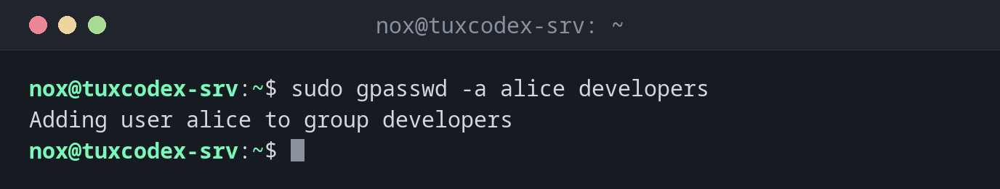

# gpasswd

> Verwaltet die Mitglieder einer Gruppe: hinzufügen, entfernen oder alle auf einmal setzen, und Gruppenverwalter benennen.



## Syntax

```bash
gpasswd [OPTION] GRUPPE
```

## Optionen

| Option | Beschreibung |
|--------|--------------|
| `-a BENUTZER`, `--add` | Einen Benutzer zur Gruppe hinzufügen |
| `-d BENUTZER`, `--delete` | Einen Benutzer aus der Gruppe entfernen |
| `-M BENUTZER`, `--members` | Die komplette Mitgliederliste setzen (durch Kommas getrennt) |
| `-A BENUTZER`, `--administrators` | Gruppenverwalter festlegen, die Mitglieder selbst verwalten dürfen |
| `-r`, `--remove-password` | Das Gruppenpasswort entfernen |

## Beispiele

**Einen Benutzer zu einer Gruppe hinzufügen:**

```bash
sudo gpasswd -a alice developers
```

```text
Adding user alice to group developers
```

**Einen Benutzer aus einer Gruppe entfernen:**

```bash
sudo gpasswd -d alice developers
```

```text
Removing user alice from group developers
```

**Alle Mitglieder auf einmal setzen:**

```bash
sudo gpasswd -M alice,bob,nox developers
getent group developers
```

```text
developers:x:1005:alice,bob,nox
```

**Einen Benutzer entfernen, der kein Mitglied ist:**

```bash
sudo gpasswd -d carol developers
```

```text
gpasswd: user 'carol' is not a member of 'developers'
```

**Eine Teamleitung die Gruppe ohne `sudo` verwalten lassen:**

```bash
sudo gpasswd -A alice developers
gpasswd -a bob developers
```

```text
Adding user bob to group developers
```

Den zweiten Befehl hat `alice` ausgeführt, ohne `sudo`.

## Wann brauche ich das?

- Um einen Benutzer zu einer Gruppe hinzuzufügen oder daraus zu entfernen, auf jeder
  Distribution und mit klarer Meldung
- Um einer Teamleitung die Kontrolle über die Mitglieder einer Teamgruppe zu geben
- Um die Mitglieder einer Gruppe genau festzulegen, zum Beispiel aus einem Skript

!!! tip "`gpasswd -d` statt `usermod -G`"
    Um einen Benutzer aus einer einzelnen Gruppe zu entfernen, ist `gpasswd -d` der
    sichere Weg. Bei `usermod -G` musst du alle verbleibenden Gruppen aufzählen und
    vergisst leicht eine.

!!! warning "`-M` ersetzt alle Mitglieder"
    `gpasswd -M alice developers` macht `alice` zum **einzigen** Mitglied. Alle anderen
    werden aus der Gruppe entfernt.

## Verwandte Befehle

[groupadd](groupadd.md) · [usermod](usermod.md)
