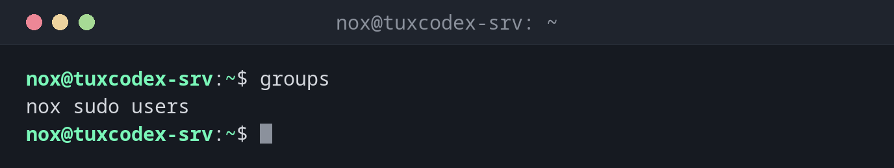

# groups

> Zeigt die Gruppen, zu denen ein Benutzer gehört.



## Syntax

```bash
groups [BENUTZER]...
```

## Optionen

`groups` hat keine eigenen Optionen.

| Option | Beschreibung |
|--------|--------------|
| `--help` | Hilfetext anzeigen und beenden |
| `--version` | Versionsinformationen anzeigen und beenden |

## Beispiele

**Die eigenen Gruppen anzeigen:**

```bash
groups
```

```text
nox sudo users
```

**Die Gruppen eines anderen Benutzers anzeigen:**

```bash
groups alice
```

```text
alice : alice users
```

Mit einem Benutzernamen beginnt die Ausgabe mit dem Namen und einem Doppelpunkt.

**Mehrere Benutzer auf einmal prüfen:**

```bash
groups nox alice www-data
```

```text
nox : nox sudo users
alice : alice users
www-data : www-data
```

**Nach dem Hinzufügen einer Gruppe Sitzung und Datenbank vergleichen:**

```bash
sudo usermod -aG docker nox
groups
groups nox
```

```text
nox sudo users
nox : nox sudo users docker
```

`groups` ohne Namen zeigt die Gruppen deiner aktuellen Sitzung. Die neue Gruppe `docker`
erscheint dort erst nach einer neuen Anmeldung.

## Wann brauche ich das?

- Um zu prüfen, ob ein Benutzer in `sudo`, `docker`, `www-data` oder einer anderen Gruppe
  ist, die Zugriff gewährt
- Um herauszufinden, warum ein Benutzer nicht auf ein gemeinsames Verzeichnis zugreifen kann
- Um zu kontrollieren, ob `usermod -aG` oder `gpasswd -a` funktioniert hat

!!! tip "`groups` oder `id`?"
    `groups` zeigt nur die Namen. [`id`](../01-orientation/id.md) zeigt auch die Nummern
    (UID und GIDs), was hilft, wenn Dateien Nummern statt Namen anzeigen.

!!! warning "Neue Gruppen brauchen eine neue Anmeldung"
    Eine Gruppe, zu der du hinzugefügt wurdest, gilt erst in neuen Sitzungen. Melde dich
    ab und wieder an oder öffne eine neue SSH-Verbindung, bevor du den neuen Zugriff testest.

## Verwandte Befehle

[id](../01-orientation/id.md) · [whoami](../01-orientation/whoami.md)
