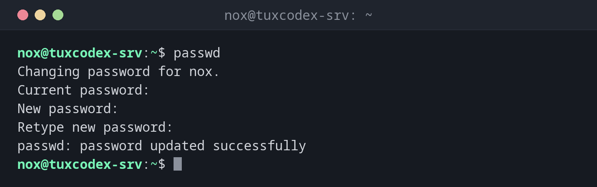

# passwd

> Changes the password of a user, and can lock, unlock or expire it.



## Syntax

```bash
passwd [OPTION]... [USER]
```

## Options

| Option | Description |
|--------|-------------|
| *(none)* | Change your own password |
| `USER` | Change the password of another user (as `root`) |
| `-S`, `--status` | Show the password status |
| `-l`, `--lock` | Lock the password |
| `-u`, `--unlock` | Unlock the password |
| `-e`, `--expire` | Force a password change at the next login |
| `-d`, `--delete` | Delete the password (login without password) |

Status letters in `passwd -S`:

| Letter | Meaning |
|--------|---------|
| `P` | The user has a usable password |
| `L` | The password is locked |
| `NP` | The user has no password |

## Examples

**Change your own password:**

```bash
passwd
```

```text
Changing password for nox.
Current password:
New password:
Retype new password:
passwd: password updated successfully
```

What you type is not shown, not even as `*`.

**Set the password of another user:**

```bash
sudo passwd alice
```

```text
New password:
Retype new password:
passwd: password updated successfully
```

As `root`, you don't need to know the old password.

**Force a new password at the next login:**

```bash
sudo passwd -e alice
```

```text
passwd: password expiry information changed.
```

When `alice` logs in next time, the system asks for a new password straight away.

**Show the password status:**

```bash
sudo passwd -S alice
```

```text
alice P 2026-10-26 0 99999 7 -1
```

The fields: user, status, date of the last change, minimum age, maximum age, warning
period and inactivity period in days.

**Typo in the second input:**

```bash
passwd
```

```text
Changing password for nox.
Current password:
New password:
Retype new password:
Sorry, passwords do not match.
passwd: Authentication token manipulation error
passwd: password unchanged
```

## When do I need it?

- To give a new user a start password, ideally together with `passwd -e`
- To reset the password of a user who forgot it
- To lock an account temporarily (`-l`) and unlock it later (`-u`)
- To check whether an account has a password at all (`-S`)

!!! tip "Start passwords"
    Set a random start password and force a change at the first login:
    `sudo passwd alice` and then `sudo passwd -e alice`. That way, only the user knows
    the final password.

!!! warning "`-l` doesn't stop SSH keys"
    A locked password only blocks logins with a password. A user with an SSH key in
    `~/.ssh/authorized_keys` can still log in. See [`usermod`](usermod.md) for how to
    lock an account completely.

!!! danger "Never use `passwd -d` on a server"
    `-d` removes the password completely. Depending on the configuration, anyone can then
    log in as this user without a password.

## Related commands

[usermod](usermod.md) · [adduser](adduser.md)
