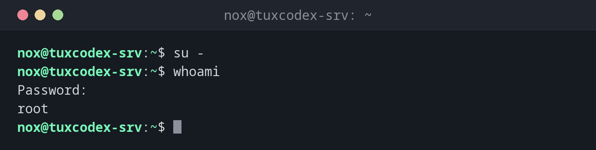

# su

> Switches to another user in the current terminal, by default to `root`.



## Syntax

```bash
su [OPTION]... [-] [USER]
```

## Options

| Option | Description |
|--------|-------------|
| `-`, `-l`, `--login` | Start a login shell: environment, `$PATH` and directory of the target user |
| `-c COMMAND` | Only run a single command as the other user |
| `-s SHELL`, `--shell` | Use this shell instead of the login shell of the user |
| `-p`, `--preserve-environment` | Keep the current environment |

Without `-`, you stay in your directory and keep most of your environment. With `-`,
it is like a fresh login as the other user.

## Examples

**Become `root` with the root password:**

```bash
su -
whoami
```

```text
Password:
root
```

**Switch to another user:**

```bash
su - alice
pwd
```

```text
Password:
/home/alice
```

You need the password of `alice`, not your own.

**Run a single command as `root`:**

```bash
su -c 'systemctl restart nginx'
```

```text
Password:
```

**Work as a service user without a login shell:**

```bash
sudo su - www-data
sudo su - www-data -s /bin/bash -c 'whoami'
```

```text
This account is currently not available.
www-data
```

`www-data` has the shell `/usr/sbin/nologin`. With `-s /bin/bash`, you can still run
commands as this user.

**Wrong password:**

```bash
su -
```

```text
Password:
su: Authentication failure
```

## When do I need it?

- On servers where `root` has a password and `sudo` is not installed
- To test something with the rights and environment of another user, for example a
  deploy user
- To run commands as a service user that normally can't log in

!!! tip "Always use `su -`"
    Plain `su` keeps your environment, including your `$PATH`. Commands from `/usr/sbin`
    may then not be found, and settings of your user leak into the root shell. `su -`
    gives you a clean login environment.

!!! warning "`su` needs the password of the target user"
    With `su`, everyone who wants to become `root` needs the root password. With `sudo`,
    everyone uses their own password, and every command is logged. On servers with several
    admins, `sudo` is the better choice.

## Distribution differences

| | Debian | Ubuntu | RHEL | Arch |
|---|--------|--------|------|------|
| Root password | set during installation, or left empty (then locked) | locked | set during installation, or locked | set by the admin |
| `sudo` installed | if the root password was left empty | yes | yes | no |

If `root` has no password, use `sudo -i` instead of `su -`.

## Related commands

[whoami](../01-orientation/whoami.md) · [id](../01-orientation/id.md)
