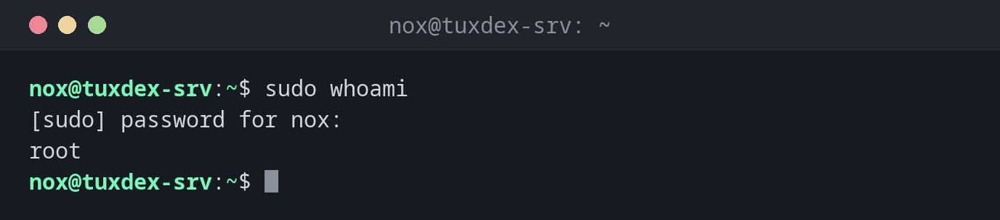

# sudo

> Führt einen einzelnen Befehl mit den Rechten von `root` oder einem anderen Benutzer aus, mit deinem eigenen Passwort und einem Logeintrag für jeden Befehl.



## Syntax

```bash
sudo [OPTION]... BEFEHL
```

## Optionen

| Option | Beschreibung |
|--------|--------------|
| `-u BENUTZER` | Den Befehl als `BENUTZER` statt als `root` ausführen |
| `-i` | Eine Login-Shell als `root` starten (oder als `-u BENUTZER`) |
| `-s` | Eine Shell als `root` starten, aber im aktuellen Verzeichnis bleiben |
| `-l` | Anzeigen, welche Befehle du mit `sudo` ausführen darfst |
| `-e DATEI` | Eine Datei sicher als `root` bearbeiten (wie `sudoedit`) |
| `-k` | Das zwischengespeicherte Passwort vergessen, beim nächsten Mal neu fragen |
| `-v` | Das zwischengespeicherte Passwort auffrischen, ohne einen Befehl auszuführen |

## Beispiele

**Einen Befehl als `root` ausführen:**

```bash
sudo whoami
```

```text
[sudo] password for nox:
root
```

Du gibst **dein eigenes** Passwort ein. In den nächsten 15 Minuten fragt `sudo` nicht noch
einmal.

**Anzeigen, was du darfst:**

```bash
sudo -l
```

```text
Matching Defaults entries for nox on tuxdex-srv:
    env_reset, mail_badpass, secure_path=/usr/local/sbin\:/usr/local/bin\:/usr/sbin\:/usr/bin\:/sbin\:/bin, use_pty

User nox may run the following commands on tuxdex-srv:
    (ALL : ALL) ALL
```

`(ALL : ALL) ALL` bedeutet: jeden Befehl, als jeder Benutzer und jede Gruppe.

**Einen Befehl als anderer Benutzer ausführen:**

```bash
sudo -u www-data whoami
```

```text
www-data
```

**Eine Root-Shell für mehrere Befehle öffnen:**

```bash
sudo -i
pwd
```

```text
/root
```

Schließe die Root-Shell mit `exit`, sobald du fertig bist.

**Ein Benutzer ohne `sudo`-Rechte:**

```bash
sudo whoami
```

```text
[sudo] password for alice:
alice is not in the sudoers file.
```

Der Versuch wird protokolliert. Nimm den Benutzer in die Admin-Gruppe auf (siehe unten),
wenn er `sudo` benutzen darf.

## Wann brauche ich das?

- Für jede Admin-Aufgabe: Pakete installieren, Dienste neu starten, Dateien in `/etc`
  bearbeiten
- Um etwas als Dienstbenutzer auszuführen, zum Beispiel `sudo -u postgres psql`
- Um zu testen, ob ein Dienstbenutzer eine Datei lesen kann: `sudo -u www-data cat DATEI`
- Um Benutzern genau die Rechte zu geben, die sie brauchen, ohne das Root-Passwort zu teilen

!!! tip "Den letzten Befehl mit `sudo` wiederholen"
    `sudo` vergessen? `sudo !!` wiederholt den vorherigen Befehl mit `sudo` davor.

!!! tip "Dateien mit `sudo -e` bearbeiten"
    `sudo -e /etc/hosts` öffnet eine Kopie der Datei in deinem eigenen Editor mit deinen
    Einstellungen und schreibt sie erst beim Speichern als `root` zurück. Das ist sicherer,
    als den ganzen Editor als `root` laufen zu lassen.

!!! warning "Umleitungen laufen nicht als `root`"
    `sudo echo text > /etc/datei` scheitert, weil die Umleitung `>` deine eigene Shell
    erledigt. Nimm stattdessen `echo text | sudo tee /etc/datei`.

## Unterschiede zwischen Distributionen

| | Debian | Ubuntu | RHEL | Arch |
|---|--------|--------|------|------|
| `sudo` installiert | wenn das Root-Passwort bei der Installation leer blieb | ja | ja | nein |
| Admin-Gruppe | `sudo` | `sudo` | `wheel` | `wheel` (Regel in `/etc/sudoers` auskommentiert) |
| Einem Benutzer Admin-Rechte geben | `sudo adduser alice sudo` | `sudo adduser alice sudo` | `sudo usermod -aG wheel alice` | `usermod -aG wheel alice`, dann `%wheel` mit `visudo` aktivieren |

## Verwandte Befehle

[su](su.md) · [usermod](usermod.md) · [whoami](../01-orientation/whoami.md) · [visudo](visudo.md)
