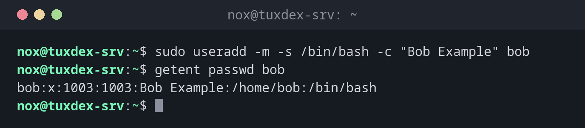

# useradd

> Legt einen neuen Benutzer mit einem einzigen Befehl ohne Rückfragen an, das Low-Level-Werkzeug, das auf jeder Distribution gleich funktioniert.



## Syntax

```bash
useradd [OPTION]... BENUTZER
```

## Optionen

| Option | Beschreibung |
|--------|--------------|
| `-m`, `--create-home` | Home-Verzeichnis anlegen und `/etc/skel` kopieren |
| `-s SHELL`, `--shell` | Login-Shell, z. B. `/bin/bash` |
| `-c TEXT`, `--comment` | Vollständiger Name oder Beschreibung |
| `-G GRUPPEN`, `--groups` | Zusätzliche Gruppen, durch Kommas getrennt |
| `-g GRUPPE`, `--gid` | Primäre Gruppe (statt einer neuen Gruppe mit dem Benutzernamen) |
| `-d VERZ`, `--home-dir` | Home-Verzeichnis |
| `-u UID`, `--uid` | Diese UID verwenden |
| `-r`, `--system` | Einen Systembenutzer anlegen (UID unter 1000, kein Home-Verzeichnis) |
| `-e DATUM`, `--expiredate` | Datum, an dem das Konto abläuft (`JJJJ-MM-TT`) |
| `-D`, `--defaults` | Die Standardwerte anzeigen |

## Beispiele

**Einen normalen Benutzer mit Home-Verzeichnis und Bash anlegen:**

```bash
sudo useradd -m -s /bin/bash -c "Bob Example" bob
getent passwd bob
```

```text
bob:x:1003:1003:Bob Example:/home/bob:/bin/bash
```

**Was ohne `-m` und `-s` passiert:**

```bash
sudo useradd carol
getent passwd carol
ls -d /home/carol
```

```text
carol:x:1004:1004::/home/carol:/bin/sh
ls: cannot access '/home/carol': No such file or directory
```

Unter Debian und Ubuntu legt `useradd` standardmäßig kein Home-Verzeichnis an und nutzt
`/bin/sh` als Shell.

**Einen Benutzer mit zusätzlichen Gruppen anlegen:**

```bash
sudo useradd -m -s /bin/bash -G sudo,docker dave
groups dave
```

```text
dave : dave sudo docker
```

**Einen Systembenutzer für einen Dienst anlegen:**

```bash
sudo useradd -r -s /usr/sbin/nologin -d /opt/myapp myapp
getent passwd myapp
```

```text
myapp:x:997:997::/opt/myapp:/usr/sbin/nologin
```

**Versuchen, einen Benutzer anzulegen, der schon existiert:**

```bash
sudo useradd bob
```

```text
useradd: user 'bob' already exists
```

## Wann brauche ich das?

- In Skripten, Ansible-Rollen oder Dockerfiles, weil `useradd` nie nachfragt
- Auf Distributionen, auf denen `adduser` fehlt oder anders funktioniert, etwa Arch,
  RHEL (dort ist `adduser` nur ein anderer Name für `useradd`) oder Alpine
- Um Systembenutzer für Dienste mit genauer UID, Home-Verzeichnis und Shell anzulegen

!!! tip "Danach ein Passwort setzen"
    `useradd` setzt kein Passwort, der Benutzer kann sich also noch nicht mit einem
    Passwort anmelden. Setze es mit `sudo passwd bob`, oder hinterlege einen SSH-Schlüssel
    in `~/.ssh/authorized_keys`.

!!! warning "Für normale Benutzer immer `-m`"
    Ohne `-m` hat der Benutzer kein Home-Verzeichnis. Anmeldungen landen dann mit einer
    Warnung in `/`, und Programme können keine Einstellungen speichern.

## Unterschiede zwischen Distributionen

| | Debian | Ubuntu | RHEL | Arch |
|---|--------|--------|------|------|
| Home-Verzeichnis ohne `-m` | wird nicht angelegt | wird nicht angelegt | wird angelegt | wird nicht angelegt |
| Standard-Shell (`useradd -D`) | `/bin/sh` | `/bin/sh` | `/bin/bash` | `/bin/bash` |
| Admin-Gruppe | `sudo` | `sudo` | `wheel` | `wheel` |
| Empfohlenes Werkzeug | `adduser` | `adduser` | `useradd` | `useradd` |

## Verwandte Befehle

[adduser](adduser.md) · [getent](getent.md) · [usermod](usermod.md) · [userdel](userdel.md)
