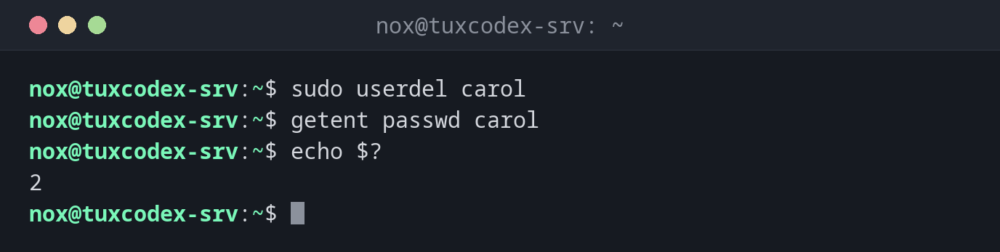

# userdel

> Deletes a user account, optionally together with home directory and mail spool, on every distribution.



## Syntax

```bash
userdel [OPTION]... USER
```

## Options

| Option | Description |
|--------|-------------|
| `-r`, `--remove` | Also delete the home directory and the mail spool |
| `-f`, `--force` | Delete even if the user is still logged in (dangerous) |

## Examples

**Delete a user:**

```bash
sudo userdel carol
getent passwd carol
echo $?
```

```text
2
```

The account is gone, `getent` finds nothing any more.

**Delete a user with home directory:**

```bash
sudo userdel -r bob
```

```text
userdel: bob mail spool (/var/mail/bob) not found
```

The message is harmless: `bob` simply never had a mail spool. The home directory has been
deleted.

**What remains without `-r`:**

```bash
sudo userdel dave
stat -c '%U:%G %n' /home/dave
```

```text
UNKNOWN:UNKNOWN /home/dave
```

The home directory still exists, but belongs to a UID that no longer has a name.

**Try to delete a user who is logged in:**

```bash
sudo userdel alice
```

```text
userdel: user alice is currently used by process 2345
```

## When do I need it?

- To delete accounts in scripts or on distributions without `deluser`
- To clean up after a person or a service is gone for good
- In Ansible or other automation, where the `user` module uses `userdel` in the background

!!! tip "End running processes first"
    Find the processes of the user with `ps -u alice` and end them, or use
    `sudo pkill -u alice`. Then `userdel` works without `-f`.

!!! warning "Orphaned files"
    Files of a deleted user remain everywhere outside the home directory. If a new user
    later gets the same UID, they suddenly own these files. Find them before deleting
    with `sudo find / -xdev -user alice`.

!!! danger "`-f` while the user is working"
    `userdel -f` deletes the account even while processes of the user are running. They
    keep running under a UID without a name, which makes errors hard to trace.

## Related commands

[deluser](deluser.md) · [useradd](useradd.md)
