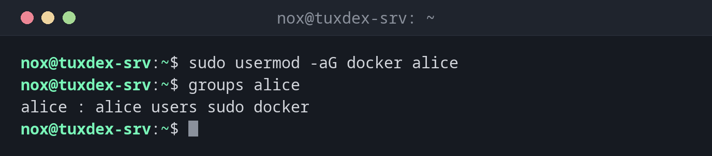

# usermod

> Ändert einen vorhandenen Benutzer: Gruppen, Shell, Home-Verzeichnis, Name, Sperre und Ablaufdatum.



## Syntax

```bash
usermod [OPTION]... BENUTZER
```

## Optionen

| Option | Beschreibung |
|--------|--------------|
| `-aG GRUPPEN` | Benutzer zu weiteren Gruppen **hinzufügen** (vorhandene behalten) |
| `-G GRUPPEN` | Alle zusätzlichen Gruppen durch diese Liste **ersetzen** |
| `-g GRUPPE` | Die primäre Gruppe ändern |
| `-s SHELL` | Die Login-Shell ändern |
| `-d VERZ -m` | Home-Verzeichnis ändern und den Inhalt verschieben |
| `-l NEUER_NAME` | Benutzer umbenennen |
| `-c TEXT` | Vollständigen Namen oder Beschreibung ändern |
| `-L` / `-U` | Passwort sperren / entsperren |
| `-e DATUM` | Konto am `DATUM` ablaufen lassen (`JJJJ-MM-TT`) |

## Beispiele

**Einen Benutzer zu einer Gruppe hinzufügen:**

```bash
sudo usermod -aG docker alice
groups alice
```

```text
alice : alice users sudo docker
```

**Was `-G` ohne `-a` macht:**

```bash
sudo usermod -G docker alice
groups alice
```

```text
alice : alice docker
```

Die Gruppen `users` und `sudo` sind weg. `-G` allein ersetzt alle zusätzlichen Gruppen.

**Einem Benutzer die Anmeldung an einer Shell verwehren:**

```bash
sudo usermod -s /usr/sbin/nologin deploy
getent passwd deploy
```

```text
deploy:x:1002:1002:Deploy User:/home/deploy:/usr/sbin/nologin
```

**Das Passwort eines Benutzers sperren:**

```bash
sudo usermod -L alice
sudo passwd -S alice
```

```text
alice L 2026-10-26 0 99999 7 -1
```

Das `L` steht für gesperrt. Anmeldungen mit SSH-Schlüssel funktionieren weiterhin, siehe
die Warnung unten.

**Einen Benutzer umbenennen und das Home-Verzeichnis verschieben:**

```bash
sudo usermod -l alicia -d /home/alicia -m alice
getent passwd alicia
```

```text
alicia:x:1001:1001:Alice Example,,,:/home/alicia:/bin/bash
```

**Versuchen, einen angemeldeten Benutzer zu ändern:**

```bash
sudo usermod -l alicia alice
```

```text
usermod: user alice is currently used by process 2345
```

Umbenennen oder die UID ändern geht nur, wenn der Benutzer keine laufenden Prozesse hat.

## Wann brauche ich das?

- Um einem Benutzer Zugriff auf `sudo`, `docker`, `www-data` oder eine gemeinsame Gruppe
  zu geben
- Um ein Konto vorübergehend zu deaktivieren, etwa wenn jemand das Team verlässt
- Um die Shell von Dienstbenutzern auf `/usr/sbin/nologin` zu setzen
- Um ein Konto umzubenennen oder sein Home-Verzeichnis zu verschieben

!!! danger "`-G` ohne `-a` entfernt Gruppen"
    `usermod -G docker alice` entfernt `alice` aus **allen** anderen zusätzlichen Gruppen,
    auch aus `sudo`. War das dein eigenes Admin-Konto, verlierst du `sudo`. Schreib immer
    `-aG`.

!!! warning "`-L` sperrt keine SSH-Schlüssel"
    `usermod -L` sperrt nur das Passwort. Anmeldungen mit SSH-Schlüssel funktionieren
    weiter. Um ein Konto ganz zu sperren, nimm zusätzlich `usermod -e 1` (Konto
    abgelaufen) oder `usermod -s /usr/sbin/nologin`.

## Verwandte Befehle

[useradd](useradd.md) · [groups](groups.md) · [passwd](passwd.md) · [gpasswd](gpasswd.md)
