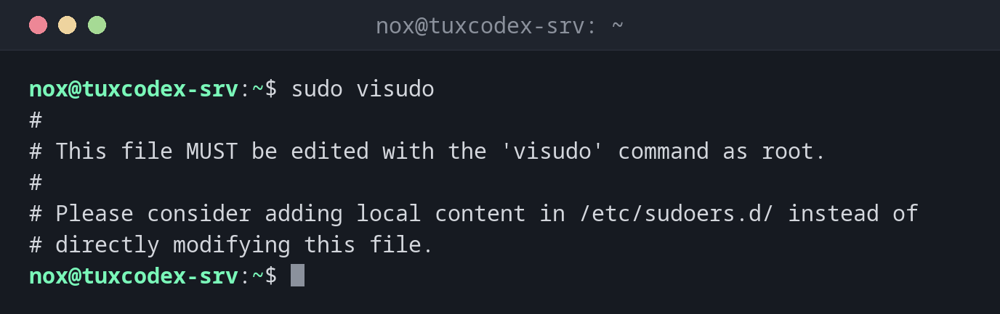

# visudo

> Edits the `sudo` configuration safely: it locks the file and checks the syntax before saving.



## Syntax

```bash
visudo [OPTION]...
```

## Options

| Option | Description |
|--------|-------------|
| *(none)* | Edit `/etc/sudoers` |
| `-f FILE` | Edit another file, e.g. in `/etc/sudoers.d/` |
| `-c`, `--check` | Only check the syntax, don't edit |
| `-s`, `--strict` | Strict check, also warns about unused aliases and similar mistakes |

A rule in the `sudoers` format:

```text
deploy ALL=(root) NOPASSWD: /usr/bin/systemctl restart nginx
  │     │    │       │        └ allowed command (with full path)
  │     │    │       └ no password needed
  │     │    └ as which user
  │     └ on which hosts
  └ user (or %group)
```

## Examples

**Edit the main configuration:**

```bash
sudo visudo
```

```text
#
# This file MUST be edited with the 'visudo' command as root.
#
# Please consider adding local content in /etc/sudoers.d/ instead of
# directly modifying this file.
```

`visudo` opens `/etc/sudoers` in the editor set in `$EDITOR` (or the system default).

**Add your own rule as a separate file:**

```bash
sudo visudo -f /etc/sudoers.d/deploy
sudo cat /etc/sudoers.d/deploy
```

```text
deploy ALL=(root) NOPASSWD: /usr/bin/systemctl restart nginx
```

This line lets the user `deploy` restart nginx without a password, and
nothing else.

**Check all `sudo` files:**

```bash
sudo visudo -c
```

```text
/etc/sudoers: parsed OK
/etc/sudoers.d/README: parsed OK
/etc/sudoers.d/deploy: parsed OK
```

**A rule with a syntax error:**

```bash
sudo visudo -c -f /etc/sudoers.d/deploy
```

```text
/etc/sudoers.d/deploy:1:60: syntax error
deploy ALL=(root) NOPASSWD /usr/bin/systemctl restart nginx
                                                           ^
```

The colon after `NOPASSWD` is missing. When you save a file with an error in the editor,
`visudo` asks `What now?`: `e` edits again, `x` quits without saving.

**Use a different editor:**

```bash
sudo EDITOR=nano visudo
```

```text
#
# This file MUST be edited with the 'visudo' command as root.
```

## When do I need it?

- To give a user or group `sudo` rights
- To allow a deploy or monitoring user exactly one or two commands without a password
- To check the configuration after changes or after copying files to `/etc/sudoers.d/`

!!! tip "Own rules in `/etc/sudoers.d/`"
    Don't change `/etc/sudoers` itself. Put your rules into separate files in
    `/etc/sudoers.d/`. Package updates then never overwrite them, and a single file can be
    removed easily.

!!! warning "File names in `/etc/sudoers.d/`"
    Files whose name contains a `.` or ends with `~` are ignored, for example
    `deploy.conf`. Use names without a dot, like `deploy`.

!!! danger "Never edit `/etc/sudoers` with a normal editor"
    A syntax error in `/etc/sudoers` breaks `sudo` completely, and without a root password
    you can no longer repair it. `visudo` refuses to save a broken file.

## Distribution differences

| | Debian | Ubuntu | RHEL | Arch |
|---|--------|--------|------|------|
| Admin rule in `/etc/sudoers` | `%sudo ALL=(ALL:ALL) ALL` | `%sudo ALL=(ALL:ALL) ALL` | `%wheel ALL=(ALL) ALL` | `%wheel ALL=(ALL:ALL) ALL`, commented out |
| Default editor | `nano` (via `editor`) | `nano` (via `editor`) | `vi` | `vi` |

## Related commands

[sudo](sudo.md) · [su](su.md)
