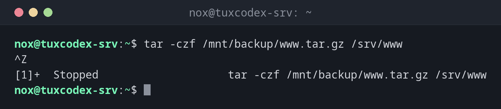

# bg

> Lets a paused job continue in the background, so the shell is free again.



## Syntax

```bash
bg [%JOB]...
```

Without a job, `bg` uses the current job (`+` in [`jobs`](jobs.md)).

## Options

| Option | Description |
|--------|-------------|
| `%NUMBER` | The job with this number, e.g. `%2` |
| `%TEXT` | The job whose command starts with `TEXT`, e.g. `%tar` |

## Examples

**Pause a command that takes longer than expected:**

```bash
tar -czf /mnt/backup/www.tar.gz /srv/www
```

```text
^Z
[1]+  Stopped                    tar -czf /mnt/backup/www.tar.gz /srv/www
```

While the command runs, press ++ctrl+z++. It is paused, and you get your prompt back.

**Continue it in the background:**

```bash
bg
```

```text
[1]+ tar -czf /mnt/backup/www.tar.gz /srv/www &
```

The `&` at the end shows: the job now runs in the background.

**Continue a specific job:**

```bash
bg %tar
```

```text
[1]+ tar -czf /mnt/backup/www.tar.gz /srv/www &
```

**No paused job:**

```bash
bg
```

```text
bash: bg: current: no such job
```

## When do I need it?

- When you started a long command without `&` and want your shell back
- To continue a job that you paused with ++ctrl+z++

!!! tip "Output still lands in the terminal"
    A background job keeps writing to your terminal and can mix with your input. For long
    jobs, redirect the output when starting: `tar … > /tmp/tar.log 2>&1 &`.

!!! warning "Not for interactive programs"
    Programs that wait for input, like `vim` or a password prompt, stop again right away
    in the background. Bring them back to the foreground with `fg`.

## Related commands

[jobs](jobs.md) · [kill](kill.md)
