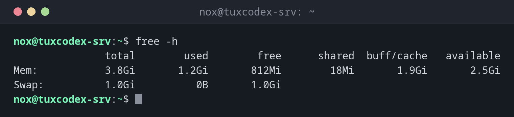

# free

> Zeigt, wie viel Arbeitsspeicher und Swap belegt, frei und noch verfügbar ist.



## Syntax

```bash
free [OPTION]...
```

## Optionen

| Option | Beschreibung |
|--------|--------------|
| `-h` | Lesbare Einheiten (`Mi`, `Gi`) |
| `-m`, `-g` | Werte in MiB oder GiB |
| `-t` | Eine Zeile mit der Summe aus Arbeitsspeicher und Swap anzeigen |
| `-s SEKUNDEN` | Die Ausgabe alle `SEKUNDEN` Sekunden wiederholen |
| `-c ANZAHL` | Nach `ANZAHL` Wiederholungen aufhören (mit `-s`) |
| `-w` | Buffer und Cache in getrennten Spalten anzeigen |

## Beispiele

**Arbeitsspeicher in lesbaren Einheiten anzeigen:**

```bash
free -h
```

```text
               total        used        free      shared  buff/cache   available
Mem:           3.8Gi       1.2Gi       812Mi        18Mi       1.9Gi       2.5Gi
Swap:          1.0Gi          0B       1.0Gi
```

| Spalte | Bedeutung |
|--------|-----------|
| `used` | Von Programmen belegt |
| `free` | Komplett ungenutzt |
| `buff/cache` | Vom Kernel als Dateicache genutzt, wird freigegeben, wenn Programme ihn brauchen |
| `available` | Was Programme noch nutzen können, ohne zu swappen |

**Werte in MiB, für Skripte:**

```bash
free -m
```

```text
               total        used        free      shared  buff/cache   available
Mem:            3915        1205         812          18        1898        2547
Swap:           1024           0        1024
```

**Die Summe aus Arbeitsspeicher und Swap anzeigen:**

```bash
free -h -t
```

```text
               total        used        free      shared  buff/cache   available
Mem:           3.8Gi       1.2Gi       812Mi        18Mi       1.9Gi       2.5Gi
Swap:          1.0Gi          0B       1.0Gi
Total:         4.8Gi       1.2Gi       1.8Gi
```

**Den Arbeitsspeicher während eines Imports beobachten, alle 5 Sekunden, dreimal:**

```bash
free -h -s 5 -c 3
```

```text
               total        used        free      shared  buff/cache   available
Mem:           3.8Gi       1.2Gi       812Mi        18Mi       1.9Gi       2.5Gi
Swap:          1.0Gi          0B       1.0Gi

               total        used        free      shared  buff/cache   available
Mem:           3.8Gi       1.5Gi       498Mi        18Mi       1.9Gi       2.2Gi
Swap:          1.0Gi          0B       1.0Gi

               total        used        free      shared  buff/cache   available
Mem:           3.8Gi       1.7Gi       301Mi        18Mi       1.9Gi       2.0Gi
Swap:          1.0Gi          0B       1.0Gi
```

## Wann brauche ich das?

- Wenn ein Server langsam ist und du Speichermangel vermutest
- Bevor du einen speicherhungrigen Job startest, etwa einen Datenbankimport oder einen Build
- Um zu prüfen, ob der Server swappt

!!! tip "Auf `available` schauen, nicht auf `free`"
    Ein niedriger `free`-Wert ist normal: Linux nutzt ungenutzten Arbeitsspeicher als
    Dateicache. Erst wenn `available` knapp wird, geht der Speicher wirklich aus.

!!! warning "Swap in Benutzung"
    Wächst `used` unter `Swap` ständig, hat der Server zu wenig Arbeitsspeicher. Er wird
    langsam, und am Ende beendet der OOM-Killer des Kernels Prozesse. Den Verursacher
    findest du mit [`top`](top.md) und `top -o %MEM`.

## Verwandte Befehle

[top](top.md) · [htop](htop.md) · [ps](ps.md)
