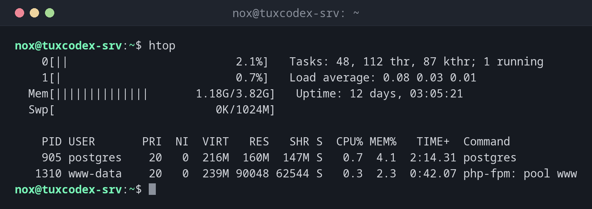

# htop

> The more comfortable version of `top`: coloured bars, scrolling, mouse support, search, tree view and killing processes with a few keys.



## Syntax

```bash
htop [OPTION]...
```

## Options

| Option | Description |
|--------|-------------|
| `-u USER` | Only show processes of `USER` |
| `-p PID,PID` | Only show these processes |
| `-t`, `--tree` | Start in tree view |
| `-s COLUMN` | Sort by this column, e.g. `PERCENT_MEM` |
| `-d TENTHS` | Update interval in tenths of a second |

Keys inside `htop`:

| Key | Action |
|-----|--------|
| ++f3++ / ++slash++ | Search for a process |
| ++f4++ / ++backslash++ | Filter: only show matching processes |
| ++f5++ / ++t++ | Switch tree view on and off |
| ++f6++ | Choose the sort column |
| ++f9++ / ++k++ | Send a signal to the selected process |
| ++space++ | Mark processes, to send a signal to several at once |
| ++f10++ / ++q++ | Quit |

## Examples

**Start `htop`:**

```bash
htop
```

```text
    0[||                         2.1%]   Tasks: 48, 112 thr, 87 kthr; 1 running
    1[|                          0.7%]   Load average: 0.08 0.03 0.01
  Mem[||||||||||||||       1.18G/3.82G]   Uptime: 12 days, 03:05:21
  Swp[                        0K/1024M]

    PID USER       PRI  NI  VIRT   RES   SHR S  CPU% MEM%   TIME+  Command
    905 postgres    20   0  216M  160M  147M S   0.7  4.1  2:14.31 postgres
   1310 www-data    20   0  239M 90048 62544 S   0.3  2.3  0:42.07 php-fpm: pool www
```

At the top, one bar per CPU core plus memory and swap. Below, the process list as in
[`top`](top.md).

**Only show the processes of one user:**

```bash
htop -u www-data
```

```text
    PID USER       PRI  NI  VIRT   RES   SHR S  CPU% MEM%   TIME+  Command
   1310 www-data    20   0  239M 90048 62544 S   0.3  2.3  0:42.07 php-fpm: pool www
    813 www-data    20   0 12968  5876  3912 S   0.0  0.1  0:03.12 nginx: worker process
```

**Start in tree view:**

```bash
htop -t
```

```text
    PID USER       PRI  NI  VIRT   RES   SHR S  CPU% MEM%   TIME+  Command
    812 root        20   0 11360  1820   920 S   0.0  0.0  0:00.01 nginx: master process
    813 www-data    20   0 12968  5876  3912 S   0.0  0.1  0:03.12 ├─ nginx: worker process
    814 www-data    20   0 12968  5852  3908 S   0.0  0.1  0:03.08 └─ nginx: worker process
```

## When do I need it?

- When a server is slow and you want to see at a glance which cores and processes are
  busy
- To find, filter and end processes quickly, also several at once
- To understand the structure of services in the tree view

!!! tip "Filter instead of searching"
    ++f4++ and a word like `php` hides everything else. You then only see the processes
    you are interested in, and the filter stays active while `htop` updates.

!!! warning "Not on every server"
    `htop` is not installed by default on most distributions, and on RHEL it is only in
    the EPEL repository. [`top`](top.md) is always there.

## Distribution differences

| | Debian | Ubuntu | RHEL | Arch |
|---|--------|--------|------|------|
| Installed by default | no | yes (server) | no | no |
| Install | `sudo apt install htop` | `sudo apt install htop` | from EPEL: `sudo dnf install epel-release`, then `sudo dnf install htop` | `sudo pacman -S htop` |

## Related commands

[top](top.md) · [ps](ps.md)
