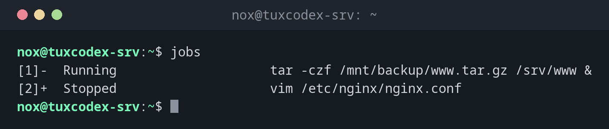

# jobs

> Listet die Befehle auf, die du in der aktuellen Shell im Hintergrund gestartet oder angehalten hast.



## Syntax

```bash
jobs [OPTION]... [%JOB]...
```

## Optionen

| Option | Beschreibung |
|--------|--------------|
| `-l` | Auch die PID anzeigen |
| `-p` | Nur die PIDs anzeigen |
| `-r` | Nur laufende Jobs |
| `-s` | Nur angehaltene Jobs |

Einen Job sprichst du mit `%` und seiner Nummer an: `%1`, `%2`. `%+` (oder nur `%`) ist
der aktuelle Job, `%-` der vorherige.

## Beispiele

**Alle Jobs dieser Shell anzeigen:**

```bash
jobs
```

```text
[1]-  Running                    tar -czf /mnt/backup/www.tar.gz /srv/www &
[2]+  Stopped                    vim /etc/nginx/nginx.conf
```

| Teil | Bedeutung |
|------|-----------|
| `[1]` | Jobnummer, für `%1` |
| `+` / `-` | Aktueller und vorheriger Job: `fg` und `bg` ohne Nummer nehmen `+` |
| `Running` | Läuft im Hintergrund |
| `Stopped` | Angehalten, zum Beispiel mit ++ctrl+z++ |

**Auch die PIDs anzeigen:**

```bash
jobs -l
```

```text
[1]- 4520 Running                    tar -czf /mnt/backup/www.tar.gz /srv/www &
[2]+ 4533 Stopped                    vim /etc/nginx/nginx.conf
```

**Nur angehaltene Jobs anzeigen:**

```bash
jobs -s
```

```text
[2]+  Stopped                    vim /etc/nginx/nginx.conf
```

**Einen Befehl im Hintergrund starten:**

```bash
tar -czf /mnt/backup/www.tar.gz /srv/www &
```

```text
[1] 4520
```

Die Shell gibt die Jobnummer und die PID aus.

**Später prüfen, ob er fertig ist:**

```bash
jobs
```

```text
[1]-  Done                       tar -czf /mnt/backup/www.tar.gz /srv/www
[2]+  Stopped                    vim /etc/nginx/nginx.conf
```

`Done` wird einmal angezeigt. Danach verschwindet der Job aus der Liste.

## Wann brauche ich das?

- Um herauszufinden, was im Hintergrund deiner Shell noch läuft
- Vor dem Abmelden, um zu sehen, ob ein Job beendet würde
- Um die Jobnummer für [`fg`](fg.md), [`bg`](bg.md) oder `kill %1` zu bekommen

!!! tip "`kill` mit Jobnummern"
    In der Shell versteht [`kill`](kill.md) auch Jobnummern: `kill %1` beendet Job 1,
    ohne dass du die PID nachschlagen musst.

!!! warning "Nur diese Shell"
    `jobs` kennt nur die Jobs der aktuellen Shell. Eine zweite SSH-Sitzung oder ein neues
    Terminal hat eine eigene Liste. Alle Prozesse siehst du mit [`ps`](ps.md).

!!! warning "Abmelden beendet Jobs"
    Schließt du die Shell oder bricht die SSH-Verbindung ab, bekommen laufende Jobs
    meist das Signal `HUP` und enden. Für lange Jobs nimm [`nohup`](nohup.md) oder einen
    Terminal-Multiplexer wie `tmux`.

## Verwandte Befehle

[kill](kill.md) · [ps](ps.md) · [bg](bg.md) · [fg](fg.md) · [nohup](nohup.md)
