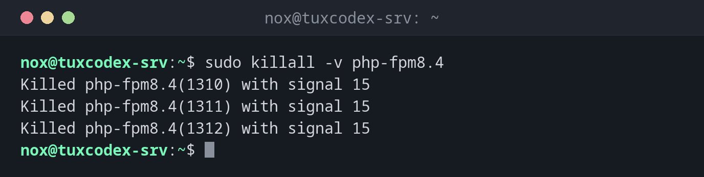

# killall

> Sendet allen Prozessen mit genau diesem Namen ein Signal. Anders als bei `pkill` muss der Name vollständig passen.



## Syntax

```bash
killall [-SIGNAL] [OPTION]... NAME...
```

## Optionen

| Option | Beschreibung |
|--------|--------------|
| `-SIGNAL` | Zu sendendes Signal, Standard ist `TERM` |
| `-v` | Jeden Prozess melden, der ein Signal bekommen hat |
| `-i` | Vor jedem Prozess nachfragen |
| `-w` | Warten, bis alle Prozesse beendet sind |
| `-u BENUTZER` | Nur Prozesse dieses Benutzers |
| `-o ZEIT`, `-y ZEIT` | Nur Prozesse, die älter oder jünger als `ZEIT` sind, z. B. `2h` |

## Beispiele

**Alle Prozesse eines Programms beenden und melden:**

```bash
sudo killall -v php-fpm8.4
```

```text
Killed php-fpm8.4(1310) with signal 15
Killed php-fpm8.4(1311) with signal 15
Killed php-fpm8.4(1312) with signal 15
```

**Vor jedem Prozess nachfragen:**

```bash
killall -i backup.sh
```

```text
Kill backup.sh(4410) ? (y/N) y
```

**Ein Skript beenden und warten, bis es wirklich weg ist:**

```bash
killall -w backup.sh && echo "beendet"
```

```text
beendet
```

**Nur Prozesse beenden, die länger als zwei Stunden laufen:**

```bash
killall -v -o 2h rsync
```

```text
Killed rsync(4415) with signal 15
```

**Der Name passt nicht:**

```bash
killall php-fpm
```

```text
php-fpm: no process found
```

Der Prozess heißt `php-fpm8.4`, und `killall` akzeptiert nur den vollständigen Namen.

## Wann brauche ich das?

- Um alle Instanzen eines Programms zu beenden, etwa mehrere hängende Kopien eines Skripts
- In Skripten mit `-w`, wenn der nächste Schritt erst nach dem Ende des Prozesses starten darf
- Um mit `-o` lang laufende Jobs aufzuräumen

!!! tip "Exakte Namen sind sicherer"
    Weil `killall` keine Teile eines Namens vergleicht, trifft `killall ss` nie `sshd`.
    Damit ist es eine gute Wahl, wenn du den genauen Namen kennst.

!!! warning "Paket `psmisc`"
    `killall` gehört wie [`pstree`](pstree.md) zum Paket `psmisc`. Fehlt es auf einem
    minimalen System, installiere `psmisc` oder nimm [`pkill -x`](pkill.md).

!!! danger "`killall` auf anderen Systemen"
    Unter Solaris und einigen anderen Unix-Systemen beendet `killall` *alle* Prozesse,
    ohne Namen. Arbeitest du auch auf solchen Systemen, nimm lieber [`pkill`](pkill.md).

## Verwandte Befehle

[pkill](pkill.md) · [kill](kill.md) · [pidof](pidof.md) · [pstree](pstree.md)
