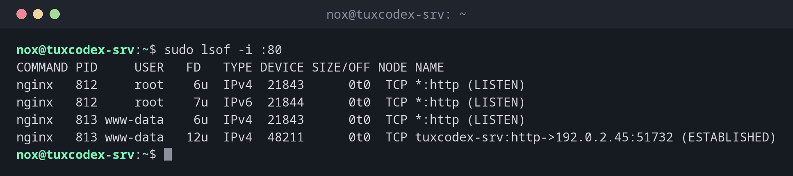

# lsof

> Listet geöffnete Dateien auf und welcher Prozess sie hält. Da auch Sockets unter Linux Dateien sind, zeigt es auch, wer einen Port belegt.



## Syntax

```bash
lsof [OPTION]... [DATEI]...
```

## Optionen

| Option | Beschreibung |
|--------|--------------|
| `-i :PORT` | Netzwerkverbindungen auf diesem Port |
| `-p PID` | Von diesem Prozess geöffnete Dateien |
| `-u BENUTZER` | Von Prozessen dieses Benutzers geöffnete Dateien |
| `+D VERZEICHNIS` | Geöffnete Dateien unterhalb dieses Verzeichnisses |
| `+L1` | Gelöschte Dateien, die noch geöffnet sind |
| `-t` | Nur die PIDs ausgeben, für Skripte |
| `-n`, `-P` | Hostnamen und Portnamen nicht auflösen |

## Beispiele

**Herausfinden, wer Port 80 belegt:**

```bash
sudo lsof -i :80
```

```text
COMMAND PID     USER   FD   TYPE DEVICE SIZE/OFF NODE NAME
nginx   812     root    6u  IPv4  21843      0t0  TCP *:http (LISTEN)
nginx   812     root    7u  IPv6  21844      0t0  TCP *:http (LISTEN)
nginx   813 www-data    6u  IPv4  21843      0t0  TCP *:http (LISTEN)
nginx   813 www-data   12u  IPv4  48211      0t0  TCP tuxcodex-srv:http->192.0.2.45:51732 (ESTABLISHED)
```

| Spalte | Bedeutung |
|--------|-----------|
| `FD` | Dateideskriptor: Nummer plus Modus (`r` lesen, `w` schreiben, `u` beides), oder `cwd` für das Arbeitsverzeichnis |
| `TYPE` | `REG` Datei, `DIR` Verzeichnis, `IPv4`/`IPv6` Netzwerk-Socket |
| `NAME` | Pfad, oder Adresse und Port mit dem Verbindungszustand |

**Herausfinden, warum sich ein Verzeichnis nicht aushängen lässt:**

```bash
sudo lsof +D /mnt/backup
```

```text
COMMAND  PID USER   FD   TYPE DEVICE SIZE/OFF NODE NAME
bash    2201  nox  cwd    DIR   8,17     4096    2 /mnt/backup
rsync   4415  nox    3r   REG   8,17  1048576 1311 /mnt/backup/db.sql.gz
```

Eine Shell steht noch im Verzeichnis, und `rsync` liest eine Datei daraus. Deshalb meldet
`umount` den Fehler `target is busy`.

**Gelöschte Dateien finden, die noch Platz belegen:**

```bash
sudo lsof +L1
```

```text
COMMAND PID     USER   FD   TYPE DEVICE   SIZE/OFF NLINK   NODE NAME
nginx   813 www-data    4w   REG  254,1 8589934592     0 393270 /var/log/nginx/access.log.1 (deleted)
```

Die Logdatei wurde gelöscht, aber `nginx` hält sie noch offen. Die 8 GiB werden erst frei,
wenn der Prozess die Datei schließt, zum Beispiel nach `sudo systemctl reload nginx`.

**Nur die PIDs ausgeben:**

```bash
sudo lsof -t -i :80
```

```text
812
813
814
```

## Wann brauche ich das?

- Wenn ein Dienst nicht startet, weil sein Port schon belegt ist
- Wenn `umount` mit `target is busy` abbricht
- Wenn die Platte voll ist, aber `du` viel weniger Daten findet, als `df` meldet

!!! tip "Schneller für Ports: `ss`"
    Für die Frage „Wer lauscht auf welchem Port?“ ist `sudo ss -tlnp` schneller und immer
    installiert. `lsof` zeigt mehr Details pro Prozess.

!!! warning "`sudo` verwenden"
    Ohne Root-Rechte zeigt `lsof` nur deine eigenen Prozesse. Die Ausgabe ist nicht
    falsch, aber unvollständig, und der gesuchte Prozess fehlt oft.

!!! warning "Nicht immer installiert"
    Minimale Installationen enthalten `lsof` oft nicht. Installiere das Paket `lsof` mit
    dem Paketmanager deiner Distribution.

## Verwandte Befehle

[ps](ps.md) · [pgrep](pgrep.md) · [pidof](pidof.md)
