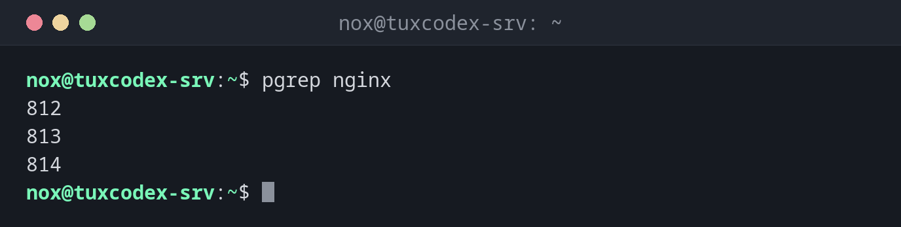

# pgrep

> Findet die PIDs von Prozessen anhand von Name, Benutzer oder Kommandozeile.



## Syntax

```bash
pgrep [OPTION]... MUSTER
```

## Optionen

| Option | Beschreibung |
|--------|--------------|
| `-l` | Prozessnamen neben der PID anzeigen |
| `-a` | Die vollständige Kommandozeile neben der PID anzeigen |
| `-f` | Die ganze Kommandozeile durchsuchen, nicht nur den Prozessnamen |
| `-x` | Der Name muss exakt passen |
| `-u BENUTZER` | Nur Prozesse von `BENUTZER` |
| `-c` | Nur die Anzahl passender Prozesse ausgeben |
| `-n` / `-o` | Nur der neueste / älteste passende Prozess |

## Beispiele

**Die PIDs eines Programms finden:**

```bash
pgrep nginx
```

```text
812
813
814
```

**Die PIDs mit ihrer Kommandozeile anzeigen:**

```bash
pgrep -a nginx
```

```text
812 nginx: master process /usr/sbin/nginx -g daemon on; master_process on;
813 nginx: worker process
814 nginx: worker process
```

**Alle Prozesse eines Benutzers finden:**

```bash
pgrep -l -u www-data
```

```text
813 nginx
814 nginx
1310 php-fpm8.4
```

**Ein Skript anhand seiner Kommandozeile finden:**

```bash
pgrep -af backup.sh
```

```text
4410 /bin/bash /home/nox/scripts/backup.sh
```

Bei Skripten heißt der Prozess `bash`. Nur `-f` findet den Skriptnamen.

**Die Prozesse eines Programms zählen:**

```bash
pgrep -c php-fpm
```

```text
6
```

**In einem Skript prüfen, ob ein Programm läuft:**

```bash
pgrep -x nginx > /dev/null && echo "nginx is running"
```

```text
nginx is running
```

## Wann brauche ich das?

- Um die PID eines Prozesses zu finden, bevor du ihn beendest, seine Priorität änderst
  oder ihn genauer ansiehst
- Um in Skripten und im Monitoring zu prüfen, ob ein Programm läuft
- Um alle Prozesse eines Benutzers zu finden, etwa bevor du das Konto löschst

!!! tip "Besser als `ps | grep`"
    `pgrep` findet sich nie selbst und gibt nur die PIDs aus, was sich in Skripten leicht
    weiterverwenden lässt: `kill $(pgrep -x myapp)`.

!!! warning "Muster passen auf Teile von Namen"
    `pgrep php` findet auch `php-fpm8.4` und jeden anderen Namen, der `php` enthält. Nimm
    `-x`, wenn du genau einen Namen meinst.

## Verwandte Befehle

[ps](ps.md) · [grep](../05-text-processing/grep.md)
