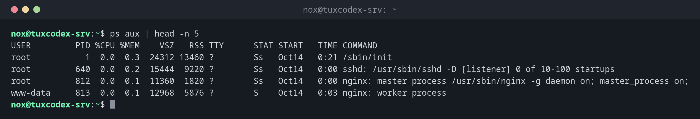

# ps

> Zeigt eine Momentaufnahme der laufenden Prozesse, mit Besitzer, CPU, Arbeitsspeicher, Zustand und Kommandozeile.



## Syntax

```bash
ps [OPTION]...
```

## Optionen

| Option | Beschreibung |
|--------|--------------|
| `aux` | Alle Prozesse aller Benutzer, mit CPU, Arbeitsspeicher und Kommandozeile (BSD-Stil) |
| `-ef` | Alle Prozesse mit Elternprozess (`PPID`) und Startzeit |
| `-u BENUTZER` | Nur Prozesse von `BENUTZER` |
| `-C NAME` | Nur Prozesse mit diesem Befehlsnamen |
| `-p PID` | Nur den Prozess mit dieser PID |
| `-o FELDER` | Spalten wählen, z. B. `pid,user,%cpu,%mem,cmd` |
| `--sort=FELD` | Nach einer Spalte sortieren, `-` davor für absteigend, z. B. `--sort=-%mem` |
| `--forest` | Eltern- und Kindprozesse als Baum anzeigen |

## Beispiele

**Alle Prozesse anzeigen:**

```bash
ps aux | head -n 5
```

```text
USER         PID %CPU %MEM    VSZ   RSS TTY      STAT START   TIME COMMAND
root           1  0.0  0.3  24312 13460 ?        Ss   Oct14   0:21 /sbin/init
root         640  0.0  0.2  15444  9220 ?        Ss   Oct14   0:00 sshd: /usr/sbin/sshd -D [listener] 0 of 10-100 startups
root         812  0.0  0.1  11360  1820 ?        Ss   Oct14   0:00 nginx: master process /usr/sbin/nginx -g daemon on; master_process on;
www-data     813  0.0  0.1  12968  5876 ?        S    Oct14   0:03 nginx: worker process
```

| Spalte | Bedeutung |
|--------|-----------|
| `%CPU`, `%MEM` | Anteil an CPU-Zeit und Arbeitsspeicher |
| `VSZ`, `RSS` | Virtueller und tatsächlich genutzter Speicher in KB |
| `TTY` | Terminal, `?` bei Diensten ohne Terminal |
| `STAT` | Zustand (`S` schläft, `R` läuft, `s` Sitzungsleiter, …) |
| `START`, `TIME` | Startzeit und bisher verbrauchte CPU-Zeit |

**Die Prozesse eines Programms samt Elternprozess anzeigen:**

```bash
ps -fC nginx
```

```text
UID          PID    PPID  C STIME TTY          TIME CMD
root         812       1  0 Oct14 ?        00:00:00 nginx: master process /usr/sbin/nginx -g daemon on; master_process on;
www-data     813     812  0 Oct14 ?        00:00:03 nginx: worker process
www-data     814     812  0 Oct14 ?        00:00:03 nginx: worker process
```

Die Worker (`813`, `814`) wurden vom Master-Prozess (`812`) gestartet.

**Die Prozesse mit dem größten Speicherverbrauch finden:**

```bash
ps -eo pid,user,%mem,%cpu,comm --sort=-%mem | head -n 4
```

```text
    PID USER     %MEM %CPU COMMAND
    905 postgres  4.1  0.2 postgres
   1310 www-data  2.3  0.5 php-fpm8.4
    812 root      0.1  0.0 nginx
```

**Anzeigen, wie lange ein Prozess schon läuft:**

```bash
ps -o pid,ppid,stat,etime,cmd -p 812
```

```text
    PID    PPID STAT     ELAPSED CMD
    812       1 Ss   12-03:05:21 nginx: master process /usr/sbin/nginx -g daemon on; master_process on;
```

`12-03:05:21` bedeutet 12 Tage, 3 Stunden, 5 Minuten und 21 Sekunden.

**Zombie-Prozesse finden:**

```bash
ps -eo stat,pid,ppid,comm | awk '$1 ~ /^Z/'
```

```text
Z       4021    4010 worker
```

Der Zombie `4021` wartet auf seinen Elternprozess `4010`. Nur der kann ihn aufräumen.

## Wann brauche ich das?

- Um zu prüfen, ob ein Programm oder Dienst überhaupt läuft
- Um die PID eines Prozesses zu finden, bevor du ihn beendest oder genauer ansiehst
- Um herauszufinden, welche Prozesse am meisten CPU oder Arbeitsspeicher brauchen
- Um zu sehen, wer einen Prozess gestartet hat, als welcher Benutzer und mit welchen Optionen

!!! tip "`ps aux` oder `ps -ef`?"
    Beide zeigen alle Prozesse. `ps aux` zeigt zusätzlich CPU und Arbeitsspeicher, `ps -ef`
    den Elternprozess. Nimm, was zur Frage passt, die Liste ist dieselbe.

!!! warning "`ps aux | grep` findet sich selbst"
    `ps aux | grep nginx` zeigt auch den `grep`-Prozess selbst. Nimm stattdessen [`pgrep`](pgrep.md)
    oder den Trick `ps aux | grep '[n]ginx'`.

## Verwandte Befehle

[uptime](../01-orientation/uptime.md) · [grep](../05-text-processing/grep.md) · [pgrep](pgrep.md) · [pstree](pstree.md)
