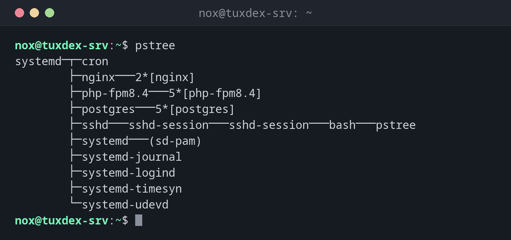

# pstree

> Zeigt die laufenden Prozesse als Baum, sodass du siehst, welcher Prozess welchen gestartet hat.



## Syntax

```bash
pstree [OPTION]... [PID | BENUTZER]
```

## Optionen

| Option | Beschreibung |
|--------|--------------|
| `-p` | Die PID jedes Prozesses anzeigen |
| `-u` | Den Benutzer anzeigen, wenn er vom Eltern- zum Kindprozess wechselt |
| `-a` | Die Argumente der Kommandozeile anzeigen |
| `-s` | Die Elternprozesse des angegebenen Prozesses anzeigen |
| `-c` | Gleiche Zweige nicht zusammenfassen (`2*[nginx]`) |

## Beispiele

**Den ganzen Prozessbaum anzeigen:**

```bash
pstree
```

```text
systemd─┬─cron
        ├─nginx───2*[nginx]
        ├─php-fpm8.4───5*[php-fpm8.4]
        ├─postgres───5*[postgres]
        ├─sshd───sshd-session───sshd-session───bash───pstree
        ├─systemd───(sd-pam)
        ├─systemd-journal
        ├─systemd-logind
        ├─systemd-timesyn
        └─systemd-udevd
```

`2*[nginx]` bedeutet: zwei gleiche Kindprozesse namens `nginx`.

**Einen Zweig mit PIDs anzeigen:**

```bash
pstree -p 812
```

```text
nginx(812)─┬─nginx(813)
           └─nginx(814)
```

**Den Benutzer der Kindprozesse anzeigen:**

```bash
pstree -u 812
```

```text
nginx───2*[nginx(www-data)]
```

Der Master-Prozess läuft als `root`, die Worker als `www-data`.

**Herausfinden, woher ein Prozess kommt:**

```bash
pstree -s -p 4410
```

```text
systemd(1)───sshd(640)───sshd-session(2190)───sshd-session(2200)───bash(2201)───backup.sh(4410)
```

Das Skript wurde von Hand in einer SSH-Sitzung gestartet, nicht von cron oder systemd.

## Wann brauche ich das?

- Um zu verstehen, wie ein Dienst aufgebaut ist: Master-Prozess, Worker, Helfer
- Um herauszufinden, wer einen Prozess gestartet hat, etwa ein Skript in einer
  SSH-Sitzung oder ein Cronjob
- Um den richtigen Elternprozess zu finden, wenn ein Kindprozess hängt oder zum Zombie
  wurde

!!! tip "Den Elternprozess beenden, nicht jedes Kind"
    Hat ein Dienst viele Kindprozesse, beende oder starte den Elternprozess neu. Er stoppt
    seine Kinder in der Regel sauber.

!!! warning "Paket `psmisc`"
    `pstree` gehört zum Paket `psmisc`. Fehlt es auf einem minimalen System, installiere
    `psmisc` mit dem Paketmanager deiner Distribution.

## Verwandte Befehle

[ps](ps.md) · [pgrep](pgrep.md) · [killall](killall.md)
