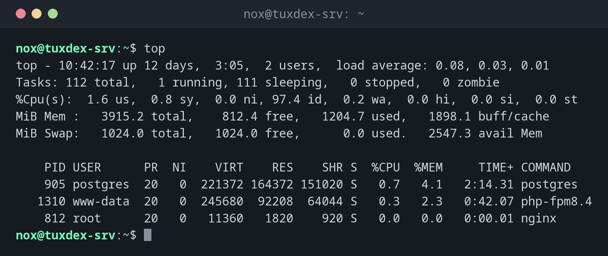

# top

> Zeigt CPU, Arbeitsspeicher und die aktivsten Prozesse live, alle paar Sekunden aktualisiert.



## Syntax

```bash
top [OPTION]...
```

## Optionen

| Option | Beschreibung |
|--------|--------------|
| `-o FELD` | Nach dieser Spalte sortieren, z. B. `%MEM` |
| `-u BENUTZER` | Nur Prozesse von `BENUTZER` anzeigen |
| `-p PID` | Nur diese Prozesse anzeigen (durch Kommas getrennt) |
| `-d SEKUNDEN` | Aktualisierungsintervall |
| `-b` | Batch-Modus: reine Textausgabe, für Skripte und Logs |
| `-n ANZAHL` | Nach `ANZAHL` Aktualisierungen beenden |

Tasten innerhalb von `top`:

| Taste | Aktion |
|-------|--------|
| ++shift+p++ / ++shift+m++ | Nach CPU / Arbeitsspeicher sortieren |
| ++1++ | Jeden CPU-Kern einzeln anzeigen |
| ++c++ | Die vollständige Kommandozeile anzeigen |
| ++u++ | Nur die Prozesse eines Benutzers anzeigen |
| ++k++ | Ein Signal an einen Prozess senden (fragt nach der PID) |
| ++q++ | Beenden |

## Beispiele

**`top` starten:**

```bash
top
```

```text
top - 10:42:17 up 12 days,  3:05,  2 users,  load average: 0.08, 0.03, 0.01
Tasks: 112 total,   1 running, 111 sleeping,   0 stopped,   0 zombie
%Cpu(s):  1.6 us,  0.8 sy,  0.0 ni, 97.4 id,  0.2 wa,  0.0 hi,  0.0 si,  0.0 st
MiB Mem :   3915.2 total,    812.4 free,   1204.7 used,   1898.1 buff/cache
MiB Swap:   1024.0 total,   1024.0 free,      0.0 used.   2547.3 avail Mem

    PID USER      PR  NI    VIRT    RES    SHR S  %CPU  %MEM     TIME+ COMMAND
    905 postgres  20   0  221372 164372 151020 S   0.7   4.1   2:14.31 postgres
   1310 www-data  20   0  245680  92208  64044 S   0.3   2.3   0:42.07 php-fpm8.4
    812 root      20   0   11360   1820    920 S   0.0   0.0   0:00.01 nginx
```

| Zeile | Bedeutung |
|-------|-----------|
| `top -` | Uhrzeit, Laufzeit, Benutzer und Load Average, wie bei [`uptime`](../01-orientation/uptime.md) |
| `Tasks` | Anzahl der Prozesse pro Zustand, auch Zombies |
| `%Cpu(s)` | `us` Programme, `sy` Kernel, `id` untätig, `wa` Warten auf Platte, `st` vom Hypervisor abgezogen |
| `MiB Mem`, `MiB Swap` | Arbeitsspeicher und Swap, `avail Mem` ist das, was Programme noch nutzen können |

**Nach Arbeitsspeicher sortieren:**

```bash
top -o %MEM
```

```text
    PID USER      PR  NI    VIRT    RES    SHR S  %CPU  %MEM     TIME+ COMMAND
    905 postgres  20   0  221372 164372 151020 S   0.7   4.1   2:14.31 postgres
   1310 www-data  20   0  245680  92208  64044 S   0.3   2.3   0:42.07 php-fpm8.4
```

**Nur die Prozesse eines Benutzers beobachten:**

```bash
top -u www-data
```

```text
    PID USER      PR  NI    VIRT    RES    SHR S  %CPU  %MEM     TIME+ COMMAND
   1310 www-data  20   0  245680  92208  64044 S   0.3   2.3   0:42.07 php-fpm8.4
    813 www-data  20   0   12968   5876   3912 S   0.0   0.1   0:03.12 nginx
```

**Eine Momentaufnahme für einen Bericht oder ein Skript speichern:**

```bash
top -b -n 1 | head -n 5
```

```text
top - 10:42:17 up 12 days,  3:05,  2 users,  load average: 0.08, 0.03, 0.01
Tasks: 112 total,   1 running, 111 sleeping,   0 stopped,   0 zombie
%Cpu(s):  1.6 us,  0.8 sy,  0.0 ni, 97.4 id,  0.2 wa,  0.0 hi,  0.0 si,  0.0 st
MiB Mem :   3915.2 total,    812.4 free,   1204.7 used,   1898.1 buff/cache
MiB Swap:   1024.0 total,   1024.0 free,      0.0 used.   2547.3 avail Mem
```

## Wann brauche ich das?

- Wenn ein Server langsam ist: Welcher Prozess braucht die CPU, wartet sie auf die
  Platte (`wa`)?
- Um Arbeitsspeicher und Swap während eines Backups, Imports oder Deployments zu beobachten
- Um außer Kontrolle geratene Prozesse zu finden und direkt mit ++k++ zu beenden

!!! tip "Ein hoher `wa`-Wert"
    `wa` ist die Zeit, in der die CPU auf Festplatte oder Netzwerkspeicher wartet. Bleibt
    der Wert über ein paar Prozent, ist der Speicher der Engpass, nicht die CPU.

!!! tip "`st` auf virtuellen Servern"
    `st` (steal) ist CPU-Zeit, die der Hypervisor anderen VMs gibt. Ein dauerhaft hoher
    Wert bedeutet, dass deine VM nicht die CPU bekommt, die sie haben sollte. Das ist ein
    Fall für deinen Hoster.

## Verwandte Befehle

[ps](ps.md) · [uptime](../01-orientation/uptime.md) · [htop](htop.md) · [free](free.md)
