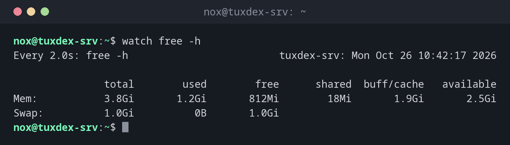

# watch

> Führt einen Befehl immer wieder aus und zeigt seine Ausgabe bildschirmfüllend an. Ideal, um zu beobachten, wie sich etwas ändert.



## Syntax

```bash
watch [OPTION]... BEFEHL
```

Beenden mit ++ctrl+c++. Befehle mit Pipes oder `;` setzt du in Anführungszeichen:
`watch 'ps aux | grep tar'`.

## Optionen

| Option | Beschreibung |
|--------|--------------|
| `-n SEKUNDEN` | Intervall, Standard sind `2` Sekunden |
| `-d` | Hervorheben, was sich seit dem letzten Lauf geändert hat |
| `-g` | Beenden, sobald sich die Ausgabe ändert |
| `-t` | Die Kopfzeile ausblenden |
| `-e` | Beenden, wenn der Befehl fehlschlägt, und auf eine Taste warten |

## Beispiele

**Den Arbeitsspeicher beobachten:**

```bash
watch free -h
```

```text
Every 2.0s: free -h                         tuxdex-srv: Mon Oct 26 10:42:17 2026

               total        used        free      shared  buff/cache   available
Mem:           3.8Gi       1.2Gi       812Mi        18Mi       1.9Gi       2.5Gi
Swap:          1.0Gi          0B       1.0Gi
```

Die Kopfzeile zeigt Intervall, Befehl, Hostnamen und die Uhrzeit des letzten Laufs.

**Zusehen, wie ein Backup-Verzeichnis wächst, alle 10 Sekunden:**

```bash
watch -n 10 -d ls -l /mnt/backup
```

```text
Every 10.0s: ls -l /mnt/backup              tuxdex-srv: Mon Oct 26 10:42:17 2026

total 1849352
-rw-r--r-- 1 nox nox  412318720 Oct 26 10:42 db.sql.gz
-rw-r--r-- 1 nox nox 1481408512 Oct 26 10:42 www.tar.gz
```

Mit `-d` werden die Größen hervorgehoben, die sich seit dem letzten Lauf geändert haben.

**Prozesse zählen:**

```bash
watch -n 5 'pgrep -c php-fpm8.4'
```

```text
Every 5.0s: pgrep -c php-fpm8.4             tuxdex-srv: Mon Oct 26 10:42:17 2026

6
```

**Warten, bis ein Backup fertig ist:**

```bash
watch -g -n 5 pgrep backup.sh && echo "Backup fertig"
```

```text
Backup fertig
```

`-g` beendet `watch`, sobald sich die Ausgabe ändert, hier wenn die PID verschwindet.

## Wann brauche ich das?

- Um Arbeitsspeicher, Prozesse oder Dateien während eines Deployments oder Imports zu
  beobachten
- Um zu sehen, wie schnell eine Datei oder ein Verzeichnis wächst
- Zusammen mit `-g`, um auf eine Änderung zu warten und dann weiterzumachen

!!! tip "Änderungen auf einen Blick"
    `-d` hilft vor allem bei langen Ausgaben: Du siehst sofort, welcher Wert sich
    geändert hat, und musst nicht Zeile für Zeile vergleichen.

!!! warning "Kurze Intervalle kosten Ressourcen"
    `watch -n 0.1` mit einem teuren Befehl, etwa einem `find` über die ganze Platte,
    belastet den Server selbst. Wähle das Intervall passend zum Befehl.

## Verwandte Befehle

[free](free.md) · [top](top.md) · [pgrep](pgrep.md) · [timeout](timeout.md)
