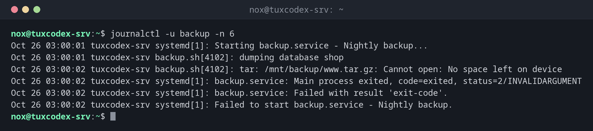

# journalctl

> Reads the systemd journal: the central log of all services, the kernel and the boot process, filtered by service, time or priority.



## Syntax

```bash
journalctl [OPTION]...
```

## Options

| Option | Description |
|--------|-------------|
| `-u UNIT` | Only messages of this unit, e.g. `-u nginx` |
| `-f` | Follow new messages live, like `tail -f` |
| `-n NUMBER` | Only the last `NUMBER` lines |
| `-e` | Jump to the end of the log |
| `-b`, `-b -1` | Only the current boot, or the one before |
| `--since`, `--until` | Time range, e.g. `--since "1 hour ago"` or `--since today` |
| `-p PRIORITY` | Only this priority and more important, e.g. `-p err` |
| `-k` | Only kernel messages, like `dmesg` |
| `-r` | Newest messages first |
| `--no-pager` | Print everything instead of opening `less` |
| `--disk-usage` | Show how much space the journal takes |

## Examples

**Find out why a service failed:**

```bash
journalctl -u backup -n 6
```

```text
Oct 26 03:00:01 tuxcodex-srv systemd[1]: Starting backup.service - Nightly backup...
Oct 26 03:00:01 tuxcodex-srv backup.sh[4102]: dumping database shop
Oct 26 03:00:02 tuxcodex-srv backup.sh[4102]: tar: /mnt/backup/www.tar.gz: Cannot open: No space left on device
Oct 26 03:00:02 tuxcodex-srv systemd[1]: backup.service: Main process exited, code=exited, status=2/INVALIDARGUMENT
Oct 26 03:00:02 tuxcodex-srv systemd[1]: backup.service: Failed with result 'exit-code'.
Oct 26 03:00:02 tuxcodex-srv systemd[1]: Failed to start backup.service - Nightly backup.
```

The third line shows the cause: the backup disk is full.

**Follow the log of a service live:**

```bash
journalctl -u nginx -f
```

```text
Oct 26 10:42:17 tuxcodex-srv systemd[1]: Reloading nginx.service - A high performance web server and a reverse proxy server...
Oct 26 10:42:17 tuxcodex-srv systemd[1]: Reloaded nginx.service - A high performance web server and a reverse proxy server.
```

New lines appear as soon as they are written. Quit with ++ctrl+c++.

**Only errors since the last boot:**

```bash
journalctl -p err -b
```

```text
Oct 14 07:37:09 tuxcodex-srv kernel: ACPI Error: AE_NOT_FOUND, While resolving a named reference package element (20240827/dspkginit-438)
Oct 26 03:00:02 tuxcodex-srv systemd[1]: Failed to start backup.service - Nightly backup.
```

**Messages of the last hour:**

```bash
journalctl --since "1 hour ago" -u ssh
```

```text
Oct 26 09:58:31 tuxcodex-srv sshd-session[2190]: Accepted publickey for nox from 192.0.2.45 port 51732 ssh2: ED25519 SHA256:3qN8vY1oZkT6cW2xLr5bJ9dF0hG4mA7sE1uK8pQ2iVw
Oct 26 09:58:31 tuxcodex-srv sshd-session[2190]: pam_unix(sshd:session): session opened for user nox(uid=1000) by nox(uid=0)
```

**List the recorded boots:**

```bash
journalctl --list-boots
```

```text
IDX BOOT ID                          FIRST ENTRY                  LAST ENTRY
 -2 6f1c0e9a2b7d4f3e8a5c1d9b0e7f2a64 Fri 2026-09-18 09:12:44 CEST Thu 2026-10-01 22:30:05 CEST
 -1 b3a8d2e4f6c14a9b8e7d5c3f1a2b0c96 Thu 2026-10-01 22:31:40 CEST Wed 2026-10-14 07:35:58 CEST
  0 2d9e4b7a1c3f4e8d9b6a5c0e7f1d3a28 Wed 2026-10-14 07:36:52 CEST Mon 2026-10-26 10:42:17 CET
```

With `journalctl -b -1`, you read the log of the boot before, for example to find out why
the server crashed.

**Check how much space the journal takes:**

```bash
journalctl --disk-usage
```

```text
Archived and active journals take up 312.4M in the file system.
```

## When do I need it?

- When a service doesn't start or keeps crashing
- After an unexpected reboot: what happened right before (`-b -1`)?
- To watch a service while you test a change (`-f`)
- To find failed SSH logins or other security events

!!! tip "Combine the filters"
    The options can be combined freely: `journalctl -u nginx -p warning --since today`
    shows only today's warnings and errors of nginx.

!!! tip "Limit the size"
    `sudo journalctl --vacuum-size=500M` deletes old archived journal files until at most
    500 MB are left. For a permanent limit, set `SystemMaxUse=` in
    `/etc/systemd/journald.conf`.

!!! warning "Use `sudo` for system logs"
    Without root rights, you only see your own messages, unless you are a member of the
    group `adm` or `systemd-journal`. Without them, the log looks emptier than it is.

## Distribution differences

| | Debian | Ubuntu | RHEL | Arch |
|---|--------|--------|------|------|
| Classic text log via rsyslog | not installed | `/var/log/syslog` | `/var/log/messages` | not installed |
| SSH service for `-u` | `ssh` | `ssh` | `sshd` | `sshd` |

On distributions without rsyslog, the journal is the only system log.

## Related commands

[systemctl](systemctl.md) · [tail](../04-viewing-files/tail.md) · [less](../04-viewing-files/less.md) · [grep](../05-text-processing/grep.md)
