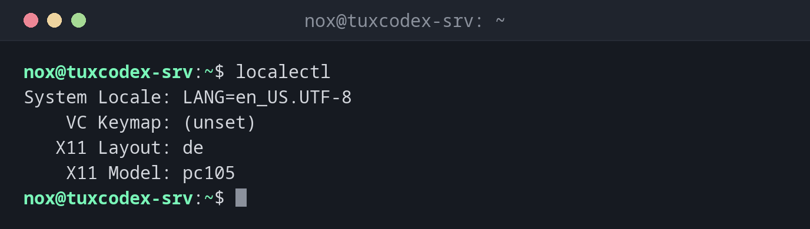

# localectl

> Shows and sets the system language (locale) and the keyboard layout.



## Syntax

```bash
localectl [OPTION]... [COMMAND] [ARGUMENT]...
```

## Options

| Command | Description |
|---------|-------------|
| *(none)*, `status` | Show locale and keyboard settings |
| `list-locales` | List the locales that are installed |
| `set-locale LANG=…` | Set the system locale |
| `list-keymaps` | List the keyboard layouts for the console |
| `set-keymap MAP` | Set the keyboard layout for the console |
| `set-x11-keymap LAYOUT` | Set the keyboard layout for graphical sessions |

## Examples

**Show the current settings:**

```bash
localectl
```

```text
System Locale: LANG=en_US.UTF-8
    VC Keymap: (unset)
   X11 Layout: de
    X11 Model: pc105
```

`VC Keymap` is the layout on the server console, `X11 Layout` the one for graphical
sessions. Over SSH, your own computer's keyboard layout applies.

**Show the installed locales:**

```bash
localectl list-locales
```

```text
C.UTF-8
de_DE.UTF-8
en_US.UTF-8
```

**Change the system language:**

```bash
sudo localectl set-locale LANG=de_DE.UTF-8
localectl status
```

```text
System Locale: LANG=de_DE.UTF-8
    VC Keymap: (unset)
   X11 Layout: de
    X11 Model: pc105
```

The new setting applies to new logins. Log out and in again to see it.

## When do I need it?

- After the installation, when the server uses the wrong language or keyboard layout
- When programs show question marks instead of umlauts, often a missing UTF-8 locale
- When a program warns `Setting locale failed`

!!! tip "English on servers"
    Many admins keep servers on `en_US.UTF-8` or `C.UTF-8`. Error messages are then
    in English, and you find much more help for them online.

!!! warning "Install the locale first"
    `set-locale` only sets the value. If the locale isn't installed, programs fall back
    to `C` and complain. Check with `list-locales` first.

## Distribution differences

| | Debian | Ubuntu | RHEL | Arch |
|---|--------|--------|------|------|
| Install a locale | `sudo dpkg-reconfigure locales` | `sudo locale-gen de_DE.UTF-8` | `sudo dnf install glibc-langpack-de` | uncomment in `/etc/locale.gen`, then `sudo locale-gen` |

## Related commands

[hostnamectl](../01-orientation/hostnamectl.md) · [timedatectl](../01-orientation/timedatectl.md)
