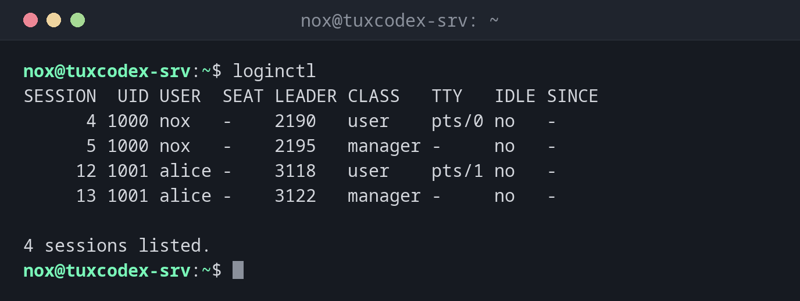

# loginctl

> Shows and controls login sessions: who is logged in through which session, and ends sessions or all processes of a user.



## Syntax

```bash
loginctl [OPTION]... [COMMAND] [ARGUMENT]...
```

## Options

| Command | Description |
|---------|-------------|
| *(none)*, `list-sessions` | List all sessions |
| `list-users` | List all logged in users |
| `session-status ID` | Details and processes of a session |
| `terminate-session ID` | End a session with all its processes |
| `terminate-user USER` | End all sessions and processes of a user |
| `enable-linger USER` | Keep the user's services running after logout |
| `show-user USER -p PROPERTY` | Print a single property, e.g. `Linger` |

## Examples

**Show all sessions:**

```bash
loginctl
```

```text
SESSION  UID USER  SEAT LEADER CLASS   TTY   IDLE SINCE
      4 1000 nox   -    2190   user    pts/0 no   -
      5 1000 nox   -    2195   manager -     no   -
     12 1001 alice -    3118   user    pts/1 no   -
     13 1001 alice -    3122   manager -     no   -

4 sessions listed.
```

`user` sessions are the SSH logins. The `manager` sessions belong to the user's own
service manager, which systemd starts for every logged in user.

**List the logged in users:**

```bash
loginctl list-users
```

```text
 UID USER  LINGER STATE
1000 nox   no     active
1001 alice no     active

2 users listed.
```

**Log out a user completely:**

```bash
sudo loginctl terminate-user alice
loginctl list-users
```

```text
 UID USER LINGER STATE
1000 nox  no     active

1 users listed.
```

All processes of `alice` are ended, including programs started in the background.

**Keep a user's services running after logout:**

```bash
sudo loginctl enable-linger nox
loginctl show-user nox -p Linger
```

```text
Linger=yes
```

## When do I need it?

- To see who is logged in and through which session
- To log out a user whose account you locked, including all background processes
- To let your own user services or timers (`systemctl --user`) run without a login

!!! tip "Ending sessions cleanly"
    `terminate-user` is more thorough than `pkill -u`: systemd knows every process of a
    session, including those that left the shell long ago.

!!! warning "Background jobs end at logout"
    Depending on the setting `KillUserProcesses=` in `/etc/systemd/logind.conf`, systemd
    ends all processes of a session at logout, even jobs started with `nohup`. Use
    `systemd-run` or `enable-linger` for jobs that must keep running.

## Related commands

[who](../01-orientation/who.md) · [w](../01-orientation/w.md) · [pkill](../08-processes/pkill.md) · [systemd-run](systemd-run.md)
