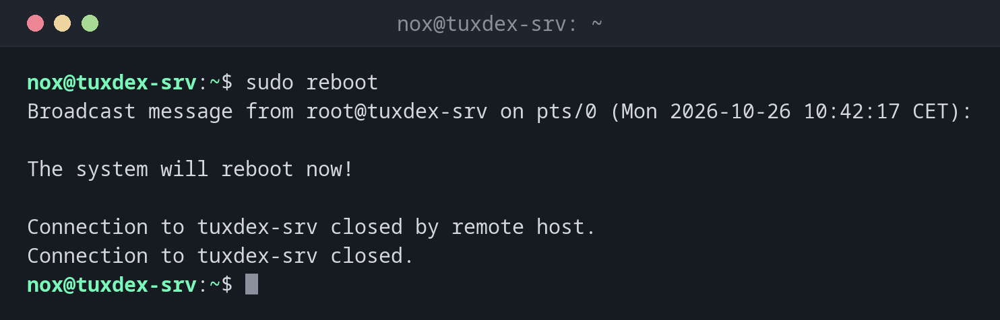

# reboot

> Startet das System sofort neu. Kurzform von `systemctl reboot`.



## Syntax

```bash
reboot [OPTION]...
```

## Optionen

| Option | Beschreibung |
|--------|--------------|
| *(keine)* | Sauber neu starten: alle Dienste stoppen, Dateisysteme aushängen, neu starten |
| `-f`, `--force` | Sofort neu starten, ohne Dienste sauber zu stoppen |
| `-w`, `--wtmp-only` | Nur den Neustart-Eintrag in die Anmeldehistorie schreiben, nicht neu starten |

Verwandte Befehle: `poweroff` schaltet das System aus, `halt` hält es an, ohne es
auszuschalten.

## Beispiele

**Den Server neu starten:**

```bash
sudo reboot
```

```text
Broadcast message from root@tuxdex-srv on pts/0 (Mon 2026-10-26 10:42:17 CET):

The system will reboot now!

Connection to tuxdex-srv closed by remote host.
Connection to tuxdex-srv closed.
```

Die SSH-Verbindung endet. Nach ein bis zwei Minuten kannst du dich wieder anmelden.

**Nach dem erneuten Anmelden prüfen, ob der Neustart geklappt hat:**

```bash
uptime
```

```text
 10:44:03 up 1 min,  1 user,  load average: 0.52, 0.18, 0.06
```

**Den laufenden Kernel mit dem neuesten installierten vergleichen:**

```bash
uname -r
ls /boot/vmlinuz-*
```

```text
6.12.48+deb13-amd64
/boot/vmlinuz-6.12.48+deb13-amd64  /boot/vmlinuz-6.12.57+deb13-amd64
```

Ein neuerer Kernel ist installiert, läuft aber noch nicht: Er wird erst nach einem
Neustart aktiv.

## Wann brauche ich das?

- Nach einem Kernel-Update, damit der neue Kernel genutzt wird
- Nach Updates zentraler Bibliotheken wie `glibc` oder `openssl`
- Wenn ein System so hängt, dass ein Neustart der Dienste nicht hilft

!!! tip "Besser mit Vorwarnung"
    `reboot` handelt sofort. Sind andere Benutzer angemeldet, nimm
    [`shutdown -r +5`](shutdown.md) und gib ihnen Zeit, ihre Arbeit zu speichern.

!!! warning "Kommt der Server wieder hoch?"
    Bevor du einen entfernten Server neu startest, stell sicher, dass SSH und Netzwerk von
    selbst starten und dass du Zugriff auf eine Konsole des Hosters hast, falls er nicht
    zurückkommt.

!!! danger "`reboot -f`"
    `--force` stoppt keine Dienste und hängt Dateisysteme nicht sauber aus. Datenbanken
    können Daten verlieren. Nimm es nur, wenn ein normaler Neustart hängt.

## Unterschiede zwischen Distributionen

| | Debian | Ubuntu | RHEL | Arch |
|---|--------|--------|------|------|
| Anzeigen, ob ein Neustart nötig ist | `uname -r` mit `/boot` vergleichen | Datei `/var/run/reboot-required` existiert | `sudo dnf needs-restarting -r` | `uname -r` mit `pacman -Q linux` vergleichen |

## Verwandte Befehle

[shutdown](shutdown.md) · [systemctl](systemctl.md) · [uptime](../01-orientation/uptime.md) · [last](../01-orientation/last.md) · [uname](../01-orientation/uname.md)
