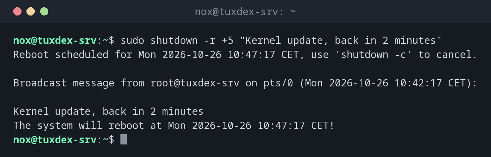

# shutdown

> Fährt das System herunter oder startet es neu, sofort oder zu einer festen Zeit, und warnt vorher alle angemeldeten Benutzer.



## Syntax

```bash
shutdown [OPTION]... [ZEIT] [NACHRICHT]
```

`ZEIT` ist `now`, `+MINUTEN` (z. B. `+5`) oder eine Uhrzeit wie `22:00`. Ohne Zeitangabe
wartet `shutdown` eine Minute.

## Optionen

| Option | Beschreibung |
|--------|--------------|
| `-r` | Neu starten statt herunterfahren |
| `-h`, `-P` | Herunterfahren und ausschalten (Standard) |
| `-c` | Ein geplantes Herunterfahren abbrechen |
| `--show` | Ein geplantes Herunterfahren anzeigen |
| `-k` | Nur die Warnung senden, nicht herunterfahren |

## Beispiele

**In 5 Minuten neu starten und die Benutzer warnen:**

```bash
sudo shutdown -r +5 "Kernel update, back in 2 minutes"
```

```text
Reboot scheduled for Mon 2026-10-26 10:47:17 CET, use 'shutdown -c' to cancel.

Broadcast message from root@tuxdex-srv on pts/0 (Mon 2026-10-26 10:42:17 CET):

Kernel update, back in 2 minutes
The system will reboot at Mon 2026-10-26 10:47:17 CET!
```

Jeder angemeldete Benutzer sieht die Nachricht in seinem Terminal. Ab 5 Minuten vor dem
Zeitpunkt sind keine neuen Anmeldungen mehr möglich.

**Prüfen, ob ein Herunterfahren geplant ist:**

```bash
shutdown --show
```

```text
Reboot scheduled for Mon 2026-10-26 10:47:17 CET, use 'shutdown -c' to cancel.
```

**Den geplanten Neustart abbrechen:**

```bash
sudo shutdown -c
shutdown --show
```

```text
Broadcast message from root@tuxdex-srv on pts/0 (Mon 2026-10-26 10:43:02 CET):

System shutdown has been cancelled

No scheduled shutdown.
```

**Heute Abend um 22:00 herunterfahren:**

```bash
sudo shutdown -h 22:00 "Hardware maintenance"
```

```text
Shutdown scheduled for Mon 2026-10-26 22:00:00 CET, use 'shutdown -c' to cancel.

Broadcast message from root@tuxdex-srv on pts/0 (Mon 2026-10-26 10:42:17 CET):

Hardware maintenance
The system will power off at Mon 2026-10-26 22:00:00 CET!
```

## Wann brauche ich das?

- Um nach einem Kernel-Update neu zu starten und den Benutzern Zeit zum Speichern zu geben
- Um Wartungsarbeiten außerhalb der Arbeitszeit einzuplanen
- Um einen Server vor Hardwarearbeiten oder einem Umzug herunterzufahren

!!! tip "Prüfen, wer angemeldet ist"
    Schau vor einem Neustart mit [`w`](../01-orientation/w.md) oder
    [`loginctl`](loginctl.md), ob noch jemand auf dem Server arbeitet.

!!! warning "Kommt der Server wieder hoch?"
    Nach einem Neustart muss der Server alles von selbst starten. Prüfe vorher mit
    `systemctl is-enabled`, ob alle wichtigen Dienste aktiviert sind.

!!! danger "Der falsche Server"
    `shutdown -h now` in der falschen SSH-Sitzung schaltet einen Produktivserver aus, und
    zum Wiedereinschalten brauchst du womöglich physischen Zugang oder die Konsole des
    Hosters. Prüfe den Hostnamen im Prompt, bevor du ++enter++ drückst.

## Verwandte Befehle

[systemctl](systemctl.md) · [loginctl](loginctl.md) · [w](../01-orientation/w.md) · [reboot](reboot.md)
