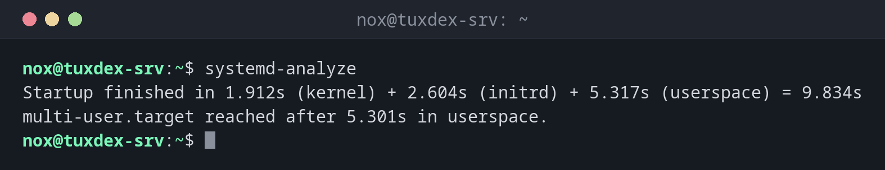

# systemd-analyze

> Analysiert den Bootvorgang und Unit-Dateien: was den Start langsam gemacht hat, in welcher Reihenfolge Dienste starten und ob eine Unit-Datei oder eine Zeitangabe stimmt.



## Syntax

```bash
systemd-analyze [OPTION]... [BEFEHL] [ARGUMENT]...
```

## Optionen

| Befehl | Beschreibung |
|--------|--------------|
| *(keiner)*, `time` | Gesamte Bootzeit, aufgeteilt in Kernel, initrd und Userspace |
| `blame` | Startzeit jeder Unit, langsamste zuerst |
| `critical-chain [UNIT]` | Die Kette der Units, auf die der Bootvorgang oder eine Unit warten musste |
| `verify DATEI` | Eine Unit-Datei auf Fehler prüfen |
| `calendar AUSDRUCK` | Eine Zeitangabe für Timer prüfen und den nächsten Lauf anzeigen |
| `security [UNIT]` | Die Sandbox-Einstellungen von Diensten bewerten |

## Beispiele

**Anzeigen, wie lange das Booten gedauert hat:**

```bash
systemd-analyze
```

```text
Startup finished in 1.912s (kernel) + 2.604s (initrd) + 5.317s (userspace) = 9.834s
multi-user.target reached after 5.301s in userspace.
```

**Anzeigen, welche Units am längsten zum Starten gebraucht haben:**

```bash
systemd-analyze blame | head -n 5
```

```text
4.211s postgresql@17-main.service
1.028s networking.service
 498ms php8.4-fpm.service
 351ms apparmor.service
 312ms nginx.service
```

**Anzeigen, worauf ein Dienst warten musste:**

```bash
systemd-analyze critical-chain nginx.service
```

```text
The time when unit became active or started is printed after the "@" character.
The time the unit took to start is printed after the "+" character.

nginx.service +312ms
└─network-online.target @3.902s
  └─networking.service @2.871s +1.028s
    └─apparmor.service @2.512s +351ms
      └─local-fs.target @2.498s
```

`@` ist der Zeitpunkt nach dem Booten, `+` die Zeit, die die Unit selbst gebraucht hat.

**Eine Zeitangabe prüfen, bevor sie in einen Timer kommt:**

```bash
systemd-analyze calendar "Mon..Fri 03:00"
```

```text
  Original form: Mon..Fri 03:00
Normalized form: Mon..Fri *-*-* 03:00:00
    Next elapse: Tue 2026-10-27 03:00:00 CET
       (in UTC): Tue 2026-10-27 02:00:00 UTC
       From now: 16h left
```

**Die eigene Unit-Datei prüfen:**

```bash
systemd-analyze verify /etc/systemd/system/backup.service
```

```text
backup.service: Command /usr/local/bin/backup.sh is not executable: No such file or directory
```

Das Skript existiert noch nicht, oder der Pfad hat einen Tippfehler.

## Wann brauche ich das?

- Wenn der Server lange zum Booten braucht und du wissen willst, welcher Dienst schuld ist
- Wenn ein Dienst zu früh startet, etwa bevor das Netzwerk bereit ist
- Bevor du eine eigene Unit oder einen Timer aktivierst, um Fehler vorher zu finden

!!! tip "`blame` ist nicht alles"
    Dienste starten parallel. Eine Unit mit langer Zeit in `blame` verzögert den Start
    nicht unbedingt. `critical-chain` zeigt, worauf der Bootvorgang wirklich gewartet hat.

!!! tip "Timer mit `calendar` testen"
    `systemd-analyze calendar` versteht auch `--iterations=5` und zeigt dann die nächsten
    fünf Läufe. So prüfst du auch komplizierte Ausdrücke wie `*-*-1,15 04:30`.

## Verwandte Befehle

[systemctl](systemctl.md) · [journalctl](journalctl.md) · [uptime](../01-orientation/uptime.md) · [systemd-run](systemd-run.md)
