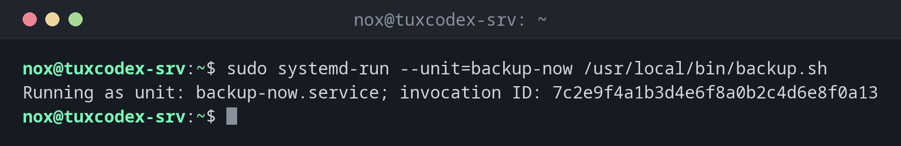

# systemd-run

> Runs a command as a temporary systemd unit: in the background with its own log, with resource limits, or once at a later time.



## Syntax

```bash
systemd-run [OPTION]... COMMAND [ARGUMENT]...
```

## Options

| Option | Description |
|--------|-------------|
| `--unit=NAME` | Name of the unit, instead of a generated `run-…` name |
| `--on-active=TIME` | Run once after `TIME`, e.g. `30min` |
| `--on-calendar=TIME` | Run once at this time, e.g. `"2026-10-27 03:00"` |
| `-p PROPERTY=VALUE` | Set a unit property, e.g. `MemoryMax=500M` or `CPUQuota=50%` |
| `--wait` | Wait until the command has finished, then show a summary |
| `-t`, `--pty` | Connect the command to your terminal |
| `--user` | Run in your own user manager instead of the system |

## Examples

**Run a script as a service in the background:**

```bash
sudo systemd-run --unit=backup-now /usr/local/bin/backup.sh
```

```text
Running as unit: backup-now.service; invocation ID: 7c2e9f4a1b3d4e6f8a0b2c4d6e8f0a13
```

The script now runs independently of your SSH session. Its output goes to the journal:
`journalctl -u backup-now`.

**Restart a service once in 30 minutes:**

```bash
sudo systemd-run --on-active=30min --unit=php-restart /usr/bin/systemctl restart php8.4-fpm
```

```text
Running timer as unit: php-restart.timer
Will run service as unit: php-restart.service
```

**Run a migration tonight at 3 o'clock:**

```bash
sudo systemd-run --on-calendar="2026-10-27 03:00" --unit=migrate /usr/local/bin/migrate.sh
```

```text
Running timer as unit: migrate.timer
Will run service as unit: migrate.service
```

`systemctl list-timers` shows when it will run.

**Limit memory and CPU and wait for the result:**

```bash
sudo systemd-run --wait -p MemoryMax=500M -p CPUQuota=50% --unit=import /usr/local/bin/import.sh
```

```text
Running as unit: import.service; invocation ID: 1f8b3d5c7e9a4b2d6f0e8c4a2b6d9e17
          Finished with result: success
Main processes terminated with: code=exited, status=0/SUCCESS
               Service runtime: 4min 12.304s
             CPU time consumed: 2min 3.871s
                   Memory peak: 486.2M (swap: 0B)
```

`CPUQuota=50%` allows at most half a CPU core. If the script needs more memory than
`MemoryMax`, the kernel ends it.

## When do I need it?

- To start a long job that must survive logging out, with a proper log
- To run something once at a later time, without a cron entry
- To limit a heavy job to a share of memory and CPU

!!! tip "Better than `nohup` for long jobs"
    Compared to [`nohup`](../08-processes/nohup.md), you get a clean log in the journal,
    the state with `systemctl status`, and you can stop the job with `systemctl stop`.

!!! warning "The unit is temporary"
    When the command has finished successfully, the unit disappears. Only failed units
    stay until you remove them with `sudo systemctl reset-failed`. For jobs that should
    run regularly, write a real unit with a timer.

## Related commands

[systemctl](systemctl.md) · [journalctl](journalctl.md) · [systemd-analyze](systemd-analyze.md) · [nohup](../08-processes/nohup.md)
