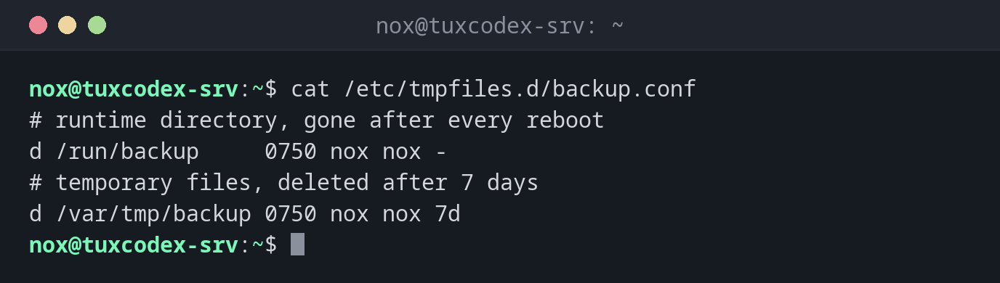

# systemd-tmpfiles

> Legt Dateien und Verzeichnisse nach einfachen Konfigurationsdateien an, räumt sie auf und entfernt sie, zum Beispiel Laufzeitverzeichnisse nach jedem Booten oder alte Dateien in temporären Verzeichnissen.



## Syntax

```bash
systemd-tmpfiles [OPTION]... [KONFIGURATIONSDATEI]...
```

## Optionen

| Option | Beschreibung |
|--------|--------------|
| `--create` | Dateien und Verzeichnisse anlegen und Besitzer und Rechte setzen |
| `--clean` | Dateien löschen, die älter als das eingestellte Alter sind |
| `--remove` | Entfernen, was zum Entfernen markiert ist |
| `-n`, `--dry-run` | Nur anzeigen, was passieren würde (neuere systemd-Versionen) |
| `--cat-config` | Alle Konfigurationsdateien mit Inhalt anzeigen |

Konfigurationszeilen haben die Form `TYP PFAD RECHTE BENUTZER GRUPPE ALTER`:

| Typ | Bedeutung |
|-----|-----------|
| `d` | Verzeichnis anlegen, nach Alter aufräumen |
| `D` | Wie `d`, aber der Inhalt wird zusätzlich bei jedem Booten entfernt |
| `f` | Datei anlegen, falls sie nicht existiert |
| `L` | Symbolischen Link anlegen |
| `z` | Nur Besitzer und Rechte eines vorhandenen Pfads setzen |

Eigene Konfigurationen gehören nach `/etc/tmpfiles.d/NAME.conf`.

## Beispiele

**Eine Konfiguration für ein Backup-Skript:**

```bash
cat /etc/tmpfiles.d/backup.conf
```

```text
# runtime directory, gone after every reboot
d /run/backup     0750 nox nox -
# temporary files, deleted after 7 days
d /var/tmp/backup 0750 nox nox 7d
```

`/run` liegt im Arbeitsspeicher und ist nach jedem Booten leer. Der Eintrag sorgt dafür,
dass das Verzeichnis mit dem richtigen Besitzer wieder existiert.

**Die Verzeichnisse sofort anlegen:**

```bash
sudo systemd-tmpfiles --create /etc/tmpfiles.d/backup.conf
ls -ld /run/backup /var/tmp/backup
```

```text
drwxr-x--- 2 nox nox   40 Oct 26 10:42 /run/backup
drwxr-x--- 2 nox nox 4096 Oct 26 10:42 /var/tmp/backup
```

Ohne diesen Befehl würden die Verzeichnisse erst beim nächsten Booten angelegt.

**Herausfinden, wann aufgeräumt wird:**

```bash
systemctl list-timers systemd-tmpfiles-clean.timer
```

```text
NEXT                        LEFT LAST                        PASSED       UNIT                         ACTIVATES
Tue 2026-10-27 07:52:21 CET  21h Mon 2026-10-26 07:52:21 CET 2h 50min ago systemd-tmpfiles-clean.timer systemd-tmpfiles-clean.service

1 timers listed.
Pass --all to see loaded but inactive timers, too.
```

Einmal am Tag werden Dateien gelöscht, die älter als das eingestellte Alter sind, hier
die in `/var/tmp/backup` nach 7 Tagen.

## Wann brauche ich das?

- Wenn ein Dienst oder Skript ein Verzeichnis in `/run` braucht, das nach jedem Booten
  da sein muss
- Um temporäre Verzeichnisse automatisch aufzuräumen, ohne eigenen Cronjob
- Um herauszufinden, warum Dateien in `/tmp` oder `/var/tmp` verschwinden

!!! tip "Die Vorgaben des Systems ansehen"
    `systemd-tmpfiles --cat-config | less` zeigt alle Regeln, auch die für `/tmp` und
    `/var/tmp`. So erfährst du, wie lange Dateien dort auf deiner Distribution überleben.

!!! warning "`D` löscht bei jedem Booten"
    Bei Typ `D` wird der Inhalt des Verzeichnisses bei jedem Booten entfernt. Nimm ihn nie
    für Verzeichnisse mit Daten, die erhalten bleiben müssen.

## Verwandte Befehle

[systemctl](systemctl.md) · [mkdir](../03-files/mkdir.md) · [chmod](../06-permissions/chmod.md) · [chown](../06-permissions/chown.md)
