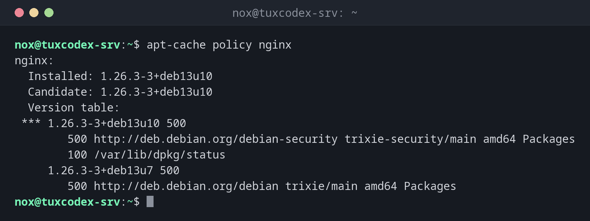

# apt-cache

> Fragt die Paketlisten von Debian und Ubuntu ab: welche Versionen aus welcher Paketquelle verfügbar sind und welche Pakete voneinander abhängen.



## Syntax

```bash
apt-cache BEFEHL [PAKET]...
```

## Optionen

| Befehl | Beschreibung |
|--------|--------------|
| `policy PAKET` | Installierte Version, Kandidat und alle verfügbaren Versionen mit ihren Paketquellen |
| `madison PAKET` | Alle verfügbaren Versionen, eine pro Zeile |
| `depends PAKET` | Was das Paket braucht |
| `rdepends PAKET` | Welche Pakete dieses Paket brauchen (umgekehrte Abhängigkeiten) |
| `search WORT` | Namen und Beschreibungen durchsuchen |
| `show PAKET` | Details aller verfügbaren Versionen |

`apt-cache` liest nur, deshalb braucht es kein `sudo`.

## Beispiele

**Installierte Version und Kandidaten anzeigen:**

```bash
apt-cache policy nginx
```

```text
nginx:
  Installed: 1.26.3-3+deb13u10
  Candidate: 1.26.3-3+deb13u10
  Version table:
 *** 1.26.3-3+deb13u10 500
        500 http://deb.debian.org/debian-security trixie-security/main amd64 Packages
        100 /var/lib/dpkg/status
     1.26.3-3+deb13u7 500
        500 http://deb.debian.org/debian trixie/main amd64 Packages
```

| Zeile | Bedeutung |
|-------|-----------|
| `Installed` | Die Version auf dem System |
| `Candidate` | Die Version, die `apt install` oder `apt upgrade` installieren würde |
| `***` | Markiert die installierte Version |
| `500`, `100` | Priorität der Quelle: Die höhere gewinnt |

**Alle verfügbaren Versionen kurz anzeigen:**

```bash
apt-cache madison nginx
```

```text
     nginx | 1.26.3-3+deb13u10 | http://deb.debian.org/debian-security trixie-security/main amd64 Packages
     nginx | 1.26.3-3+deb13u7 | http://deb.debian.org/debian trixie/main amd64 Packages
```

**Anzeigen, was ein Paket braucht:**

```bash
apt-cache depends htop
```

```text
htop
  Depends: libc6
  Depends: libncursesw6
  Depends: libtinfo6
  Suggests: lm-sensors
  Suggests: lsof
  Suggests: strace
```

**Herausfinden, welche installierten Pakete eine Bibliothek brauchen:**

```bash
apt-cache rdepends --installed libncursesw6
```

```text
libncursesw6
Reverse Depends:
  htop
```

**Pakete nach Namen suchen:**

```bash
apt-cache search --names-only "^nginx-"
```

```text
nginx - small, powerful, scalable web/proxy server
nginx-common - small, powerful, scalable web/proxy server - common files
nginx-core - nginx web/proxy server (standard version)
nginx-dev - nginx web/proxy server - development headers
nginx-doc - small, powerful, scalable web/proxy server - documentation
```

## Wann brauche ich das?

- Vor einem Update: Welche Version würde installiert, und aus welcher Paketquelle?
- Wenn ein Sicherheitsupdate nicht ankommt: Ist die Sicherheits-Paketquelle eingetragen?
- Bevor du eine Bibliothek entfernst: Welche Programme brauchen sie noch?

!!! tip "Die Sicherheits-Paketquelle prüfen"
    Zeigt `policy` für ein installiertes Paket keine Zeile mit `-security`, fehlt die
    Sicherheits-Paketquelle in den Quellen. Dann bekommt der Server keine
    Sicherheitsupdates.

!!! tip "Nur die Listen vom letzten `update`"
    `apt-cache` liest die lokalen Paketlisten. Sind sie alt, führe vorher
    `sudo apt update` aus.

## Unterschiede zwischen Distributionen

| | Debian | Ubuntu | RHEL | Arch |
|---|--------|--------|------|------|
| Verfügbare Versionen anzeigen | `apt-cache policy` | `apt-cache policy` | `dnf list --showduplicates` | `pacman -Si` |
| Umgekehrte Abhängigkeiten | `apt-cache rdepends` | `apt-cache rdepends` | `dnf repoquery --whatrequires` | `pacman -Qi` (Feld `Required By`) |

## Verwandte Befehle

[apt](apt.md) · [dpkg](dpkg.md)
