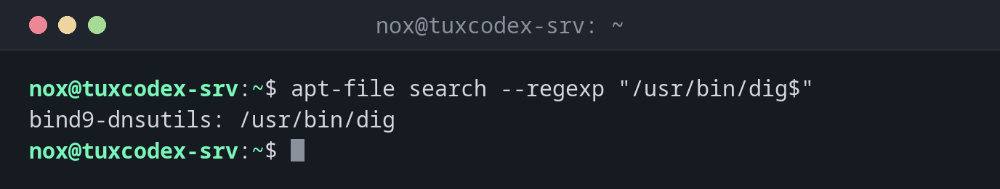

# apt-file

> Durchsucht alle Pakete in den Paketquellen von Debian und Ubuntu nach einer Datei, auch Pakete, die nicht installiert sind. Beantwortet die Frage: Welches Paket brauche ich für diesen Befehl?



## Syntax

```bash
apt-file [OPTION]... BEFEHL MUSTER
```

## Optionen

| Option | Beschreibung |
|--------|--------------|
| `update` | Die Dateilisten der Paketquellen herunterladen |
| `search MUSTER` | Pakete finden, die eine zu `MUSTER` passende Datei enthalten |
| `list PAKET` | Die Dateien eines Pakets auflisten, auch wenn es nicht installiert ist |
| `-x`, `--regexp` | Das Muster als regulären Ausdruck behandeln |

## Beispiele

**Herausfinden, welches Paket einen Befehl enthält:**

```bash
apt-file search --regexp "/usr/bin/dig$"
```

```text
bind9-dnsutils: /usr/bin/dig
```

`dig` fehlt auf dem Server? Installiere es mit `sudo apt install bind9-dnsutils`.

**Zuerst die Dateilisten herunterladen:**

```bash
sudo apt-file update
```

```text
Hit:1 http://deb.debian.org/debian trixie InRelease
Hit:2 http://deb.debian.org/debian trixie-updates InRelease
Hit:3 http://deb.debian.org/debian-security trixie-security InRelease
Get:4 http://deb.debian.org/debian trixie/main amd64 Contents (deb) [12.7 MB]
Get:5 http://deb.debian.org/debian trixie/main all Contents (deb) [38.2 MB]
Get:6 http://deb.debian.org/debian trixie-updates/main all Contents (deb) [9071 B]
Fetched 50.9 MB in 4s (12.2 MB/s)
Reading package lists...
```

**Nach mehreren Befehlen auf einmal suchen:**

```bash
apt-file search -x "bin/(ip|ss)$"
```

```text
iproute2: /usr/bin/ip
iproute2: /usr/bin/ss
iproute2: /usr/sbin/ip
```

**Die Dateien eines nicht installierten Pakets auflisten:**

```bash
apt-file list htop
```

```text
htop: /usr/bin/htop
htop: /usr/share/applications/htop.desktop
htop: /usr/share/doc/htop/AUTHORS
htop: /usr/share/doc/htop/README.md.gz
htop: /usr/share/doc/htop/changelog.Debian.gz
```

## Wann brauche ich das?

- Wenn ein Befehl fehlt und du nicht weißt, welches Paket ihn liefert
- Wenn Software eine Bibliothek oder Header-Datei braucht, etwa beim Kompilieren
- Um zu sehen, was ein Paket installieren würde, bevor du es installierst

!!! tip "Genau suchen"
    Ohne `--regexp` findet `apt-file search bin/dig` auch `digikam`, `digitemp` und viele
    mehr. Mit vollem Pfad und `$` am Ende bekommst du genau die gesuchte Datei.

!!! warning "Nicht vorinstalliert"
    Installiere es mit `sudo apt install apt-file` und führe einmal `sudo apt-file update`
    aus. Die Dateilisten sind etwa 50 MB groß.

## Unterschiede zwischen Distributionen

| | Debian | Ubuntu | RHEL | Arch |
|---|--------|--------|------|------|
| Welches Paket liefert eine Datei? | `apt-file search` | `apt-file search` | `dnf provides '*/bin/dig'` | `pacman -F dig` (nach `pacman -Fy`) |

## Verwandte Befehle

[apt](apt.md) · [dpkg](dpkg.md) · [which](../02-navigation/which.md)
