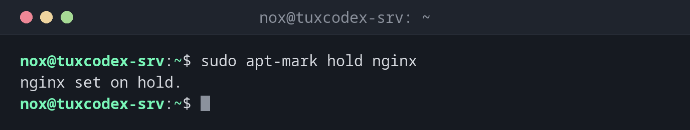

# apt-mark

> Sets marks on packages under Debian and Ubuntu: hold a package at its current version, or mark it as installed manually or automatically.



## Syntax

```bash
apt-mark COMMAND [PACKAGE]...
```

## Options

| Command | Description |
|---------|-------------|
| `hold PACKAGE` | Hold the package: it is no longer updated |
| `unhold PACKAGE` | Allow updates again |
| `showhold` | List all held packages |
| `manual PACKAGE` | Mark as installed manually: `autoremove` never removes it |
| `auto PACKAGE` | Mark as installed automatically: `autoremove` removes it when nothing needs it |
| `showmanual` | List all packages that were installed manually |

## Examples

**Hold a package at its current version:**

```bash
sudo apt-mark hold nginx
```

```text
nginx set on hold.
```

From now on, `apt upgrade` lists `nginx` under `Not Upgrading` and leaves it alone.

**Show all held packages:**

```bash
apt-mark showhold
```

```text
nginx
```

**Allow updates again:**

```bash
sudo apt-mark unhold nginx
```

```text
Canceled hold on nginx.
```

**Protect a package from `autoremove`:**

```bash
sudo apt-mark manual libncursesw6
```

```text
libncursesw6 set to manually installed.
```

**Let `autoremove` clean up a package later:**

```bash
sudo apt-mark auto htop
```

```text
htop set to automatically installed.
```

If no manually installed package needs `htop`, the next `apt autoremove` removes it.

## When do I need it?

- When an update of a package would break something, until you have tested it
- To keep a kernel, a database or PHP at a version that your application needs
- To clean up after testing: mark test packages as `auto`, then run `apt autoremove`

!!! tip "Find out what you installed"
    `apt-mark showmanual` lists everything that was installed on purpose. This is a good
    basis for documenting a server or setting up a second one the same way.

!!! warning "Held packages get no security updates"
    A package on `hold` stays at its version, including all its security holes. Use
    `hold` only temporarily and check `apt-mark showhold` regularly.

## Distribution differences

| | Debian | Ubuntu | RHEL | Arch |
|---|--------|--------|------|------|
| Hold a package | `apt-mark hold` | `apt-mark hold` | `dnf versionlock add` (plugin) | `IgnorePkg` in `/etc/pacman.conf` |
| Mark as installed explicitly | `apt-mark manual` | `apt-mark manual` | `dnf mark install` | `pacman -D --asexplicit` |

## Related commands

[apt](apt.md) · [apt-cache](apt-cache.md) · [dpkg](dpkg.md)
