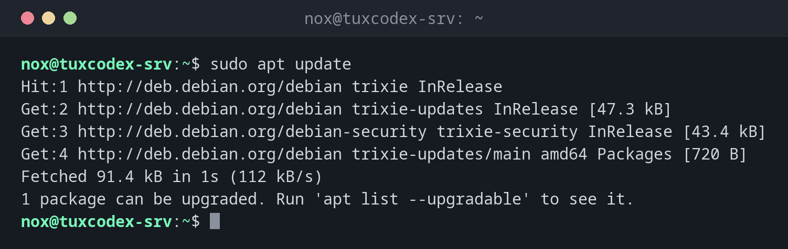

# apt

> Der Paketmanager von Debian und Ubuntu: installiert, aktualisiert und entfernt Software aus den Paketquellen und löst Abhängigkeiten automatisch auf.



## Syntax

```bash
apt [OPTION]... BEFEHL [PAKET]...
```

## Optionen

| Befehl | Beschreibung |
|--------|--------------|
| `update` | Die aktuellen Paketlisten aus den Paketquellen herunterladen |
| `upgrade` | Alle verfügbaren Updates installieren |
| `full-upgrade` | Wie `upgrade`, entfernt aber auch Pakete, wenn ein Update das verlangt |
| `install PAKET` | Ein Paket samt Abhängigkeiten installieren |
| `remove PAKET` | Ein Paket entfernen, seine Konfigurationsdateien behalten |
| `purge PAKET` | Ein Paket samt Konfigurationsdateien entfernen |
| `autoremove` | Abhängigkeiten entfernen, die nichts mehr braucht |
| `search WORT` | Namen und Beschreibungen durchsuchen |
| `show PAKET` | Details anzeigen: Version, Größe, Abhängigkeiten, Beschreibung |
| `list --upgradable` | Die Pakete auflisten, für die es ein Update gibt |
| `-y` | Alle Fragen mit Ja beantworten, für Skripte |

## Beispiele

**Die Paketlisten aktualisieren:**

```bash
sudo apt update
```

```text
Hit:1 http://deb.debian.org/debian trixie InRelease
Get:2 http://deb.debian.org/debian trixie-updates InRelease [47.3 kB]
Get:3 http://deb.debian.org/debian-security trixie-security InRelease [43.4 kB]
Get:4 http://deb.debian.org/debian trixie-updates/main amd64 Packages [720 B]
Fetched 91.4 kB in 1s (112 kB/s)
1 package can be upgraded. Run 'apt list --upgradable' to see it.
```

`update` ändert nichts am System. Es holt nur die Listen dessen, was verfügbar ist.

**Anzeigen, für welche Pakete es ein Update gibt:**

```bash
apt list --upgradable
```

```text
Listing... Done
tzdata/stable-updates 2026e-0+deb13u1 all [upgradable from: 2026c-0+deb13u1]
```

**Alle Updates installieren:**

```bash
sudo apt upgrade
```

```text
Upgrading:
  tzdata

Summary:
  Upgrading: 1, Installing: 0, Removing: 0, Not Upgrading: 0
  Download size: 266 kB
  Space needed: 1024 B / 18.4 GB available

Continue? [Y/n] y
Get:1 http://deb.debian.org/debian trixie-updates/main amd64 tzdata all 2026e-0+deb13u1 [266 kB]
Fetched 266 kB in 0s (5306 kB/s)
Preparing to unpack .../tzdata_2026e-0+deb13u1_all.deb ...
Unpacking tzdata (2026e-0+deb13u1) over (2026c-0+deb13u1) ...
Setting up tzdata (2026e-0+deb13u1) ...
```

**Ein Paket installieren:**

```bash
sudo apt install htop
```

```text
Installing:
  htop

Installing dependencies:
  libgpm2  libncursesw6

Suggested packages:
  lm-sensors  lsof  strace  gpm

Summary:
  Upgrading: 0, Installing: 3, Removing: 0, Not Upgrading: 0
  Download size: 321 kB
  Space needed: 909 kB / 18.4 GB available

Continue? [Y/n] y
Get:1 http://deb.debian.org/debian trixie/main amd64 libncursesw6 amd64 6.5+20250216-2 [135 kB]
Get:2 http://deb.debian.org/debian trixie/main amd64 htop amd64 3.4.1-5 [171 kB]
Get:3 http://deb.debian.org/debian trixie/main amd64 libgpm2 amd64 1.20.7-11+b2 [14.4 kB]
Fetched 321 kB in 0s (4825 kB/s)
Setting up libgpm2:amd64 (1.20.7-11+b2) ...
Setting up libncursesw6:amd64 (6.5+20250216-2) ...
Setting up htop (3.4.1-5) ...
```

`apt` zeigt, was es tun wird, und fragt vorher nach. `Suggested packages` werden nicht
installiert, sie sind nur Hinweise.

**Details eines Pakets anzeigen:**

```bash
apt show htop
```

```text
Package: htop
Version: 3.4.1-5
Priority: optional
Section: utils
Maintainer: Daniel Lange <DLange@debian.org>
Installed-Size: 434 kB
Depends: libc6 (>= 2.38), libncursesw6 (>= 6), libtinfo6 (>= 6)
Suggests: lm-sensors, lsof, strace
Homepage: https://htop.dev/
Download-Size: 171 kB
APT-Manual-Installed: yes
APT-Sources: http://deb.debian.org/debian trixie/main amd64 Packages
Description: interactive processes viewer
```

**Ein Paket und nicht mehr benötigte Abhängigkeiten entfernen:**

```bash
sudo apt remove htop
sudo apt autoremove
```

```text
REMOVING:
  htop

Summary:
  Upgrading: 0, Installing: 0, Removing: 1, Not Upgrading: 0
  Freed space: 434 kB

Continue? [Y/n] y
Removing htop (3.4.1-5) ...

REMOVING:
  libgpm2  libncursesw6

Summary:
  Upgrading: 0, Installing: 0, Removing: 2, Not Upgrading: 0
  Freed space: 475 kB

Continue? [Y/n] y
Removing libgpm2:amd64 (1.20.7-11+b2) ...
Removing libncursesw6:amd64 (6.5+20250216-2) ...
```

## Wann brauche ich das?

- Regelmäßig: `apt update` und `apt upgrade` halten den Server sicher
- Um Software für eine neue Aufgabe zu installieren, etwa einen Webserver oder eine Datenbank
- Um Pakete aufzuräumen, die du nicht mehr brauchst

!!! tip "Immer zuerst `update`"
    `apt install` und `apt upgrade` kennen nur, was das letzte `apt update`
    heruntergeladen hat. Führe vorher `sudo apt update` aus, sonst installierst du
    womöglich veraltete Versionen oder bekommst `404 Not Found`.

!!! tip "`apt` oder `apt-get`?"
    `apt` ist für die interaktive Arbeit gedacht, mit übersichtlicherer Ausgabe. In
    Skripten nimm `apt-get`: Seine Ausgabe bleibt zwischen Versionen gleich, und `apt`
    warnt selbst davor, wenn seine Ausgabe umgeleitet wird.

!!! warning "Vor dem Bestätigen lesen"
    Schau dir die Liste unter `REMOVING` an, bevor du mit `y` antwortest. Will eine
    Installation oder ein Update Pakete entfernen, die du brauchst, brich mit `n` ab und
    finde heraus, warum.

## Unterschiede zwischen Distributionen

| | Debian | Ubuntu | RHEL | Arch |
|---|--------|--------|------|------|
| Verfügbar | ja | ja | nein, `dnf` nutzen | nein, `pacman` nutzen |
| Konfiguration der Paketquellen | `/etc/apt/sources.list.d/debian.sources` | `/etc/apt/sources.list.d/ubuntu.sources` (seit 24.04) | entfällt | entfällt |

## Verwandte Befehle

[systemctl](../09-systemd/systemctl.md) · [htop](../08-processes/htop.md)
