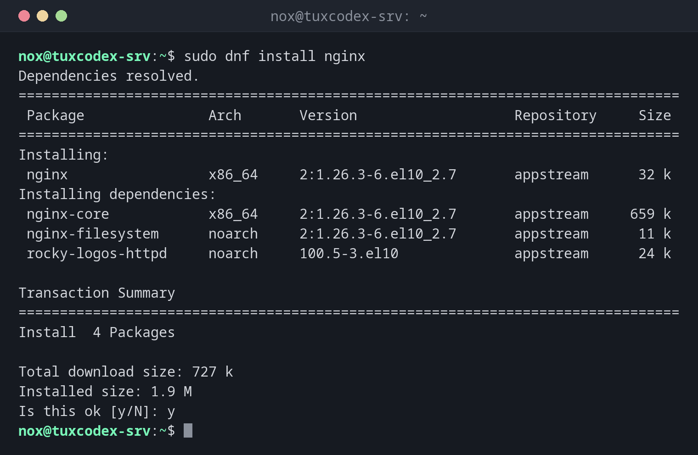

# dnf

> Der Paketmanager von RHEL, Rocky Linux und AlmaLinux: installiert, aktualisiert und entfernt Software aus den Paketquellen und führt eine Historie jeder Änderung.



## Syntax

```bash
dnf [OPTION]... BEFEHL [PAKET]...
```

## Optionen

| Befehl | Beschreibung |
|--------|--------------|
| `install PAKET` | Ein Paket samt Abhängigkeiten installieren |
| `upgrade` | Alle verfügbaren Updates installieren |
| `check-update` | Verfügbare Updates auflisten, ohne sie zu installieren |
| `remove PAKET` | Ein Paket und nicht mehr benötigte Abhängigkeiten entfernen |
| `search WORT` | Namen und Zusammenfassungen durchsuchen |
| `info PAKET` | Details eines Pakets anzeigen |
| `provides PFAD` | Das Paket finden, das eine Datei enthält |
| `history` | Alle bisherigen Transaktionen auflisten |
| `history undo ID` | Eine Transaktion rückgängig machen |
| `-y` | Alle Fragen mit Ja beantworten, für Skripte |

## Beispiele

**Ein Paket installieren:**

```bash
sudo dnf install nginx
```

```text
Dependencies resolved.
================================================================================
 Package               Arch       Version                   Repository     Size
================================================================================
Installing:
 nginx                 x86_64     2:1.26.3-6.el10_2.7       appstream      32 k
Installing dependencies:
 nginx-core            x86_64     2:1.26.3-6.el10_2.7       appstream     659 k
 nginx-filesystem      noarch     2:1.26.3-6.el10_2.7       appstream      11 k
 rocky-logos-httpd     noarch     100.5-3.el10              appstream      24 k

Transaction Summary
================================================================================
Install  4 Packages

Total download size: 727 k
Installed size: 1.9 M
Is this ok [y/N]: y
```

Nach der Bestätigung lädt und installiert `dnf` die Pakete und endet mit `Complete!`.
Unter RHEL ist der Dienst noch nicht gestartet: `sudo systemctl enable --now nginx`.

**Anzeigen, welche Updates verfügbar sind:**

```bash
dnf check-update
```

```text
Last metadata expiration check: 0:00:01 ago on Mon Oct 26 10:42:16 2026.

ca-certificates.noarch              2026.2.92_v9.0.319-100.3.el10_2       baseos
curl.x86_64                         8.12.1-4.el10_2.7                     baseos
expat.x86_64                        2.7.3-1.el10_2.7                      baseos
glib2.x86_64                        2.80.4-12.el10_2.22                   baseos
```

**Details eines Pakets anzeigen:**

```bash
dnf info nginx
```

```text
Installed Packages
Name         : nginx
Epoch        : 2
Version      : 1.26.3
Release      : 6.el10_2.7
Architecture : x86_64
Size         : 119 k
Source       : nginx-1.26.3-6.el10_2.7.src.rpm
Repository   : @System
From repo    : appstream
Summary      : A high performance web server and reverse proxy server
URL          : https://nginx.org
License      : BSD-2-Clause
```

**Das Paket finden, das einen Befehl enthält:**

```bash
dnf provides /usr/bin/dig
```

```text
bind-utils-32:9.18.33-15.el10_2.2.x86_64 : Utilities for querying DNS name servers
Repo        : appstream
Matched from:
Filename    : /usr/bin/dig
```

**Die Historie aller Änderungen anzeigen:**

```bash
sudo dnf history
```

```text
ID     | Command line             | Date and time    | Action(s)      | Altered
-------------------------------------------------------------------------------
     4 | install nginx            | 2026-10-26 10:41 | Install        |    4
     3 | upgrade                  | 2026-10-19 08:12 | I, U           |   46
     2 | install vim-enhanced     | 2026-10-14 07:52 | Install        |    3
     1 |                          | 2026-10-14 07:20 | Install        |  412
```

`sudo dnf history undo 4` würde nginx und seine Abhängigkeiten wieder entfernen.

**Ein Paket entfernen:**

```bash
sudo dnf remove nginx
```

```text
Dependencies resolved.
================================================================================
 Package               Arch       Version                  Repository      Size
================================================================================
Removing:
 nginx                 x86_64     2:1.26.3-6.el10_2.7      @appstream     119 k
Removing unused dependencies:
 nginx-core            x86_64     2:1.26.3-6.el10_2.7      @appstream     1.8 M
 nginx-filesystem      noarch     2:1.26.3-6.el10_2.7      @appstream     141
 rocky-logos-httpd     noarch     100.5-3.el10             @appstream      24 k

Transaction Summary
================================================================================
Remove  4 Packages

Freed space: 1.9 M
Is this ok [y/N]: y
```

## Wann brauche ich das?

- Unter RHEL, Rocky Linux und AlmaLinux für jede Installation und jedes Update
- Um herauszufinden, welches Paket einen fehlenden Befehl liefert
- Nach einem fehlerhaften Update: `dnf history` zeigt, was sich geändert hat,
  `history undo` macht es rückgängig

!!! tip "EPEL für zusätzliche Software"
    Viele Werkzeuge wie `htop` liegen nicht in den RHEL-Paketquellen, sondern in EPEL
    (Extra Packages for Enterprise Linux). Unter Rocky und Alma aktiviert
    `sudo dnf install epel-release` sie.

!!! tip "`dnf` entfernt ungenutzte Abhängigkeiten automatisch"
    Anders als `apt remove` entfernt `dnf remove` auch Abhängigkeiten, die nur das
    entfernte Paket gebraucht hat. Lies die Liste unter `Removing unused dependencies`,
    bevor du bestätigst.

!!! warning "Konfigurationsdateien bleiben"
    `dnf` kennt kein `purge`. Geänderte Konfigurationsdateien bleiben beim Entfernen als
    `.rpmsave` liegen. Lösche sie von Hand, wenn du sie nicht mehr brauchst.

## Unterschiede zwischen Distributionen

| | Debian | Ubuntu | RHEL | Arch |
|---|--------|--------|------|------|
| Verfügbar | nein, [`apt`](apt.md) nutzen | nein, [`apt`](apt.md) nutzen | ja | nein, `pacman` nutzen |
| Konfiguration der Paketquellen | entfällt | entfällt | `/etc/yum.repos.d/*.repo` | entfällt |

## Verwandte Befehle

[apt](apt.md) · [systemctl](../09-systemd/systemctl.md)
