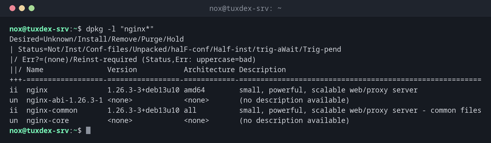

# dpkg

> The low-level package tool of Debian and Ubuntu: lists installed packages, shows which files belong to which package, and installs single `.deb` files.



## Syntax

```bash
dpkg [OPTION]... ACTION [PACKAGE | FILE]...
```

## Options

| Option | Description |
|--------|-------------|
| `-l [PATTERN]` | List installed packages with their state |
| `-L PACKAGE` | List the files of an installed package |
| `-S PATH` | Find the package that a file belongs to |
| `-s PACKAGE` | Show the state and details of a package |
| `-i FILE.deb` | Install a package file |
| `-I FILE.deb` | Show the details of a package file without installing it |
| `--configure -a` | Finish configuring packages after an interrupted installation |

## Examples

**Show installed packages matching a pattern:**

```bash
dpkg -l "nginx*"
```

```text
Desired=Unknown/Install/Remove/Purge/Hold
| Status=Not/Inst/Conf-files/Unpacked/halF-conf/Half-inst/trig-aWait/Trig-pend
|/ Err?=(none)/Reinst-required (Status,Err: uppercase=bad)
||/ Name               Version           Architecture Description
+++-==================-=================-============-=========================================================
ii  nginx              1.26.3-3+deb13u10 amd64        small, powerful, scalable web/proxy server
un  nginx-abi-1.26.3-1 <none>            <none>       (no description available)
ii  nginx-common       1.26.3-3+deb13u10 all          small, powerful, scalable web/proxy server - common files
un  nginx-core         <none>            <none>       (no description available)
```

| Code | Meaning |
|------|---------|
| `ii` | Installed and working |
| `rc` | Removed, but the configuration files are still there |
| `un` | Not installed, only known by name |
| `iF`, `iU` | Installation was interrupted, run `sudo dpkg --configure -a` |

**Find out which package a file belongs to:**

```bash
dpkg -S /usr/sbin/nginx /etc/nginx/nginx.conf
```

```text
nginx: /usr/sbin/nginx
nginx-common: /etc/nginx/nginx.conf
```

**List the files of a package:**

```bash
dpkg -L htop | head -n 8
```

```text
/.
/usr
/usr/bin
/usr/bin/htop
/usr/share
/usr/share/applications
/usr/share/applications/htop.desktop
/usr/share/doc
```

**Check whether a package is installed:**

```bash
dpkg -s nginx | head -n 3
```

```text
Package: nginx
Status: install ok installed
Priority: optional
```

**Install a downloaded package file:**

```bash
sudo dpkg -i htop_3.4.1-5_amd64.deb
```

```text
Selecting previously unselected package htop.
(Reading database ... 12414 files and directories currently installed.)
Preparing to unpack htop_3.4.1-5_amd64.deb ...
Unpacking htop (3.4.1-5) ...
dpkg: dependency problems prevent configuration of htop:
 htop depends on libncursesw6 (>= 6); however:
  Package libncursesw6 is not installed.

dpkg: error processing package htop (--install):
 dependency problems - leaving unconfigured
Errors were encountered while processing:
 htop
```

`dpkg` doesn't fetch dependencies. `sudo apt install -f` installs the missing ones and
finishes the installation.

## When do I need it?

- To find out which package a configuration file or program comes from
- To check which version of a package is installed exactly
- After an interrupted update, to finish it with `dpkg --configure -a`
- To find packages in state `rc` whose configuration files are still lying around

!!! tip "Install `.deb` files with `apt`"
    `sudo apt install ./htop_3.4.1-5_amd64.deb` installs a package file and fetches its
    dependencies from the repositories in one step. The `./` is important, otherwise
    `apt` searches the repositories for a package with that name.

!!! tip "Remove leftover configuration files"
    `dpkg -l | grep '^rc'` lists removed packages whose configuration files still
    exist. `sudo apt purge PACKAGE` removes them.

!!! warning "`.deb` files from the internet"
    A `.deb` file runs scripts as root during installation and gets no security
    updates from your repositories. Only install files from sources you trust.

## Distribution differences

| | Debian | Ubuntu | RHEL | Arch |
|---|--------|--------|------|------|
| Low-level package tool | `dpkg` | `dpkg` | `rpm` | `pacman` |
| Which package owns a file? | `dpkg -S` | `dpkg -S` | `rpm -qf` | `pacman -Qo` |

## Related commands

[apt](apt.md) · [apt-cache](apt-cache.md) · [apt-file](apt-file.md) · [rpm](rpm.md)
