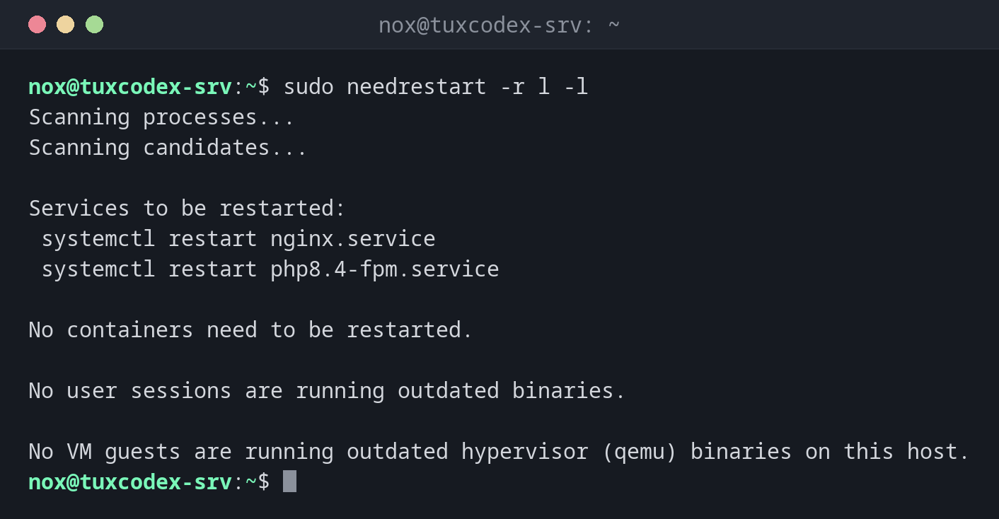

# needrestart

> Findet Dienste, die nach einem Update noch alte Bibliotheken nutzen, und zeigt, ob ein neuerer Kernel auf einen Neustart wartet.



## Syntax

```bash
needrestart [OPTION]...
```

## Optionen

| Option | Beschreibung |
|--------|--------------|
| `-r l` | Die Dienste nur auflisten, nicht neu starten |
| `-r a` | Die betroffenen Dienste automatisch neu starten |
| `-r i` | Bei jedem Dienst nachfragen (Standard bei interaktivem Aufruf) |
| `-k` | Nur den Kernel prüfen |
| `-l` | Nur Dienste und Bibliotheken prüfen |
| `-b` | Batch-Modus: maschinenlesbare Ausgabe für Skripte und Monitoring |

Unter Debian und Ubuntu läuft `needrestart` außerdem nach jedem `apt upgrade` automatisch.

## Beispiele

**Die Dienste auflisten, die einen Neustart brauchen:**

```bash
sudo needrestart -r l -l
```

```text
Scanning processes...
Scanning candidates...

Services to be restarted:
 systemctl restart nginx.service
 systemctl restart php8.4-fpm.service

No containers need to be restarted.

No user sessions are running outdated binaries.

No VM guests are running outdated hypervisor (qemu) binaries on this host.
```

Beide Dienste nutzen noch die alte Version einer gerade aktualisierten Bibliothek, etwa
OpenSSL. Bis sie neu gestartet sind, schützt die Sicherheitskorrektur sie nicht.

**Prüfen, ob ein neuerer Kernel wartet:**

```bash
sudo needrestart -k
```

```text
Scanning linux images...

Pending kernel upgrade!

Running kernel version:
  6.12.48+deb13-amd64

Diagnostics:
  The currently running kernel version is not the expected kernel version 6.12.57+deb13-amd64.

Restarting the system to load the new kernel will not be handled automatically, so you should consider rebooting. [Return]
```

**Alle betroffenen Dienste in einem Rutsch neu starten:**

```bash
sudo needrestart -r a -l
```

```text
Scanning processes...
Scanning candidates...
Restarting services...
 systemctl restart nginx.service php8.4-fpm.service

No containers need to be restarted.

No user sessions are running outdated binaries.

No VM guests are running outdated hypervisor (qemu) binaries on this host.
```

**Maschinenlesbare Ausgabe für das Monitoring:**

```bash
sudo needrestart -b | grep -E "KSTA|SVC"
```

```text
NEEDRESTART-KSTA: 3
NEEDRESTART-SVC: nginx.service
NEEDRESTART-SVC: php8.4-fpm.service
```

`KSTA: 3` bedeutet: Eine neuere Kernelversion ist installiert, ein Neustart ist nötig.
`1` heißt, der Kernel ist aktuell.

## Wann brauche ich das?

- Nach jedem Update von Bibliotheken wie OpenSSL oder glibc
- Um zu entscheiden, ob der Neustart einiger Dienste reicht oder ein Reboot nötig ist
- Im Monitoring, um gewarnt zu werden, wenn ein Server einen Neustart braucht

!!! tip "Dienste neu starten statt des Servers"
    Bei Bibliotheks-Updates reicht meist ein Neustart der betroffenen Dienste. Der Server
    läuft weiter, und nur ein Reboot für einen neuen Kernel braucht ein Wartungsfenster.

!!! warning "Nicht jeder Dienst lässt sich neu starten"
    Manche Dienste startet `needrestart` nicht automatisch neu, etwa den Display-Manager
    oder den D-Bus-Daemon, weil das deine Sitzung beenden könnte. Es listet sie unter
    `Service restarts being deferred` auf.

## Unterschiede zwischen Distributionen

| | Debian | Ubuntu | RHEL | Arch |
|---|--------|--------|------|------|
| Werkzeug | `needrestart`, installieren mit `sudo apt install needrestart` | `needrestart`, installiert | `sudo dnf needs-restarting` (`-s` Dienste, `-r` Neustart) | kein Standardwerkzeug: aktualisierte Dienste neu starten oder neu booten |
| Läuft nach Updates automatisch | ja, als apt-Hook | ja, als apt-Hook | nein | nein |

## Verwandte Befehle

[unattended-upgrade](unattended-upgrade.md) · [apt](apt.md) · [systemctl](../09-systemd/systemctl.md) · [reboot](../09-systemd/reboot.md)
