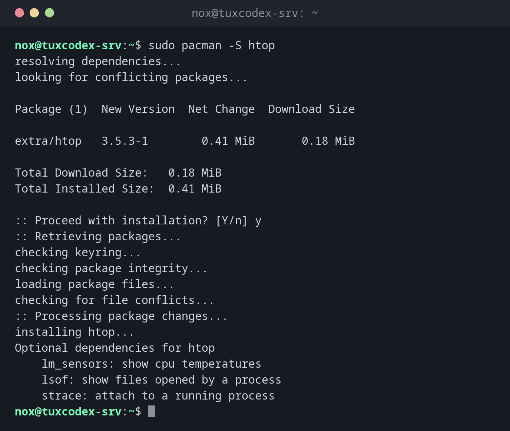

# pacman

> The package manager of Arch Linux: installs, updates and removes packages, and queries both the repositories and the installed packages, all in one tool.



## Syntax

```bash
pacman OPERATION [OPTION]... [PACKAGE]...
```

The first capital letter selects the operation: `-S` works with the repositories (sync),
`-Q` with the installed packages (query), `-R` removes.

## Options

| Option | Description |
|--------|-------------|
| `-Syu` | Refresh the package lists and install all updates |
| `-S PACKAGE` | Install a package |
| `-Ss WORD` | Search the repositories |
| `-Si PACKAGE` | Show details of a package in the repositories |
| `-Q` | List installed packages (`-Qe`: only those installed explicitly) |
| `-Qi PACKAGE` | Show details of an installed package |
| `-Qo PATH` | Find the package that owns a file |
| `-Qdt` | List orphans: dependencies that nothing needs anymore |
| `-R PACKAGE` | Remove a package (`-Rns`: also unneeded dependencies and configuration) |
| `-Sc` | Remove old package files from the cache |

## Examples

**Install a package:**

```bash
sudo pacman -S htop
```

```text
resolving dependencies...
looking for conflicting packages...

Package (1)  New Version  Net Change  Download Size

extra/htop   3.5.3-1        0.41 MiB       0.18 MiB

Total Download Size:   0.18 MiB
Total Installed Size:  0.41 MiB

:: Proceed with installation? [Y/n] y
:: Retrieving packages...
checking keyring...
checking package integrity...
loading package files...
checking for file conflicts...
:: Processing package changes...
installing htop...
Optional dependencies for htop
    lm_sensors: show cpu temperatures
    lsof: show files opened by a process
    strace: attach to a running process
```

**Update the whole system:**

```bash
sudo pacman -Syu
```

```text
:: Synchronizing package databases...
 core downloading...
 extra downloading...
:: Starting full system upgrade...
 there is nothing to do
```

**Search the repositories:**

```bash
pacman -Ss "^nginx$"
```

```text
extra/nginx 1.30.6-2 [installed]
    Lightweight HTTP server and IMAP/POP3 proxy server
```

**Find out which package a file belongs to:**

```bash
pacman -Qo /usr/bin/nginx
```

```text
/usr/bin/nginx is owned by nginx 1.30.6-2
```

**Find and remove orphaned dependencies:**

```bash
pacman -Qdt
```

```text
mailcap 2.1.54-3
```

`mailcap` was installed as a dependency of nginx. After removing nginx, nothing needs it
anymore. `sudo pacman -Rns $(pacman -Qdtq)` removes all orphans.

**Remove a package:**

```bash
sudo pacman -R nginx
```

```text
checking dependencies...

Package (1)  Old Version  Net Change

nginx        1.30.6-2      -1.68 MiB

Total Removed Size:  1.68 MiB

:: Do you want to remove these packages? [Y/n] y
:: Processing package changes...
removing nginx...
```

## When do I need it?

- On Arch for every installation and every update
- To find out which package a file belongs to, or which packages are orphaned
- To keep the system clean on a rolling release, where packages change often

!!! tip "Read the news before updating"
    Arch sometimes needs manual steps during an update. They are announced on
    <https://archlinux.org/news/>. Check the news before every `pacman -Syu` on a server.

!!! warning "No partial updates"
    Never run `pacman -Sy PACKAGE`: it refreshes the package lists but only updates one
    package. That can break libraries. Always use `pacman -Syu`, also before installing.

!!! warning "Services aren't started"
    On Arch, a new service is neither enabled nor started after installing. Use
    `sudo systemctl enable --now nginx`.

## Distribution differences

| | Debian | Ubuntu | RHEL | Arch |
|---|--------|--------|------|------|
| Available | no, use [`apt`](apt.md) | no, use [`apt`](apt.md) | no, use [`dnf`](dnf.md) | yes |
| Repository configuration | not applicable | not applicable | not applicable | `/etc/pacman.conf`, mirrors in `/etc/pacman.d/mirrorlist` |

## Related commands

[apt](apt.md) · [dnf](dnf.md) · [systemctl](../09-systemd/systemctl.md)
