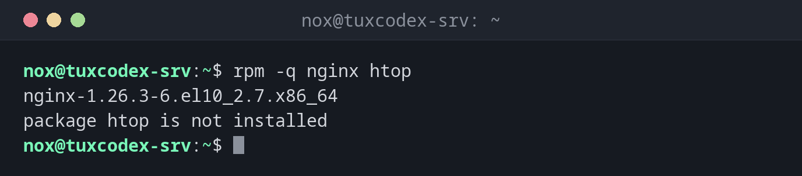

# rpm

> Das Paketwerkzeug der unteren Ebene von RHEL, Rocky Linux und AlmaLinux: fragt installierte Pakete ab, zeigt, welche Dateien zu welchem Paket gehören, und prüft, ob Dateien verändert wurden.



## Syntax

```bash
rpm [OPTION]... [PAKET | DATEI]...
```

## Optionen

| Option | Beschreibung |
|--------|--------------|
| `-q PAKET` | Ist das Paket installiert, und in welcher Version? |
| `-qa` | Alle installierten Pakete auflisten |
| `-qf PFAD` | Das Paket finden, zu dem eine Datei gehört |
| `-qi PAKET` | Details eines installierten Pakets anzeigen |
| `-ql PAKET` | Die Dateien eines Pakets auflisten |
| `-qc PAKET` | Nur seine Konfigurationsdateien auflisten |
| `-V PAKET` | Die Dateien eines Pakets mit der Paketdatenbank abgleichen |
| `--last` | Die Liste nach Installationsdatum sortieren, neueste zuerst |

## Beispiele

**Prüfen, ob ein Paket installiert ist:**

```bash
rpm -q nginx htop
```

```text
nginx-1.26.3-6.el10_2.7.x86_64
package htop is not installed
```

**Herausfinden, zu welchem Paket eine Datei gehört:**

```bash
rpm -qf /usr/sbin/nginx
```

```text
nginx-core-1.26.3-6.el10_2.7.x86_64
```

**Die Konfigurationsdateien eines Pakets auflisten:**

```bash
rpm -qc nginx-core | head -n 5
```

```text
/etc/logrotate.d/nginx
/etc/nginx/fastcgi.conf
/etc/nginx/fastcgi.conf.default
/etc/nginx/fastcgi_params
/etc/nginx/fastcgi_params.default
```

**Dateien finden, die nach der Installation verändert wurden:**

```bash
rpm -V nginx-core
```

```text
S.5....T.  c /etc/nginx/nginx.conf
```

| Buchstabe | Bedeutung |
|-----------|-----------|
| `S` | Größe weicht ab |
| `5` | Inhalt (Prüfsumme) weicht ab |
| `T` | Änderungszeit weicht ab |
| `c` | Es ist eine Konfigurationsdatei |

Eine geänderte Konfigurationsdatei ist normal. Eine geänderte Programmdatei wie
`/usr/sbin/nginx` ist ein Warnzeichen.

**Die zuletzt installierten Pakete anzeigen:**

```bash
rpm -qa --last | head -n 4
```

```text
rocky-logos-httpd-100.5-3.el10.noarch         Mon Oct 26 10:41:37 2026
nginx-filesystem-1.26.3-6.el10_2.7.noarch     Mon Oct 26 10:41:37 2026
nginx-core-1.26.3-6.el10_2.7.x86_64           Mon Oct 26 10:41:37 2026
nginx-1.26.3-6.el10_2.7.x86_64                Mon Oct 26 10:41:37 2026
```

## Wann brauche ich das?

- Um herauszufinden, aus welchem Paket eine Datei oder ein Befehl stammt
- Um zu sehen, welche Konfigurationsdateien eines Pakets du geändert hast
- Nach einem Sicherheitsvorfall: Wurden Programmdateien verändert?

!!! tip "Pakete mit `dnf` installieren"
    `rpm -i` kann einzelne `.rpm`-Dateien installieren, löst aber keine Abhängigkeiten
    auf. `sudo dnf install ./paket.rpm` macht das und holt fehlende Abhängigkeiten aus den
    Paketquellen.

!!! warning "`rpm -V` ist keine Einbruchserkennung"
    Ein Angreifer mit Root-Rechten kann auch die Paketdatenbank ändern. `rpm -V` findet
    versehentliche und einfache Änderungen, ersetzt aber kein eigenes Werkzeug wie AIDE.

## Unterschiede zwischen Distributionen

| | Debian | Ubuntu | RHEL | Arch |
|---|--------|--------|------|------|
| Paketwerkzeug der unteren Ebene | [`dpkg`](dpkg.md) | [`dpkg`](dpkg.md) | `rpm` | `pacman` |
| Zu welchem Paket gehört eine Datei? | `dpkg -S` | `dpkg -S` | `rpm -qf` | `pacman -Qo` |
| Dateien eines Pakets prüfen | `dpkg --verify` | `dpkg --verify` | `rpm -V` | `pacman -Qkk` |

## Verwandte Befehle

[dnf](dnf.md) · [dpkg](dpkg.md)
