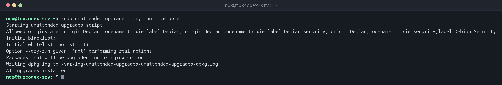

# unattended-upgrade

> Installs security updates automatically on Debian and Ubuntu, every day, without anyone having to log in.



## Syntax

```bash
unattended-upgrade [OPTION]...
```

Normally you don't run it by hand: the systemd timer `apt-daily-upgrade.timer` starts
it once a day. The package is called `unattended-upgrades`.

## Options

| Option | Description |
|--------|-------------|
| `--dry-run` | Only show what would be updated |
| `-v`, `--verbose` | Show more details |
| `-d`, `--debug` | Show everything, for troubleshooting |

Important files:

| File | Purpose |
|------|---------|
| `/etc/apt/apt.conf.d/20auto-upgrades` | Switches the daily update on or off |
| `/etc/apt/apt.conf.d/50unattended-upgrades` | Which origins are allowed, automatic reboot, mail |
| `/var/log/unattended-upgrades/` | Log of every run |

## Examples

**Test what would be updated:**

```bash
sudo unattended-upgrade --dry-run --verbose
```

```text
Starting unattended upgrades script
Allowed origins are: origin=Debian,codename=trixie,label=Debian, origin=Debian,codename=trixie,label=Debian-Security, origin=Debian,codename=trixie-security,label=Debian-Security
Initial blacklist:
Initial whitelist (not strict):
Option --dry-run given, *not* performing real actions
Packages that will be upgraded: nginx nginx-common
Writing dpkg log to /var/log/unattended-upgrades/unattended-upgrades-dpkg.log
All upgrades installed
```

Despite `All upgrades installed`, nothing was changed: `--dry-run` only simulates.

**Check whether automatic updates are switched on:**

```bash
cat /etc/apt/apt.conf.d/20auto-upgrades
```

```text
APT::Periodic::Update-Package-Lists "1";
APT::Periodic::Unattended-Upgrade "1";
```

`"1"` means: every day. If the file is missing or contains `"0"`, nothing is updated
automatically.

**Find out when it runs:**

```bash
systemctl list-timers "apt-daily*"
```

```text
NEXT                        LEFT LAST                        PASSED       UNIT                    ACTIVATES
Mon 2026-10-26 18:07:44 CET   7h Mon 2026-10-26 07:12:30 CET 3h 29min ago apt-daily.timer         apt-daily.service
Tue 2026-10-27 06:31:07 CET  19h Mon 2026-10-26 06:24:09 CET 4h 18min ago apt-daily-upgrade.timer apt-daily-upgrade.service
```

`apt-daily` downloads the package lists, `apt-daily-upgrade` installs the updates.

**See what was installed last night:**

```bash
tail -n 4 /var/log/unattended-upgrades/unattended-upgrades.log
```

```text
2026-10-26 06:24:09,942 INFO Initial whitelist (not strict):
2026-10-26 06:24:11,226 INFO Packages that will be upgraded: nginx nginx-common
2026-10-26 06:24:11,226 INFO Writing dpkg log to /var/log/unattended-upgrades/unattended-upgrades-dpkg.log
2026-10-26 06:24:13,324 INFO All upgrades installed
```

## When do I need it?

- On every Debian or Ubuntu server that is reachable from the internet
- To make sure security updates arrive within a day, also during holidays
- After an update problem: the log shows what was installed and when

!!! tip "Switch it on"
    `sudo apt install unattended-upgrades`, then
    `sudo dpkg-reconfigure -plow unattended-upgrades` and answer `Yes`. This creates
    `20auto-upgrades` with the right values.

!!! tip "Reboot automatically"
    Kernel updates only take effect after a reboot. In `50unattended-upgrades`,
    `Unattended-Upgrade::Automatic-Reboot "true";` and
    `Unattended-Upgrade::Automatic-Reboot-Time "04:00";` reboot at night when needed.

!!! warning "Services keep the old version"
    A running service keeps using the old library until it is restarted. Check with
    `needrestart` which services need a restart after an update.

## Distribution differences

| | Debian | Ubuntu | RHEL | Arch |
|---|--------|--------|------|------|
| Automatic security updates | `unattended-upgrades`, often not installed on minimal systems | `unattended-upgrades`, installed and active | `dnf-automatic` with `dnf-automatic.timer` | not intended, update by hand with `pacman -Syu` |

## Related commands

[apt](apt.md) · [apt-mark](apt-mark.md) · [systemctl](../09-systemd/systemctl.md) · [journalctl](../09-systemd/journalctl.md)
