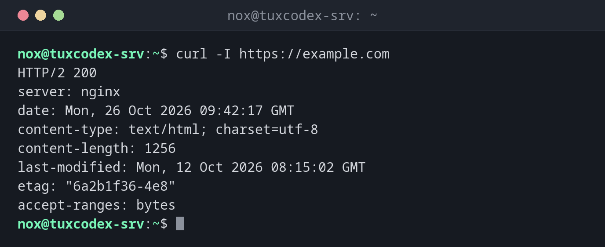

# curl

> Sends requests to web servers and APIs and shows the answer. The tool for testing websites, checking certificates and talking to REST APIs on the command line.



## Syntax

```bash
curl [OPTION]... URL
```

## Options

| Option | Description |
|--------|-------------|
| `-I` | Only fetch the headers (`HEAD` request) |
| `-L` | Follow redirects |
| `-o FILE`, `-O` | Save to `FILE`, or under the name from the URL |
| `-s`, `-S` | Silent, but `-S` still shows errors |
| `-f` | Fail with an error on HTTP errors like `404` |
| `-v` | Verbose: connection, TLS and all headers |
| `-w FORMAT` | Print values after the request, e.g. `%{http_code}` |
| `-X METHOD`, `-d DATA` | Method and body, e.g. for `POST` requests |
| `-H "Header: value"` | Send an additional header |
| `--resolve HOST:PORT:IP` | Connect to a specific IP for this host name |

## Examples

**Show the headers of a website:**

```bash
curl -I https://example.com
```

```text
HTTP/2 200
server: nginx
date: Mon, 26 Oct 2026 09:42:17 GMT
content-type: text/html; charset=utf-8
content-length: 1256
last-modified: Mon, 12 Oct 2026 08:15:02 GMT
etag: "6a2b1f36-4e8"
accept-ranges: bytes
```

**Only the status code and the response time:**

```bash
curl -sS -o /dev/null -w "%{http_code} %{time_total}s\n" https://example.com
```

```text
200 0.084215s
```

**Follow a redirect from HTTP to HTTPS:**

```bash
curl -sIL http://example.com | grep -iE "^(HTTP|location)"
```

```text
HTTP/1.1 301 Moved Permanently
Location: https://example.com/
HTTP/2 200
```

**Check when the TLS certificate expires:**

```bash
curl -svI https://example.com 2>&1 | grep -E "subject:|issuer:|expire date:"
```

```text
*  subject: CN=example.com
*  expire date: Dec 13 23:59:59 2026 GMT
*  issuer: C=US; O=Let's Encrypt; CN=R12
```

**Test a website on the new server before changing DNS:**

```bash
curl -I --resolve example.com:443:192.0.2.10 https://example.com
```

```text
HTTP/2 200
server: nginx
date: Mon, 26 Oct 2026 09:42:17 GMT
content-type: text/html; charset=utf-8
content-length: 1256
last-modified: Mon, 12 Oct 2026 08:15:02 GMT
etag: "6a2b1f36-4e8"
accept-ranges: bytes
```

`curl` connects to `192.0.2.10`, but sends `example.com` as the host name and checks
the certificate for it, exactly as a browser would after the DNS change.

**Call a JSON API:**

```bash
curl -s -H "Accept: application/json" https://api.example.com/v1/status
```

```text
{"status":"ok","version":"2.4.1","uptime":1051200}
```

Pipe it to [`jq`](../05-text-processing/jq.md) for readable output.

**When nothing listens on the port:**

```bash
curl http://192.0.2.20:8080/
```

```text
curl: (7) Failed to connect to 192.0.2.20 port 8080 after 1 ms: Could not connect to server
```

## When do I need it?

- To test whether a website or API answers, and with which status code
- To check redirects, headers and the TLS certificate of a site
- To test a new server under the real host name before switching DNS
- In scripts and health checks, for example with `-f` and the exit code

!!! tip "`-f` for scripts"
    Without `-f`, `curl` exits with `0` even on a `500` error page. With `-fsS`, it fails
    on HTTP errors, stays quiet on success and still shows the error message.

!!! warning "Never use `-k` permanently"
    `-k` (`--insecure`) ignores certificate errors. That's fine for a quick test, but in
    scripts it hides expired certificates and man-in-the-middle attacks.

## Related commands

[wget](wget.md) · [nc](nc.md) · [dig](dig.md) · [jq](../05-text-processing/jq.md)
