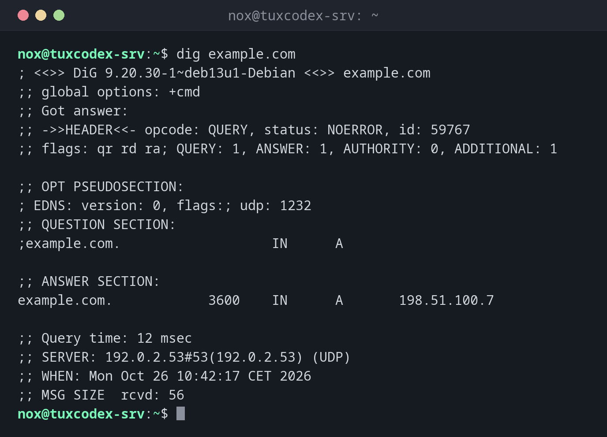

# dig

> Asks DNS servers directly and shows their full answer: which address a name has, which mail server is responsible, and which DNS server answered.



## Syntax

```bash
dig [@SERVER] NAME [TYPE] [+OPTION]...
```

## Options

| Option | Description |
|--------|-------------|
| `TYPE` | Record type: `A` (default), `AAAA`, `MX`, `TXT`, `NS`, `CNAME`, `SOA` |
| `@SERVER` | Ask this DNS server instead of the configured one |
| `+short` | Only print the answer |
| `-x ADDRESS` | Reverse lookup: which name belongs to an IP address |
| `+trace` | Follow the resolution from the root servers down |
| `+noall +answer` | Only print the answer section in full format |

## Examples

**Look up the address of a name:**

```bash
dig example.com
```

```text
; <<>> DiG 9.20.30-1~deb13u1-Debian <<>> example.com
;; global options: +cmd
;; Got answer:
;; ->>HEADER<<- opcode: QUERY, status: NOERROR, id: 59767
;; flags: qr rd ra; QUERY: 1, ANSWER: 1, AUTHORITY: 0, ADDITIONAL: 1

;; OPT PSEUDOSECTION:
; EDNS: version: 0, flags:; udp: 1232
;; QUESTION SECTION:
;example.com.                   IN      A

;; ANSWER SECTION:
example.com.            3600    IN      A       198.51.100.7

;; Query time: 12 msec
;; SERVER: 192.0.2.53#53(192.0.2.53) (UDP)
;; WHEN: Mon Oct 26 10:42:17 CET 2026
;; MSG SIZE  rcvd: 56
```

| Part | Meaning |
|------|---------|
| `status: NOERROR` | The name exists. `NXDOMAIN` means: it doesn't |
| `ANSWER SECTION` | The answer: name, TTL in seconds, class, type, value |
| `SERVER` | The DNS server that answered |
| `Query time` | How long the answer took |

**Only the answer, for scripts:**

```bash
dig +short example.com AAAA
```

```text
2001:db8:1::7
```

**Find the mail server of a domain:**

```bash
dig +short example.com MX
```

```text
10 mail.example.com.
```

**Ask a specific DNS server:**

```bash
dig @198.51.100.53 example.com +noall +answer
```

```text
example.com.            3600    IN      A       198.51.100.7
```

If two DNS servers give different answers, a change hasn't arrived everywhere yet, or one
server is configured wrongly.

**Find the name of an IP address:**

```bash
dig +short -x 198.51.100.7
```

```text
example.com.
```

**A name that doesn't exist:**

```bash
dig nosuch.example.com | grep status
```

```text
;; ->>HEADER<<- opcode: QUERY, status: NXDOMAIN, id: 40112
```

## When do I need it?

- After changing a DNS record: has the change arrived?
- When mail doesn't arrive: are `MX` and `TXT` (SPF) records correct?
- When a name resolves differently on different servers

!!! tip "Watch the TTL"
    The number after the name is the TTL: how many seconds a DNS server may cache the
    answer. After a change, old answers can stay around for that long.

!!! warning "`dig` ignores `/etc/hosts`"
    `dig` always asks DNS. Entries in `/etc/hosts` don't appear. To see what programs
    really use, run `getent hosts example.com`.

## Distribution differences

| | Debian | Ubuntu | RHEL | Arch |
|---|--------|--------|------|------|
| Package | `bind9-dnsutils` | `bind9-dnsutils` (installed) | `bind-utils` | `bind` |

## Related commands

[host](host.md) · [resolvectl](resolvectl.md) · [getent](../07-users-groups/getent.md) · [ping](ping.md)
