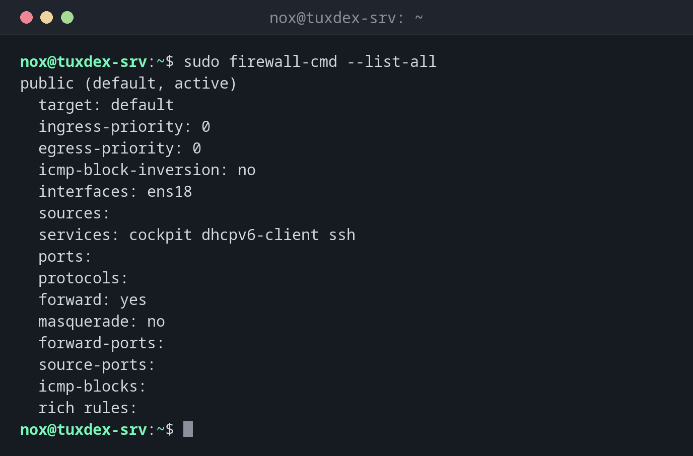

# firewall-cmd

> The command line tool of firewalld, the firewall of RHEL, Rocky Linux and AlmaLinux: opens services and ports in zones, temporarily or permanently.



## Syntax

```bash
firewall-cmd [OPTION]...
```

firewalld distinguishes two configurations: the **runtime** configuration is active now and lost at the next reload; the **permanent** configuration is saved and loaded at boot.

## Options

| Option | Description |
|--------|-------------|
| `--state` | Is firewalld running? |
| `--list-all` | Everything in the default zone: interfaces, services, ports, rules |
| `--add-service=NAME` | Allow a predefined service like `http` or `ssh` |
| `--add-port=PORT/PROTO` | Allow a port |
| `--remove-service`, `--remove-port` | Remove it again |
| `--add-rich-rule='…'` | Detailed rule, e.g. only from a certain network |
| `--permanent` | Change the saved configuration instead of the running one |
| `--reload` | Load the permanent configuration |
| `--get-services` | List all predefined services |

## Examples

**Show the active zone and what it allows:**

```bash
sudo firewall-cmd --list-all
```

```text
public (default, active)
  target: default
  ingress-priority: 0
  egress-priority: 0
  icmp-block-inversion: no
  interfaces: ens18
  sources:
  services: cockpit dhcpv6-client ssh
  ports:
  protocols:
  forward: yes
  masquerade: no
  forward-ports:
  source-ports:
  icmp-blocks:
  rich rules:
```

On a fresh RHEL server, only `ssh`, `cockpit` and `dhcpv6-client` are allowed.

**Open HTTP and HTTPS permanently:**

```bash
sudo firewall-cmd --permanent --add-service=http --add-service=https
sudo firewall-cmd --reload
```

```text
success
success
```

Each command answers `success`. Without `--reload`, the permanent change wouldn't be
active yet.

**Open a port for testing, only until the next reload:**

```bash
sudo firewall-cmd --add-port=8080/tcp
```

```text
success
```

**Allow the database only from the own network:**

```bash
sudo firewall-cmd --permanent --add-rich-rule='rule family="ipv4" source address="192.0.2.0/24" port port="5432" protocol="tcp" accept'
```

```text
success
```

**Check the result:**

```bash
sudo firewall-cmd --reload
sudo firewall-cmd --list-all
```

```text
success
public (default, active)
  target: default
  ingress-priority: 0
  egress-priority: 0
  icmp-block-inversion: no
  interfaces: ens18
  sources:
  services: cockpit dhcpv6-client http https ssh
  ports:
  protocols:
  forward: yes
  masquerade: no
  forward-ports:
  source-ports:
  icmp-blocks:
  rich rules:
        rule family="ipv4" source address="192.0.2.0/24" port port="5432" protocol="tcp" accept
```

Port `8080/tcp` is gone: it was only added to the runtime configuration and the reload
discarded it. The rich rule stays, because it was saved with `--permanent`.

## When do I need it?

- On RHEL, Rocky and Alma, after installing a service: the port is closed by default
- To allow a port only from certain networks
- When a service runs but can't be reached from outside

!!! tip "Test first, then save"
    Add a rule without `--permanent` and test it. If everything works,
    `sudo firewall-cmd --runtime-to-permanent` saves the running configuration.

!!! warning "Forgotten `--permanent`"
    Rules without `--permanent` are gone after a reload or reboot. If a port is suddenly
    closed again after a reboot, this is almost always the reason.

## Distribution differences

| | Debian | Ubuntu | RHEL | Arch |
|---|--------|--------|------|------|
| Firewall tool | `ufw` or `nft` | `ufw` | `firewall-cmd`, active by default | `ufw`, `nft` or `firewalld` |

## Related commands

[ufw](ufw.md) · [nft](nft.md) · [ss](ss.md)
