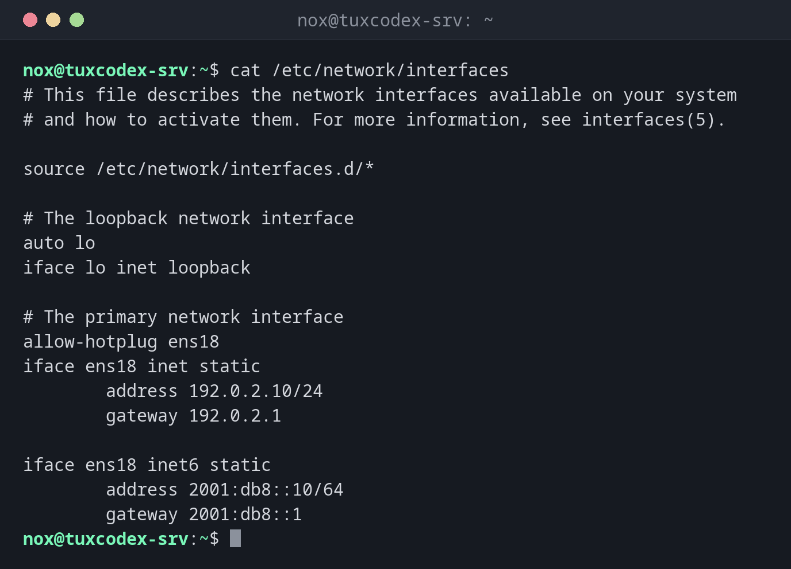

# ifup

> Brings network interfaces up and down on Debian, according to `/etc/network/interfaces`. `ifdown` is the counterpart.



## Syntax

```bash
ifup [OPTION]... INTERFACE
ifdown [OPTION]... INTERFACE
```

Both belong to the package `ifupdown`, which Debian uses on servers. Without `-v`, they print nothing when everything works.

## Options

| Option | Description |
|--------|-------------|
| `ifup DEV` | Bring up an interface as configured |
| `ifdown DEV` | Take an interface down |
| `-a` | All interfaces marked with `auto` |
| `-v` | Show every command that is run |
| `--no-act` | Only show what would be done |
| `ifquery DEV` | Show the configuration of an interface |
| `ifquery --state` | Show which interfaces ifupdown considers up |

## Examples

**The configuration of the example server:**

```bash
cat /etc/network/interfaces
```

```text
# This file describes the network interfaces available on your system
# and how to activate them. For more information, see interfaces(5).

source /etc/network/interfaces.d/*

# The loopback network interface
auto lo
iface lo inet loopback

# The primary network interface
allow-hotplug ens18
iface ens18 inet static
        address 192.0.2.10/24
        gateway 192.0.2.1

iface ens18 inet6 static
        address 2001:db8::10/64
        gateway 2001:db8::1
```

`allow-hotplug` brings the interface up as soon as it appears, `auto` at boot. The
settings below `iface` are indented by a tab.

**Add a block for a second interface:**

```bash
tail -n 3 /etc/network/interfaces
```

```text
auto ens19
iface ens19 inet static
        address 198.51.100.10/24
```

**Bring up the new interface:**

```bash
sudo ifup -v ens19
```

```text
ifup: configuring interface ens19=ens19 (inet)
run-parts --exit-on-error --verbose /etc/network/if-pre-up.d
ip addr add 198.51.100.10/255.255.255.0 broadcast 198.51.100.255          dev ens19 label ens19
ip link set dev ens19   up
run-parts --exit-on-error --verbose /etc/network/if-up.d
```

`-v` shows the `ip` commands that `ifup` runs. Without it, nothing is printed.

**Show what ifupdown reads from the configuration:**

```bash
ifquery ens18
```

```text
address: 192.0.2.10
gateway: 192.0.2.1
broadcast: 192.0.2.255
netmask: 255.255.255.0
```

**Which interfaces are up according to ifupdown:**

```bash
ifquery --state
```

```text
lo=lo
ens18=ens18
ens19=ens19
```

**The address is already set:**

```bash
sudo ifup ens19
```

```text
Error: ipv4: Address already assigned.
ifup: failed to bring up ens19
```

Someone already added the address by hand with `ip`. Remove it with
`sudo ip address del 198.51.100.10/24 dev ens19`, then run `ifup` again.

## When do I need it?

- On Debian, to activate a changed or new interface without rebooting
- To check what the configuration really contains, with `ifquery`
- After a network change, together with `ip` to verify the result

!!! tip "Restart networking without losing SSH"
    `sudo systemctl restart networking` takes all interfaces down and up again. Over SSH,
    run it in one command or with `nohup`, so the session doesn't end in the middle.

!!! danger "`ifdown` on the SSH interface"
    `sudo ifdown ens18` ends your SSH session on the spot, and the interface stays down.
    Change the main interface only with access to the hosting console.

## Distribution differences

| | Debian | Ubuntu | RHEL | Arch |
|---|--------|--------|------|------|
| Available | yes, default on servers | package `ifupdown`, not used by default | no, use `nmcli` | no, use `networkctl` |

## Related commands

[ip](ip.md) · [nmcli](nmcli.md) · [netplan](netplan.md)
