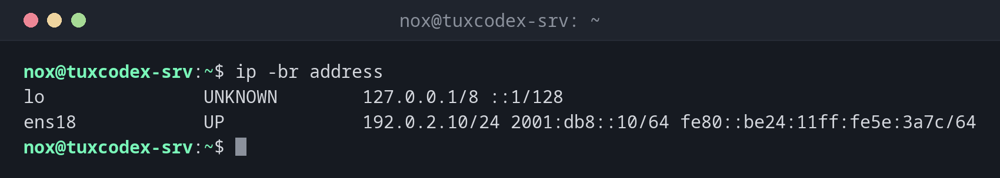

# ip

> Shows and changes network interfaces, IP addresses and routes. The central network tool on Linux, replacing the old `ifconfig` and `route`.



## Syntax

```bash
ip [OPTION]... OBJECT [COMMAND]
```

Objects can be abbreviated: `ip a` is `ip address`, `ip r` is `ip route`.

## Options

| Command | Description |
|---------|-------------|
| `ip address` | Interfaces with their IP addresses |
| `ip link` | Interfaces with state and MAC address |
| `ip route` | Routing table, including the default gateway |
| `ip route get ADDRESS` | Which route and source address would be used |
| `ip neigh` | Neighbour table: MAC addresses in the local network (ARP) |
| `-br` | Brief output, one line per interface |
| `-s` | Add statistics: bytes, packets, errors |
| `-4`, `-6` | Only IPv4 or only IPv6 |
| `ip address add`, `del` | Add or remove an address (temporarily) |
| `ip link set DEV up`, `down` | Switch an interface on or off |

## Examples

**Show all interfaces and addresses at a glance:**

```bash
ip -br address
```

```text
lo               UNKNOWN        127.0.0.1/8 ::1/128
ens18            UP             192.0.2.10/24 2001:db8::10/64 fe80::be24:11ff:fe5e:3a7c/64
```

**Show the full details of an interface:**

```bash
ip address show ens18
```

```text
2: ens18: <BROADCAST,MULTICAST,UP,LOWER_UP> mtu 1500 qdisc fq_codel state UP group default qlen 1000
    link/ether bc:24:11:5e:3a:7c brd ff:ff:ff:ff:ff:ff
    altname enp0s18
    inet 192.0.2.10/24 brd 192.0.2.255 scope global ens18
       valid_lft forever preferred_lft forever
    inet6 2001:db8::10/64 scope global
       valid_lft forever preferred_lft forever
    inet6 fe80::be24:11ff:fe5e:3a7c/64 scope link
       valid_lft forever preferred_lft forever
```

| Part | Meaning |
|------|---------|
| `UP,LOWER_UP` | The interface is on and has a link (cable or virtual connection) |
| `link/ether` | MAC address |
| `inet` | IPv4 address with prefix length |
| `inet6 ... scope global` | Public IPv6 address |
| `inet6 ... scope link` | Link-local IPv6 address, only valid in the local network |

**Show the routing table and the default gateway:**

```bash
ip route
```

```text
default via 192.0.2.1 dev ens18
192.0.2.0/24 dev ens18 proto kernel scope link src 192.0.2.10
```

**Find out which way a packet would take:**

```bash
ip route get 198.51.100.23
```

```text
198.51.100.23 via 192.0.2.1 dev ens18 src 192.0.2.10 uid 1000
    cache
```

**Show traffic and errors of an interface:**

```bash
ip -s link show ens18
```

```text
2: ens18: <BROADCAST,MULTICAST,UP,LOWER_UP> mtu 1500 qdisc fq_codel state UP mode DEFAULT group default qlen 1000
    link/ether bc:24:11:5e:3a:7c brd ff:ff:ff:ff:ff:ff
    RX:   bytes  packets errors dropped  missed   mcast
    18734523110 21483922      0      12       0       0
    TX:   bytes  packets errors dropped carrier collsns
     9876543210 14522871      0       0       0       0
    altname enp0s18
```

**Add a second address temporarily:**

```bash
sudo ip address add 192.0.2.11/24 dev ens18
ip -br address show ens18
```

```text
ens18            UP             192.0.2.10/24 192.0.2.11/24 2001:db8::10/64 fe80::be24:11ff:fe5e:3a7c/64
```

## When do I need it?

- To find out the server's addresses and which interface is used
- When the server can't reach the internet: is there a default route?
- To check an interface for errors and dropped packets
- To test an additional address before you put it into the configuration

!!! tip "`-br` and `-c` for a quick overview"
    `ip -br -c a` shows one coloured line per interface. That's usually all you need.

!!! warning "Changes are temporary"
    Everything you change with `ip` is gone after a reboot or a network restart. Put
    permanent changes into the network configuration of your distribution, see the
    [basics](basics.md).

!!! danger "`ip link set ... down` over SSH"
    Switching off the interface you are connected through ends your SSH session
    immediately, and you can't switch it on again remotely.

## Related commands

[hostname](../01-orientation/hostname.md)
