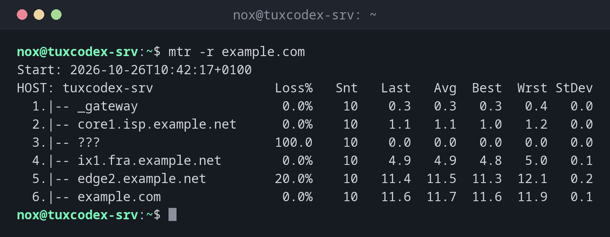

# mtr

> Verbindet `ping` und `traceroute`: misst den Weg zu einem Host fortlaufend und zeigt Paketverlust und Antwortzeiten für jeden Router.



## Syntax

```bash
mtr [OPTION]... HOST
```

Ohne Optionen zeigt `mtr` eine Live-Ansicht, die sich jede Sekunde aktualisiert. Beenden
mit ++q++.

## Optionen

| Option | Beschreibung |
|--------|--------------|
| `-r`, `--report` | Berichtsmodus: messen und das Ergebnis einmal ausgeben |
| `-c ANZAHL` | Anzahl der Runden, im Berichtsmodus Standard `10` |
| `-n` | Routernamen nicht auflösen |
| `-w` | Breiter Bericht: vollständige Hostnamen zeigen |
| `-T -P PORT` | TCP zu diesem Port statt ICMP nutzen |
| `-4`, `-6` | IPv4 oder IPv6 erzwingen |

## Beispiele

**Einen Bericht für einen Host erstellen:**

```bash
mtr -r example.com
```

```text
Start: 2026-10-26T10:42:17+0100
HOST: tuxcodex-srv                Loss%   Snt   Last   Avg  Best  Wrst StDev
  1.|-- _gateway                   0.0%    10    0.3   0.3   0.3   0.4   0.0
  2.|-- core1.isp.example.net      0.0%    10    1.1   1.1   1.0   1.2   0.0
  3.|-- ???                       100.0    10    0.0   0.0   0.0   0.0   0.0
  4.|-- ix1.fra.example.net        0.0%    10    4.9   4.9   4.8   5.0   0.1
  5.|-- edge2.example.net         20.0%    10   11.4  11.5  11.3  12.1   0.2
  6.|-- example.com                0.0%    10   11.6  11.7  11.6  11.9   0.1
```

| Spalte | Bedeutung |
|--------|-----------|
| `Loss%` | Verlorene Pakete an diesem Sprung |
| `Snt` | Gesendete Pakete |
| `Last`, `Avg`, `Best`, `Wrst` | Letzte, durchschnittliche, beste und schlechteste Antwortzeit in ms |
| `StDev` | Schwankung der Zeiten: Hohe Werte bedeuten eine instabile Verbindung |

Sprung 5 verliert 20 %, das Ziel aber nichts. Der Router antwortet `mtr` nur langsam und
leitet trotzdem alle Pakete weiter. Nur Verlust, der sich bis zum Ziel fortsetzt, ist ein
echtes Problem.

**Ohne Namensauflösung und mit mehr Runden:**

```bash
mtr -r -n -c 10 example.com
```

```text
Start: 2026-10-26T10:42:17+0100
HOST: tuxcodex-srv                Loss%   Snt   Last   Avg  Best  Wrst StDev
  1.|-- 192.0.2.1                  0.0%    10    0.3   0.3   0.3   0.4   0.0
  2.|-- 198.51.100.1               0.0%    10    1.1   1.1   1.0   1.2   0.0
  3.|-- ???                       100.0    10    0.0   0.0   0.0   0.0   0.0
  4.|-- 198.51.100.65              0.0%    10    4.9   4.9   4.8   5.0   0.1
  5.|-- 198.51.100.129            20.0%    10   11.4  11.5  11.3  12.1   0.2
  6.|-- 198.51.100.7               0.0%    10   11.6  11.7  11.6  11.9   0.1
```

**Mit TCP durch Firewalls messen:**

```bash
sudo mtr -r -T -P 443 example.com
```

```text
Start: 2026-10-26T10:42:17+0100
HOST: tuxcodex-srv                Loss%   Snt   Last   Avg  Best  Wrst StDev
  1.|-- _gateway                   0.0%    10    0.3   0.3   0.3   0.4   0.0
  2.|-- core1.isp.example.net      0.0%    10    1.1   1.1   1.0   1.2   0.0
  3.|-- ???                       100.0    10    0.0   0.0   0.0   0.0   0.0
  4.|-- ix1.fra.example.net        0.0%    10    4.9   4.9   4.8   5.0   0.1
  5.|-- edge2.example.net         20.0%    10   11.4  11.5  11.3  12.1   0.2
  6.|-- example.com                0.0%    10   11.6  11.7  11.6  11.9   0.1
```

## Wann brauche ich das?

- Wenn eine Verbindung langsam ist oder ab und zu abbricht
- Um herauszufinden, ob der Paketverlust im eigenen Netz, beim Provider oder am Ziel
  passiert
- Als Nachweis für deinen Hoster: Der Bericht zeigt genau, wo Pakete verloren gehen

!!! tip "Bei sporadischen Problemen länger messen"
    `mtr -r -c 300 example.com` misst fünf Minuten lang. Probleme, die nur ab und zu
    auftreten, zeigen sich so viel zuverlässiger als mit zehn Runden.

!!! warning "Verlust in der Mitte ist nicht immer ein Problem"
    Viele Router beantworten Testpakete nur mit niedriger Priorität. Verlust an einem
    einzelnen Sprung, der sich nicht bei den folgenden Sprüngen fortsetzt, kannst du meist
    ignorieren.

## Unterschiede zwischen Distributionen

| | Debian | Ubuntu | RHEL | Arch |
|---|--------|--------|------|------|
| Paket | `mtr-tiny` (oder `mtr` mit grafischer Oberfläche) | `mtr-tiny` | `mtr` | `mtr` |
| Vorinstalliert | nein | ja | nein | nein |

## Verwandte Befehle

[traceroute](traceroute.md) · [ping](ping.md)
