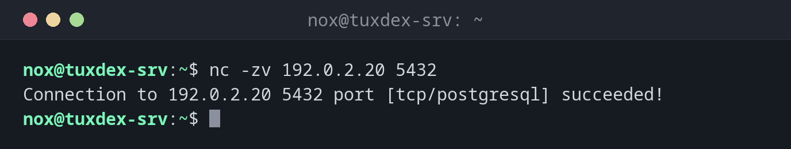

# nc

> Netcat: öffnet TCP- oder UDP-Verbindungen von Hand. Ideal, um zu testen, ob ein Port erreichbar ist, oder um direkt mit einem Dienst zu sprechen.



## Syntax

```bash
nc [OPTION]... HOST PORT
nc -l [OPTION]... PORT
```

## Optionen

| Option | Beschreibung |
|--------|--------------|
| `-z` | Nur testen, ob der Port offen ist, keine Daten senden |
| `-v` | Das Ergebnis melden |
| `-w SEKUNDEN` | Zeitlimit für die Verbindung |
| `-u` | UDP statt TCP |
| `-l` | Auf einem Port lauschen, statt sich zu verbinden |
| `-N` | Die Verbindung schließen, wenn die Eingabe endet |

## Beispiele

**Testen, ob ein Port erreichbar ist:**

```bash
nc -zv 192.0.2.20 5432
```

```text
Connection to 192.0.2.20 5432 port [tcp/postgresql] succeeded!
```

**Auf dem Port lauscht nichts:**

```bash
nc -zv 192.0.2.20 5433
```

```text
nc: connect to 192.0.2.20 port 5433 (tcp) failed: Connection refused
```

`Connection refused` heißt: Der Host ist erreichbar, aber kein Programm lauscht auf diesem
Port.

**Überhaupt keine Antwort:**

```bash
nc -zv -w 3 198.51.100.7 22
```

```text
nc: connect to 198.51.100.7 port 22 (tcp) timed out: Operation now in progress
```

Ein Timeout bedeutet meist, dass eine Firewall die Pakete unterwegs verwirft.

**Von Hand mit einem Webserver sprechen:**

```bash
printf 'HEAD / HTTP/1.1\r\nHost: example.com\r\nConnection: close\r\n\r\n' | nc example.com 80
```

```text
HTTP/1.1 301 Moved Permanently
Server: nginx
Date: Mon, 26 Oct 2026 09:42:17 GMT
Content-Type: text/html
Content-Length: 162
Connection: close
Location: https://example.com/
```

**Eine Verbindung zwischen zwei Servern testen:**

```bash
nc -l 9000
```

```text
hello from tuxcodex-srv
```

Auf dem ersten Server wartet `nc -l 9000` auf eine Verbindung. Auf dem zweiten schickt
`echo "hello from tuxcodex-srv" | nc -N 192.0.2.10 9000` eine Zeile. Kommt sie an, ist der
Weg zwischen den Servern offen, samt aller Firewalls.

## Wann brauche ich das?

- Um herauszufinden, ob eine Firewall einen Port blockiert, bevor du den Fehler im
  Dienst suchst
- Um zu prüfen, ob eine Datenbank oder ein Mailserver vom Anwendungsserver aus erreichbar
  ist
- Um direkt mit textbasierten Protokollen wie HTTP oder SMTP zu sprechen

!!! tip "Refused oder Timeout?"
    `Connection refused` kommt sofort zurück: Der Weg ist offen, aber der Dienst läuft
    nicht. Ein Timeout nach einigen Sekunden deutet auf eine Firewall hin.

!!! warning "Verschiedene `nc`-Varianten"
    Es gibt mehrere Umsetzungen mit unterschiedlichen Optionen und Meldungen. Die
    Beispiele zeigen die OpenBSD-Variante von Debian und Ubuntu. Unter RHEL ist `nc` das
    Ncat aus dem nmap-Projekt, siehe Tabelle.

## Unterschiede zwischen Distributionen

| | Debian | Ubuntu | RHEL | Arch |
|---|--------|--------|------|------|
| Paket | `netcat-openbsd` | `netcat-openbsd` (installiert) | `nmap-ncat` | `openbsd-netcat` |
| Porttest | `nc -zv HOST PORT` | `nc -zv HOST PORT` | `nc -zv HOST PORT` (Meldung `Connected to …`) | `nc -zv HOST PORT` |

## Verwandte Befehle

[ss](ss.md) · [curl](curl.md) · [ping](ping.md) · [tcpdump](tcpdump.md)
