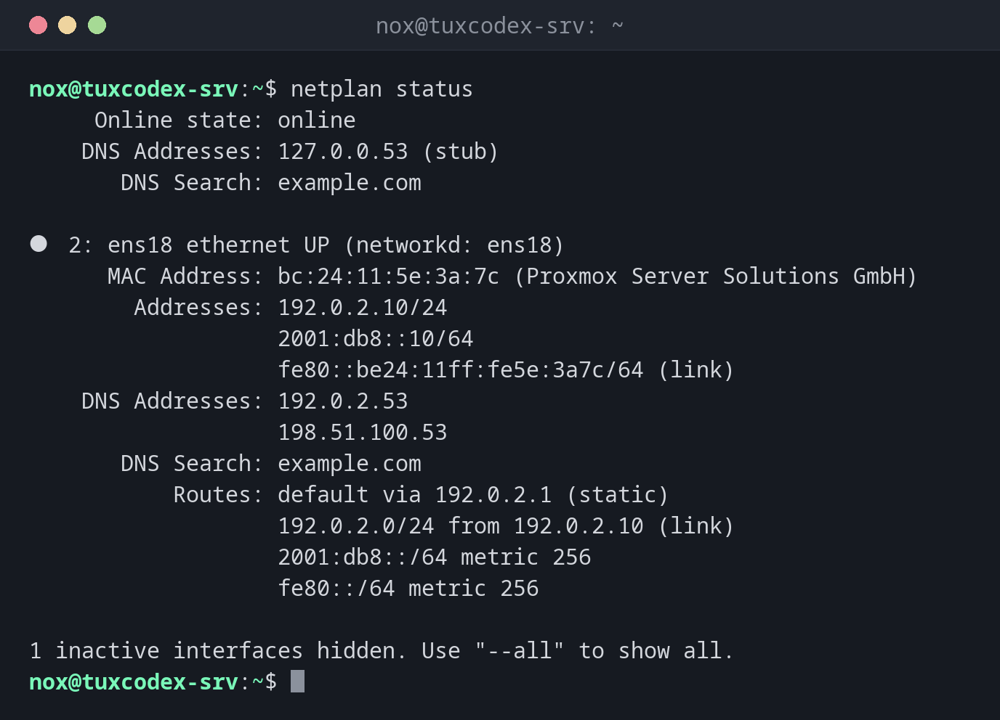

# netplan

> Configures the network on Ubuntu from YAML files in `/etc/netplan/`. Netplan generates the configuration for systemd-networkd or NetworkManager from them.



## Syntax

```bash
netplan COMMAND [OPTION]...
```

## Options

| Command | Description |
|---------|-------------|
| `try` | Apply the configuration and roll back after 120 seconds unless you confirm |
| `apply` | Apply the configuration immediately |
| `generate` | Only check and generate, don't apply |
| `get [KEY]` | Show the merged configuration, or one key like `ethernets.ens18.addresses` |
| `status` | Current state of all interfaces: addresses, routes, DNS |

## Examples

**Show the current state of the network:**

```bash
netplan status
```

```text
     Online state: online
    DNS Addresses: 127.0.0.53 (stub)
       DNS Search: example.com

●  2: ens18 ethernet UP (networkd: ens18)
      MAC Address: bc:24:11:5e:3a:7c (Proxmox Server Solutions GmbH)
        Addresses: 192.0.2.10/24
                   2001:db8::10/64
                   fe80::be24:11ff:fe5e:3a7c/64 (link)
    DNS Addresses: 192.0.2.53
                   198.51.100.53
       DNS Search: example.com
           Routes: default via 192.0.2.1 (static)
                   192.0.2.0/24 from 192.0.2.10 (link)
                   2001:db8::/64 metric 256
                   fe80::/64 metric 256

1 inactive interfaces hidden. Use "--all" to show all.
```

**A static configuration:**

```bash
sudo cat /etc/netplan/50-cloud-init.yaml
```

```text
network:
  version: 2
  ethernets:
    ens18:
      addresses:
        - 192.0.2.10/24
        - "2001:db8::10/64"
      routes:
        - to: default
          via: 192.0.2.1
      nameservers:
        addresses: [192.0.2.53, 198.51.100.53]
        search: [example.com]
```

Indentation matters in YAML: always use spaces, never tabs. Make the file only readable
for root: `sudo chmod 600 /etc/netplan/50-cloud-init.yaml`.

**Test a change safely:**

```bash
sudo netplan try
```

```text
Do you want to keep these settings?


Press ENTER before the timeout to accept the new configuration


Changes will revert in 120 seconds
Configuration accepted.
```

If you lose the connection, you can't press ++enter++, and netplan restores the old
configuration after 120 seconds.

**A typo in the YAML file:**

```bash
sudo netplan generate
```

```text
/etc/netplan/50-cloud-init.yaml:12:9: Invalid YAML: did not find expected key:
        nameservers:
        ^
```

Line 12, column 9: `nameservers` is indented by one space too many.

**Read a single value:**

```bash
sudo netplan get ethernets.ens18.addresses
```

```text
- "192.0.2.10/24"
- "2001:db8::10/64"
```

## When do I need it?

- On Ubuntu servers to set a static IP address, the gateway or DNS servers
- To add a second address, a VLAN or a bridge
- After cloning a VM, when the interface name or the address has to change

!!! tip "Always `try` instead of `apply` over SSH"
    `netplan try` rolls back automatically if the new configuration cuts you off. With
    `apply`, you would need the hosting console.

!!! warning "Cloud images overwrite the file"
    On cloud servers, cloud-init often creates `50-cloud-init.yaml` and can overwrite it
    on the next boot. Put your own settings into a separate file such as
    `60-static.yaml`, or disable the network configuration of cloud-init.

## Distribution differences

| | Debian | Ubuntu | RHEL | Arch |
|---|--------|--------|------|------|
| Network configuration | ifupdown, netplan only in cloud images | netplan | NetworkManager | systemd-networkd or NetworkManager |

## Related commands

[ip](ip.md) · [resolvectl](resolvectl.md) · [nmcli](nmcli.md) · [ifup](ifup.md)
