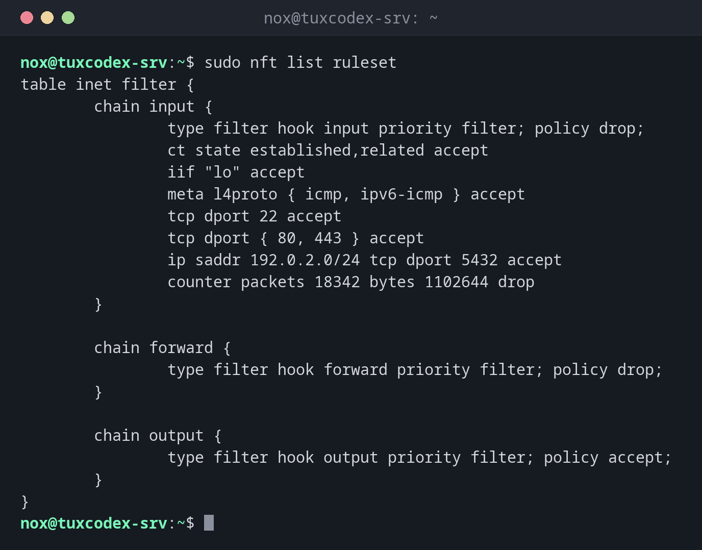

# nft

> The command line tool of nftables, the packet filter in the Linux kernel. All firewalls like `ufw` and `firewalld` build on it; with `nft` you see and write the rules directly.



## Syntax

```bash
nft [OPTION]... COMMAND
```

On Debian, the rules are kept in `/etc/nftables.conf` and loaded at boot by the service `nftables`.

## Options

| Command | Description |
|---------|-------------|
| `list ruleset` | Show all tables, chains and rules |
| `-a list chain FAMILY TABLE CHAIN` | Show a chain with rule handles |
| `-c -f FILE` | Only check a rule file for errors |
| `-f FILE` | Load a rule file |
| `add rule ...` | Append a rule at the end of a chain |
| `insert rule ... position HANDLE` | Insert a rule before the rule with this handle |
| `delete rule ... handle HANDLE` | Delete a rule |
| `flush ruleset` | Delete all rules: everything is allowed again |

## Examples

**Show all rules:**

```bash
sudo nft list ruleset
```

```text
table inet filter {
        chain input {
                type filter hook input priority filter; policy drop;
                ct state established,related accept
                iif "lo" accept
                meta l4proto { icmp, ipv6-icmp } accept
                tcp dport 22 accept
                tcp dport { 80, 443 } accept
                ip saddr 192.0.2.0/24 tcp dport 5432 accept
                counter packets 18342 bytes 1102644 drop
        }

        chain forward {
                type filter hook forward priority filter; policy drop;
        }

        chain output {
                type filter hook output priority filter; policy accept;
        }
}
```

| Part | Meaning |
|------|---------|
| `policy drop` | Everything that no rule accepts is dropped |
| `ct state established,related accept` | Answers to own connections are allowed |
| `counter ... drop` | Counts and drops the rest: here 18342 blocked packets |

**Show the rules with their handles:**

```bash
sudo nft -a list chain inet filter input
```

```text
table inet filter {
        chain input { # handle 1
                type filter hook input priority filter; policy drop;
                ct state established,related accept # handle 4
                iif "lo" accept # handle 5
                meta l4proto { icmp, ipv6-icmp } accept # handle 7
                tcp dport 22 accept # handle 8
                tcp dport { 80, 443 } accept # handle 10
                ip saddr 192.0.2.0/24 tcp dport 5432 accept # handle 11
                counter packets 18342 bytes 1102644 drop # handle 12
        }
}
```

**Allow another port before the final `drop`:**

```bash
sudo nft insert rule inet filter input position 12 tcp dport 8080 accept
sudo nft -a list chain inet filter input | tail -n 5
```

```text
                ip saddr 192.0.2.0/24 tcp dport 5432 accept # handle 11
                tcp dport 8080 accept # handle 13
                counter packets 18342 bytes 1102644 drop # handle 12
        }
}
```

`add` would append the rule after `drop`, where it would never be reached. `insert ...
position 12` puts it before the rule with handle 12.

**Check the rule file before loading it:**

```bash
sudo nft -c -f /etc/nftables.conf
```

```text
/etc/nftables.conf:9:21-25: Error: syntax error, unexpected string
        tcp dport 22 acept
                     ^^^^^
```

Nothing is loaded as long as the file has errors, so the running rules stay intact.

**Load the rules permanently:**

```bash
sudo systemctl enable --now nftables
```

```text
Created symlink '/etc/systemd/system/sysinit.target.wants/nftables.service' → '/usr/lib/systemd/system/nftables.service'.
```

`systemctl enable --now` loads `/etc/nftables.conf` now and at every boot.

## When do I need it?

- To see what really is in the kernel, no matter which firewall tool created the rules
- To write a lean firewall on Debian without an extra tool
- To find out why packets are blocked, with counters per rule

!!! tip "Use `inet` tables"
    A table of the family `inet` applies to IPv4 and IPv6 at the same time. You don't
    need separate rules for both.

!!! danger "`policy drop` without an SSH rule"
    If you load a ruleset with `policy drop` on the input chain without allowing SSH,
    your connection breaks immediately. Make sure `tcp dport 22 accept` and
    `ct state established,related accept` are in the file.

## Distribution differences

| | Debian | Ubuntu | RHEL | Arch |
|---|--------|--------|------|------|
| Installed by default | yes, service disabled | package `nftables`, `ufw` is the usual front end | yes, used by `firewalld` | package `nftables` |
| Rule file | `/etc/nftables.conf` | `/etc/nftables.conf` | managed by `firewalld` | `/etc/nftables.conf` |

## Related commands

[ufw](ufw.md) · [ss](ss.md)
