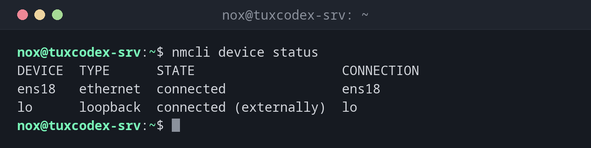

# nmcli

> Das Kommandozeilenwerkzeug des NetworkManagers, der unter RHEL, Rocky Linux und AlmaLinux das Netzwerk verwaltet: zeigt Schnittstellen und Verbindungen und ändert Adressen, Gateway und DNS dauerhaft.



## Syntax

```bash
nmcli [OPTION]... OBJEKT [BEFEHL] [ARGUMENT]...
```

Unter RHEL werden die Einstellungen in `/etc/NetworkManager/system-connections/` gespeichert und überstehen einen Neustart.

## Optionen

| Befehl | Beschreibung |
|--------|--------------|
| `general` | Gesamtzustand und Konnektivität |
| `device status` | Schnittstellen und ihr Zustand |
| `connection show` | Alle gespeicherten Verbindungen (Profile) |
| `device show GERÄT` | Adressen, Gateway, Routen und DNS einer Schnittstelle |
| `connection modify NAME EINSTELLUNG WERT` | Eine Einstellung einer Verbindung dauerhaft ändern |
| `connection up NAME`, `down NAME` | Eine Verbindung aktivieren oder deaktivieren |
| `connection reload` | Geänderte Konfigurationsdateien neu einlesen |
| `-f FELDER` | Nur diese Felder zeigen, z. B. `-f IP4` |

## Beispiele

**Die Schnittstellen und ihren Zustand anzeigen:**

```bash
nmcli device status
```

```text
DEVICE  TYPE      STATE                   CONNECTION
ens18   ethernet  connected               ens18
lo      loopback  connected (externally)  lo
```

**Die gespeicherten Verbindungen anzeigen:**

```bash
nmcli connection show
```

```text
NAME   UUID                                  TYPE      DEVICE
ens18  5fb06bd0-0bb0-7ffb-45f1-d6edd65f3e03  ethernet  ens18
lo     9c2d7e41-4a10-4f6b-b8a3-2e61c0d7f5a9  loopback  lo
```

Eine Verbindung ist ein Profil mit allen Einstellungen. Hier heißt sie wie die
Schnittstelle `ens18`, die Namen können sich aber unterscheiden.

**Adresse, Gateway und DNS einer Schnittstelle anzeigen:**

```bash
nmcli -f IP4 device show ens18
```

```text
IP4.ADDRESS[1]:                         192.0.2.10/24
IP4.GATEWAY:                            192.0.2.1
IP4.ROUTE[1]:                           dst = 192.0.2.0/24, nh = 0.0.0.0, mt = 100
IP4.ROUTE[2]:                           dst = 0.0.0.0/0, nh = 192.0.2.1, mt = 100
IP4.DNS[1]:                             192.0.2.53
IP4.DNS[2]:                             198.51.100.53
```

**Eine feste Adresse setzen und aktivieren:**

```bash
sudo nmcli connection modify ens18 ipv4.method manual ipv4.addresses 192.0.2.10/24 ipv4.gateway 192.0.2.1 ipv4.dns "192.0.2.53 198.51.100.53"
sudo nmcli connection up ens18
```

```text
Connection successfully activated (D-Bus active path: /org/freedesktop/NetworkManager/ActiveConnection/3)
```

`modify` speichert die Einstellungen nur. Sie wirken erst mit `connection up`.

**Den Gesamtzustand prüfen:**

```bash
nmcli general
```

```text
STATE      CONNECTIVITY  WIFI-HW  WIFI     WWAN-HW  WWAN
connected  full          missing  enabled  missing  enabled
```

`CONNECTIVITY full` heißt: Der NetworkManager erreicht das Internet.

## Wann brauche ich das?

- Unter RHEL, Rocky und Alma, um eine feste IP-Adresse, das Gateway oder DNS-Server zu setzen
- Um herauszufinden, welche DNS-Server eine Schnittstelle wirklich nutzt
- Um zu prüfen, ob der NetworkManager das Netzwerk als verbunden ansieht

!!! tip "Tab-Vervollständigung"
    `nmcli` hat eine sehr gute Tab-Vervollständigung: ++tab++ nach
    `nmcli connection modify ens18 ipv4.` listet alle verfügbaren Einstellungen.

!!! warning "Änderungen aus der Ferne vorsichtig testen"
    `connection up` mit falscher Adresse oder falschem Gateway beendet deine SSH-Sitzung.
    Halte die Konsole des Hosters bereit oder ändere die Adresse in zwei Schritten: erst
    die neue hinzufügen, dann die alte entfernen.

## Unterschiede zwischen Distributionen

| | Debian | Ubuntu | RHEL | Arch |
|---|--------|--------|------|------|
| NetworkManager auf Servern | nein, ifupdown | nein, netplan mit systemd-networkd | ja | optional |

## Verwandte Befehle

[ip](ip.md) · [netplan](netplan.md) · [ifup](ifup.md) · [resolvectl](resolvectl.md)
