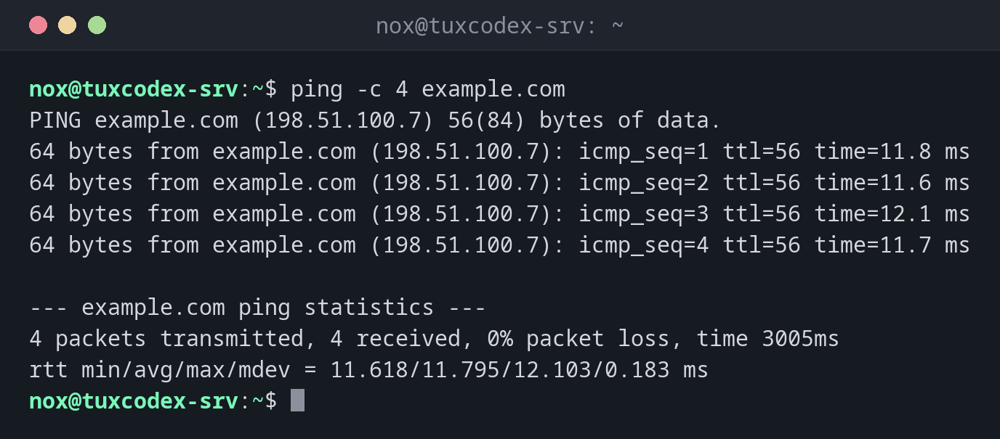

# ping

> Schickt kleine Testpakete (ICMP-Echo) an einen Host und misst, ob und wie schnell die Antworten zurückkommen.



## Syntax

```bash
ping [OPTION]... HOST
```

Unter Linux läuft `ping`, bis du es mit ++ctrl+c++ beendest, außer du gibst `-c` an.

## Optionen

| Option | Beschreibung |
|--------|--------------|
| `-c ANZAHL` | Nach `ANZAHL` Paketen aufhören |
| `-i SEKUNDEN` | Abstand zwischen den Paketen, Standard `1` |
| `-W SEKUNDEN` | Wie lange auf eine Antwort gewartet wird |
| `-q` | Still: nur die Zusammenfassung ausgeben |
| `-4`, `-6` | IPv4 oder IPv6 erzwingen |
| `-s BYTES` | Paketgröße, zum Beispiel um die MTU zu testen |

## Beispiele

**Prüfen, ob ein Host erreichbar ist:**

```bash
ping -c 4 example.com
```

```text
PING example.com (198.51.100.7) 56(84) bytes of data.
64 bytes from example.com (198.51.100.7): icmp_seq=1 ttl=56 time=11.8 ms
64 bytes from example.com (198.51.100.7): icmp_seq=2 ttl=56 time=11.6 ms
64 bytes from example.com (198.51.100.7): icmp_seq=3 ttl=56 time=12.1 ms
64 bytes from example.com (198.51.100.7): icmp_seq=4 ttl=56 time=11.7 ms

--- example.com ping statistics ---
4 packets transmitted, 4 received, 0% packet loss, time 3005ms
rtt min/avg/max/mdev = 11.618/11.795/12.103/0.183 ms
```

| Teil | Bedeutung |
|------|-----------|
| `icmp_seq` | Laufende Nummer: Lücken bedeuten verlorene Pakete |
| `ttl` | Verbleibende Sprünge, sinkt an jedem Router um eins |
| `time` | Antwortzeit hin und zurück in Millisekunden |
| `packet loss` | Anteil verlorener Pakete, sollte `0%` sein |

**Zuerst das eigene Gateway testen:**

```bash
ping -c 3 192.0.2.1
```

```text
PING 192.0.2.1 (192.0.2.1) 56(84) bytes of data.
64 bytes from 192.0.2.1: icmp_seq=1 ttl=64 time=0.312 ms
64 bytes from 192.0.2.1: icmp_seq=2 ttl=64 time=0.287 ms
64 bytes from 192.0.2.1: icmp_seq=3 ttl=64 time=0.301 ms

--- 192.0.2.1 ping statistics ---
3 packets transmitted, 3 received, 0% packet loss, time 2042ms
rtt min/avg/max/mdev = 0.287/0.300/0.312/0.010 ms
```

Antwortet das Gateway, `example.com` aber nicht, liegt das Problem außerhalb deines Netzes.

**Ein Host im eigenen Subnetz, den es nicht gibt:**

```bash
ping -c 3 192.0.2.99
```

```text
PING 192.0.2.99 (192.0.2.99) 56(84) bytes of data.
From 192.0.2.10 icmp_seq=1 Destination Host Unreachable
From 192.0.2.10 icmp_seq=2 Destination Host Unreachable
From 192.0.2.10 icmp_seq=3 Destination Host Unreachable

--- 192.0.2.99 ping statistics ---
3 packets transmitted, 0 received, +3 errors, 100% packet loss, time 2051ms
```

**Ein Name, der sich nicht auflösen lässt:**

```bash
ping -c 1 exmaple.com
```

```text
ping: exmaple.com: Name or service not known
```

Das ist ein DNS-Problem oder ein Tippfehler, kein Netzwerkproblem. Prüfe den Namen mit
[`dig`](dig.md).

**Nur die Zusammenfassung, für Skripte:**

```bash
ping -c 20 -i 0.2 -q 192.0.2.1
```

```text
PING 192.0.2.1 (192.0.2.1) 56(84) bytes of data.

--- 192.0.2.1 ping statistics ---
20 packets transmitted, 20 received, 0% packet loss, time 3812ms
rtt min/avg/max/mdev = 0.271/0.296/0.344/0.018 ms
```

## Wann brauche ich das?

- Als erster Test, wenn „das Netzwerk nicht geht“: Gateway, dann ein bekannter Host
- Um zu sehen, ob eine Verbindung instabil ist: Paketverlust und schwankende Zeiten
- In Skripten, um zu warten, bis ein Host nach einem Neustart wieder erreichbar ist

!!! tip "Von innen nach außen vorgehen"
    Pinge zuerst das eigene Gateway, dann eine öffentliche IP-Adresse, dann einen Namen.
    Der erste Schritt, der scheitert, zeigt, wo das Problem liegt: lokales Netz,
    Internetanbindung oder DNS.

!!! warning "Keine Antwort heißt nicht offline"
    Viele Server und Firewalls blockieren ICMP. Ein Host, der auf `ping` nicht antwortet,
    kann trotzdem einen Webserver betreiben. Teste den Dienst selbst mit
    [`curl`](curl.md) oder [`nc`](nc.md).

## Verwandte Befehle

[ip](ip.md) · [traceroute](traceroute.md) · [mtr](mtr.md) · [dig](dig.md)
