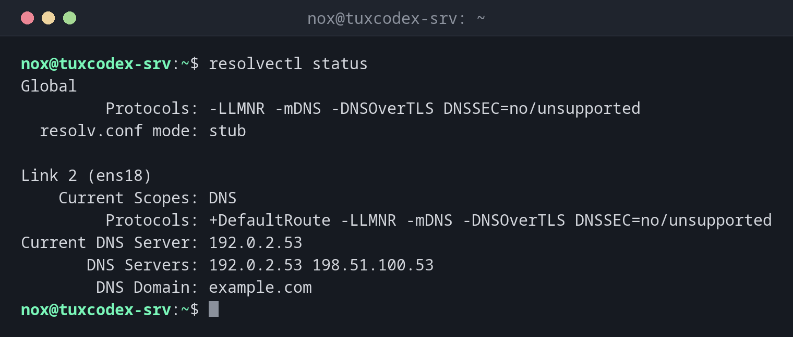

# resolvectl

> Zeigt und steuert `systemd-resolved`, den lokalen DNS-Resolver: welche DNS-Server genutzt werden, was sie antworten, und leert den DNS-Cache.



## Syntax

```bash
resolvectl [OPTION]... BEFEHL [ARGUMENT]...
```

`resolvectl` funktioniert nur, wo `systemd-resolved` läuft, was unter Ubuntu Standard ist.
Unter Debian, RHEL und Arch ist es meist nicht aktiv, siehe Tabelle.

## Optionen

| Befehl | Beschreibung |
|--------|--------------|
| `status` | DNS-Einstellungen pro Schnittstelle: Server, Domain, Protokolle |
| `query NAME` | Einen Namen so auflösen, wie Programme es tun, samt Cache |
| `dns` | Nur die DNS-Server pro Schnittstelle |
| `flush-caches` | Den DNS-Cache leeren |
| `statistics` | Cache-Treffer und -Fehlschläge, Anzahl der Anfragen |

## Beispiele

**Anzeigen, welche DNS-Server genutzt werden:**

```bash
resolvectl status
```

```text
Global
         Protocols: -LLMNR -mDNS -DNSOverTLS DNSSEC=no/unsupported
  resolv.conf mode: stub

Link 2 (ens18)
    Current Scopes: DNS
         Protocols: +DefaultRoute -LLMNR -mDNS -DNSOverTLS DNSSEC=no/unsupported
Current DNS Server: 192.0.2.53
       DNS Servers: 192.0.2.53 198.51.100.53
        DNS Domain: example.com
```

`Current DNS Server` ist der Server, der gerade antwortet. Fällt er aus, wechselt
`resolved` zum nächsten aus `DNS Servers`.

**Einen Namen so auflösen, wie ein Programm es tun würde:**

```bash
resolvectl query example.com
```

```text
example.com: 198.51.100.7                                   -- link: ens18
             2001:db8:1::7                                  -- link: ens18

-- Information acquired via protocol DNS in 23.4ms.
-- Data is authenticated: no; Data was acquired via local or encrypted transport: no
-- Data from: network
```

**Nur die DNS-Server:**

```bash
resolvectl dns
```

```text
Global:
Link 2 (ens18): 192.0.2.53 198.51.100.53
```

**Nach einer DNS-Änderung den Cache leeren:**

```bash
sudo resolvectl flush-caches
resolvectl query example.com
```

```text
example.com: 198.51.100.7                                   -- link: ens18
             2001:db8:1::7                                  -- link: ens18

-- Information acquired via protocol DNS in 23.4ms.
-- Data is authenticated: no; Data was acquired via local or encrypted transport: no
-- Data from: network
```

Vor dem Leeren stand in der letzten Zeile `Data from: cache`, und die alte Adresse wurde
angezeigt.

**Warum `/etc/resolv.conf` nur `127.0.0.53` enthält:**

```bash
grep -v "^#" /etc/resolv.conf
```

```text
nameserver 127.0.0.53
options edns0 trust-ad
search example.com
```

Programme fragen den lokalen Resolver auf `127.0.0.53`, der an die echten DNS-Server
weiterleitet. Diese siehst du nur mit `resolvectl status`.

## Wann brauche ich das?

- Unter Ubuntu, um herauszufinden, welche DNS-Server wirklich genutzt werden
- Nach einer DNS-Änderung, wenn der Server noch die alte Adresse auflöst
- Wenn Namen über eine Schnittstelle (VPN) aufgelöst werden, über eine andere aber nicht

!!! tip "`dig` oder `resolvectl query`?"
    `dig` fragt einen DNS-Server direkt, am lokalen Cache vorbei. `resolvectl query` zeigt
    die Antwort, die Programme bekommen, samt Cache. Unterscheiden sich beide, ist der
    Cache veraltet.

!!! warning "`/etc/resolv.conf` nicht von Hand bearbeiten"
    Auf Systemen mit `systemd-resolved` wird die Datei erzeugt, und deine Änderungen
    werden überschrieben. Trag die DNS-Server in der Netzwerkkonfiguration ein, unter
    Ubuntu mit [`netplan`](netplan.md).

## Unterschiede zwischen Distributionen

| | Debian | Ubuntu | RHEL | Arch |
|---|--------|--------|------|------|
| `systemd-resolved` aktiv | nein (Paket `systemd-resolved`) | ja | nein, NetworkManager schreibt `/etc/resolv.conf` | optional |
| DNS-Server anzeigen mit | `cat /etc/resolv.conf` | `resolvectl status` | `nmcli dev show` | je nach Einrichtung |

## Verwandte Befehle

[dig](dig.md) · [host](host.md) · [netplan](netplan.md) · [nmcli](nmcli.md)
